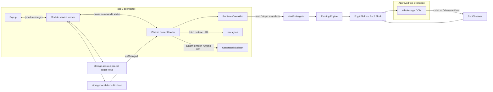
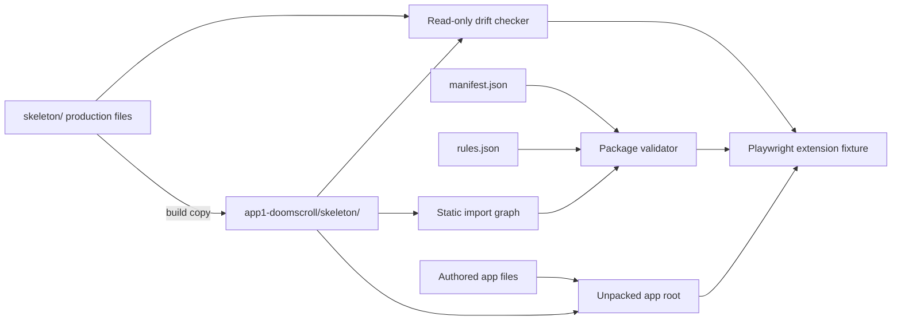

# Doomscroll App Design

## Overview

Doomscroll App is a small host integration around the existing Poltergeist skeleton. It declares four time-based rules for three exact social-feed hosts, dynamically loads the packaged skeleton from a classic Manifest V3 content script, and owns only the state needed for per-tab pause and global demo mode.

The root `skeleton/` remains the only authored engine. A deterministic Node script copies its production files into ignored package output at `app1-doomscroll/skeleton/`, which lets Chrome load `app1-doomscroll/` directly as an unpacked extension. A read-only mode proves that generated output has the same files and bytes as the root source.

The only production skeleton change is a `MutationObserver` lifecycle inside `skeleton/effects/rot.js`. The Engine correctly avoids reapplying an effect when intensity changes by less than 0.01. Near and beyond a rule's `rampTo`, computed intensity stops producing a large enough delta; depending on timer increments, the Handle's last applied value can be 1 or slightly below it. Rot therefore owns observation of later text at its latest applied fraction rather than weakening the Engine's update rule for every effect.

### Current-to-target delta

| Area | Current state | Target | Requirements |
|---|---|---|---|
| App package | `app1-doomscroll/` is empty | MV3 manifest, classic loader, rules, module worker, and popup | 1, 3, 5 |
| Site scope | No app host declarations | Exact HTTPS hosts for YouTube, X, and Instagram in every scope-bearing list | 1 |
| Rules | No app rules | Fog 2–5 min, Flicker 5–10 min, Rot 10–15 min, Block 20–25 min | 2 |
| Demo | None | A validated 1/60-time clone showing the full sequence in 25 seconds | 2, 3, 5 |
| Rot on dynamic content | New text is found only on a later explicit `apply` | One observer per Handle refreshes at the latest Rot state | 4 |
| Controls | None | Session-scoped per-tab pause and a locally stored global demo preference | 5 |
| Skeleton packaging | Root modules are outside the app root | Generated, ignored mirror plus exact drift check | 6 |
| Browser coverage | Direct effect modules only | Actual unpacked extension, local routed feed, escalation, append, pause, and resume | 7 |

### Goals

- Produce an unpacked Chrome Manifest V3 package rooted at `app1-doomscroll/`.
- Keep all host and resource exposure equal to the three approved HTTPS origins.
- Make the normal progression gradual and the demo progression short but behaviorally identical.
- Keep every transition reversible, including pause, profile switch, unload, and Rot observation.
- Preserve one live Engine and one live Rot observer per content document.
- Verify the packaged manifest/module graph rather than only testing source modules directly.

### Non-goals

- Persisting `timeOnSite`, `scrollDistance`, or `timeSinceActive` across reloads, tabs, days, or browser restarts.
- Implementing Haunt Engine Requirement 12, a Storage Adapter, or changes to `skeleton/index.js`.
- Changing `skeleton/engine.js`, meter semantics, URL matching, other effects, or rule-schema semantics.
- Detecting specific feed containers, posts, cards, navigation elements, or shadow roots.
- Supporting `twitter.com`, mobile hosts, embedded players, arbitrary subdomains, HTTP, or localhost in the production manifest.
- Tab Graveyard, changes under `demo-site/`, options pages, analytics, telemetry, publishing, or signing.

### Research findings informing the design

- Chrome injects statically declared content scripts on matching URLs and uses `document_idle` as the preferred/default timing. Content scripts run in an isolated world and can call `runtime.getURL`; extension files fetched from a content script must be declared as web-accessible resources. See [Chrome content scripts](https://developer.chrome.com/docs/extensions/develop/concepts/content-scripts).
- Web-accessible resources are denied by default. Manifest V3 maps resource paths to allowed origins, accepts `use_dynamic_url`, and considers only origins for `matches`, whose path therefore remains `/*`. See [Chrome web-accessible resources](https://developer.chrome.com/docs/extensions/reference/manifest/web-accessible-resources).
- Chrome match patterns permit exact hosts and host wildcards. This app chooses exact HTTPS hosts to avoid granting every subdomain or scheme. See [Chrome match patterns](https://developer.chrome.com/docs/extensions/develop/concepts/match-patterns).
- `storage.session` is memory-backed for the extension session and is not exposed to content scripts by default; `storage.local` is appropriate for a small persistent preference. Both require the `storage` permission. See [Chrome storage API](https://developer.chrome.com/docs/extensions/reference/api/storage).
- Most Tabs API operations, including querying a tab id and messaging a content script, do not require the broad `tabs` permission. That permission is needed for sensitive tab properties, which this popup does not read. See [Chrome Tabs API](https://developer.chrome.com/docs/extensions/reference/api/tabs).
- Current Playwright guidance requires a persistent context for extension tests. Google Chrome and Edge no longer support the command-line side-loading flags used by the fixture, so Playwright documents its bundled Chromium channel for unpacked-extension automation. See [Playwright Chrome extensions](https://playwright.dev/docs/chrome-extensions).

Content from the cited sources was rephrased for compliance with licensing restrictions.

### Packaging decision

A build script is chosen over a Kiro hook.

A hook would make package correctness depend on one editor and on the hook having run after every source change. A deterministic script works in Kiro, another editor, a terminal, and CI. It also supports a read-only check, which a one-way copy hook does not prove.

The generated location is deliberately inside the extension root:

```text
app1-doomscroll/
  manifest.json
  rules.json
  content.js
  background.js
  popup.html
  popup.js
  popup.css
  skeleton/                  # generated; ignored; never edited directly
  test/
    content.test.js
    background.test.js
    popup.test.js
    package.test.js
    browser/
      doomscroll.pw.js
    fixtures/
      feed.html
scripts/
  sync-doomscroll-skeleton.mjs
```

Chrome can therefore load `app1-doomscroll/` directly. The build copies all root skeleton production files and excludes only `skeleton/test/**`. Copying the production tree instead of a hand-maintained file list prevents a new core dependency from being omitted. Web-accessible-resource validation remains graph-based, so copied files that are not runtime imports are not exposed unnecessarily.

## Architecture

### Runtime boundaries



The page never communicates with extension state through page globals or `window.postMessage`. The content script stays in the isolated world. App messages are accepted only through extension APIs and an enumerated protocol.

### Build and verification boundaries



### Content startup sequence

```mermaid
sequenceDiagram
    participant Chrome
    participant Content as content.js
    participant Worker as background.js
    participant Storage
    participant Core as generated skeleton

    Chrome->>Content: inject at document_idle
    Content->>Content: register listeners; capture pause/demo revisions
    Content->>Worker: doomscroll:content-state
    Worker->>Storage: read per-tab pause key and demo Boolean
    Storage-->>Worker: confirmed state
    Worker-->>Content: {ok, paused, demoMode}
    Content->>Content: merge each field only if its revision is unchanged
    Content->>Content: wait until both fields are confirmed
    alt paused
        Content-->>Chrome: remain clean and ready
    else active
        par Load local package inputs
            Content->>Core: import(runtime.getURL(skeleton/index.js))
            Content->>Content: fetch(runtime.getURL(rules.json))
        end
        Content->>Content: validate/select profile; verify generation is current
        Content->>Core: startPoltergeist({rules, initialMeters})
        Core-->>Content: {engine, meters, stop}
        Content->>Content: publish current instance
    end
```

### State reconciliation

Every live event first updates desired state, then enters one serialized reconciliation queue. Events include the initial response, pause messages, `storage.local` demo changes, and reduced-motion media-query changes. Pause and demo listeners are registered before the initial read. Separate field revisions prevent an older response from overwriting a newer event.

```mermaid
stateDiagram-v2
    [*] --> LoadingState
    LoadingState --> Paused: both fields known; paused=true
    LoadingState --> Normal: paused=false, demo=false
    LoadingState --> Demo: paused=false, demo=true
    Normal --> Paused: pause; capture normal; stop
    Demo --> Paused: pause; capture demo; stop
    Normal --> Demo: enable demo; reset demo; capture normal; stop; start
    Demo --> Normal: disable demo; reset demo; stop; resume normal
    Paused --> Paused: demo toggle; reset demo snapshot
    Paused --> Normal: resume with demo=false
    Paused --> Demo: resume with demo=true
    Normal --> Normal: motion preference changed; capture; stop; restart
    Demo --> Demo: motion preference changed; capture; stop; restart
    Normal --> Faulted: stop/start failure
    Demo --> Faulted: stop/start failure
    Paused --> Faulted: start failure
    Normal --> Stopped: pagehide
    Demo --> Stopped: pagehide
    Paused --> Stopped: pagehide
```



The app targets the synchronous `startPoltergeist` and `stop` contract that exists in `skeleton/`. Asynchronous work ends before the Entry Point call, and a generation check suppresses a stale start. Supporting the separate, future async persistence design is outside this app spec.

## Components and Interfaces

### Concrete file plan

| File | Plan | Responsibility |
|---|---|---|
| `app1-doomscroll/manifest.json` | Add | MV3 metadata, exact host scope, classic content script, module worker, popup, storage permission, and narrow WAR graph. |
| `app1-doomscroll/rules.json` | Add | Four exact normal rules for Fog, Flicker, Rot, and Block. |
| `app1-doomscroll/content.js` | Add | Classic async bootstrap, dynamic import/fetch, profile transform, Runtime Controller, listener cleanup, and content-side messages. |
| `app1-doomscroll/background.js` | Add | Validated message dispatcher, independent session pause keys, local demo preference, tab-removal cleanup, and tab messaging. |
| `app1-doomscroll/popup.html` | Add | Minimal accessible markup with status and two labelled controls. |
| `app1-doomscroll/popup.js` | Add | Active-tab query, status render, pause/demo commands, and contained errors. |
| `app1-doomscroll/popup.css` | Add | Small static layout, focus, disabled, and status styles. |
| `skeleton/effects/rot.js` | Modify | Add one observer to each live Handle, use the latest params, filter own mutations, and disconnect on undo. |
| `skeleton/test/rot.test.js` | Modify | Add observer lifecycle, dynamic text, rewrite, batching, loop, and restoration tests. |
| `scripts/sync-doomscroll-skeleton.mjs` | Add | Build mode and `--check` mode; copy policy, byte comparison, and package validation. |
| `.gitignore` | Modify | Ignore only `/app1-doomscroll/skeleton/` as generated extension output. |
| `package.json` | Modify | Add `build:doomscroll` and `check:doomscroll`; keep existing test entry points. |
| `vitest.config.js` | Modify | Include app unit/package tests while retaining skeleton tests and excluding `.pw.js`. |
| `playwright.config.js` | Modify | Discover existing skeleton browser tests and the app extension suite without running either twice. |
| `app1-doomscroll/test/**` | Add | Unit, package, fixture, and unpacked-extension tests. |

No other production file under `skeleton/` changes.

### Manifest shape

The intended manifest semantics are:

```json
{
  "manifest_version": 3,
  "name": "Poltergeist: Doomscroll Decay",
  "version": "0.1.0",
  "permissions": ["storage"],
  "host_permissions": [
    "https://www.youtube.com/*",
    "https://x.com/*",
    "https://www.instagram.com/*"
  ],
  "background": {
    "service_worker": "background.js",
    "type": "module"
  },
  "action": {
    "default_popup": "popup.html"
  },
  "content_scripts": [{
    "matches": [
      "https://www.youtube.com/*",
      "https://x.com/*",
      "https://www.instagram.com/*"
    ],
    "js": ["content.js"],
    "run_at": "document_idle",
    "all_frames": false
  }],
  "web_accessible_resources": [{
    "resources": [
      "rules.json",
      "skeleton/index.js",
      "skeleton/engine.js",
      "skeleton/meters.js",
      "skeleton/match.js",
      "skeleton/validator.js",
      "skeleton/effects/index.js",
      "skeleton/effects/util.js",
      "skeleton/effects/fog.js",
      "skeleton/effects/flicker.js",
      "skeleton/effects/rot.js",
      "skeleton/effects/block.js"
    ],
    "matches": [
      "https://www.youtube.com/*",
      "https://x.com/*",
      "https://www.instagram.com/*"
    ],
    "use_dynamic_url": true
  }]
}
```

The final explicit resource list is generated or verified against the import graph rather than trusted as documentation. If the skeleton import graph changes, package validation fails until the manifest is deliberately updated.

`host_permissions` are included because the product explicitly grants persistent access only to its supported sites. No `tabs` permission is needed to query an active tab id or send a content message. The popup does not inspect `url`, `title`, `pendingUrl`, or `favIconUrl`; support is determined by pinging the statically injected content script.

### Rule profile

All rules use `timeOnSite`. This matches the product principle that a haunt grows with time spent and guarantees the same ordered sequence despite differences in page height, wheel hardware, touch scrolling, keyboard scrolling, or nested feed containers. The current Meter Set increments `timeOnSite` only while the page is visible and at least one rule matches.

| Rule | Normal threshold → full | Demo threshold → full | Params | Undo |
|---|---:|---:|---|---|
| `doomscroll-fog` | 120s → 300s | 2s → 5s | `maxBlur: 5`, `maxGrayscale: 0.8` | fade 400ms |
| `doomscroll-flicker` | 300s → 600s | 5s → 10s | `maxDepth: 0.22`, `periodMs: 1600` | instant |
| `doomscroll-rot` | 600s → 900s | 10s → 15s | `maxFraction: 0.55`, `glyphs: "░▒·_ "` | instant |
| `doomscroll-block` | 1200s → 1500s | 20s → 25s | `maxOpacity: 0.96`, `blockAt: 0.8`, required message | fade 600ms |

Because `computeIntensity` yields a minimum active intensity of 0.01 at a threshold, Block first appears faintly at 20 minutes and grows. It begins intercepting pointers at 80% intensity:

```text
1200 + (1500 - 1200) × 0.8 = 1440 seconds = 24 minutes
```

The demo equivalent is 24 seconds. Nothing blocks instantly when the first haunt begins.

The Engine computes 1 at and beyond `rampTo`, but its 0.01 update epsilon means the Handle's last applied intensity can plateau slightly below 1 when timer increments do not land on a large enough final delta. The rule configuration still defines the intended ramp end. Unit tests call Rot directly at intensity 1, while the packaged browser regression checks the harder runtime condition: newly added text changes after the ramp has ended even when the Engine makes no further Rot update. No browser assertion assumes an exact applied fraction of 0.55.

Demo transformation is pure:

```js
function createDemoProfile(normalDocument) {
  const demo = structuredClone(normalDocument);
  for (const rule of demo.rules) {
    rule.trigger.threshold /= 60;
    if (rule.trigger.rampTo !== undefined) rule.trigger.rampTo /= 60;
  }
  return demo;
}
```

A JSON-compatible clone fallback may be used if needed. The transformed document is passed through `validateRules` before startup. Production and demo both use the exact same effects and params; only trigger times differ.

### Classic loader

`content.js` contains no static module declaration. Its outer shape is an async function invoked once:

```js
void (async function bootDoomscroll() {
  // Register state/message listeners, obtain confirmed startup state,
  // then reconcile to paused, normal, or demo.
}());
```

The package inputs are cached as one Promise so repeated starts do not refetch or re-import them:

```js
const packagePromise = Promise.all([
  import(chrome.runtime.getURL('skeleton/index.js')),
  fetch(chrome.runtime.getURL('rules.json')).then(checkResponse).then((r) => r.json()),
]);
```

A failed package Promise is reported once and does not enter a retry loop. A later popup action may explicitly request another reconciliation, but it does not create overlapping starts.

### Runtime Controller

The Runtime Controller has app-owned state rather than modifying Engine internals:

```js
{
  desired: { paused: undefined, demoMode: undefined },
  revisions: { paused: 0, demoMode: 0 },
  current: null | { mode: 'normal' | 'demo', ghost },
  normalSnapshot: { timeOnSite: 0, scrollDistance: 0 },
  demoSnapshot: { timeOnSite: 0, scrollDistance: 0 },
  generation: 0,
  queue: Promise.resolve(),
  restartForMotion: false,
  disposed: false,
  fault: null
}
```

`ghost` is the `{ engine, meters, stop }` returned synchronously by the skeleton. Snapshot capture copies only the two seedable meters. `timeSinceActive` is derived and is never carried between instances.

Initial-state merge:

1. Register the pause-message, demo-storage, and media-query listeners.
2. Capture both field revisions and request `doomscroll:content-state`.
3. A live pause or demo event increments only its field revision and updates that field.
4. When the initial response arrives, assign a field only if its revision still equals the captured value. A newer event therefore wins.
5. Reconcile only after both desired fields are known.

Desired demo changes reset `demoSnapshot` to zeros immediately whenever the Boolean actually changes. This happens before queueing and even while paused. A simple pause/resume with demo still enabled does not change the Boolean, so it preserves `demoSnapshot`; off→on always starts a fresh demo.

Reconciliation algorithm:

1. Increment `generation` when desired state or the motion-restart flag changes, and append one operation to `queue`.
2. If an existing instance must stop, copy its meter values to the matching snapshot unless demo is being disabled, then call its synchronous `stop()` inside `try`/`catch`.
3. Only after `stop()` returns, clear `current`. If it throws, retain the reference, set `fault`, report once, and return without starting another instance.
4. If paused, disposed, missing confirmed state, or faulted, return with no new start.
5. Capture the current generation; load/cache the module and Normal_Profile, and derive/validate Demo_Profile if selected.
6. After asynchronous loading, compare the captured generation and desired state again. If stale, return before calling the Entry Point; the newer queued reconciliation owns the next decision.
7. Call synchronous `startPoltergeist({ rules, initialMeters })` inside `try`/`catch` and publish its returned object immediately. If it throws, set `fault`, report once, and do not retry automatically.
8. On a reduced-motion change, use the same stop/start path and same profile snapshot. If paused, no instance is created; the next resume naturally reads the current preference.

The queue and stop-before-start ordering enforce the single-instance invariant. A controller that cannot confirm cleanup does less: it enters a visible fault instead of risking a second Engine. Because the current Entry Point returns only after startup, the app can clean up only instances it actually receives; it makes no false claim about internal resources if the API itself throws before returning.

### Control state and message protocol

#### Stored state

```js
// chrome.storage.session (one independent key per paused tab)
{
  "doomscroll.pausedTab.123": true,
  "doomscroll.pausedTab.456": true
}

// chrome.storage.local
{
  "doomscroll.demoMode": false
}
```

A missing per-tab key means unpaused. A stored value is accepted only when it is exactly `true`; false or malformed values are removed or treated as absent. Independent keys avoid a shared-object read/modify/write race when two tabs change at once. Tab closure removes only its key. The demo value is accepted only when it is a Boolean; otherwise it defaults to false. Session storage tolerates service-worker suspension without making pause permanent across a browser restart.

#### Messages

| Type | Sender → receiver | Payload | Result / action |
|---|---|---|---|
| `doomscroll:content-state` | content → worker | none | Worker derives `sender.tab.id`; returns `{ok, paused, demoMode}`. |
| `doomscroll:popup-state` | popup → worker | `{tabId}` | Worker pings content and returns support, pause, and demo state. |
| `doomscroll:set-paused` | popup/extension page → worker | `{tabId, paused}` | Validate, commit the independent session key, notify the tab, return `{ok:true, paused, delivered}`. |
| `doomscroll:set-demo` | popup → worker | `{enabled}` | Validate and write local Boolean; content scripts react to `storage.onChanged`. |
| `doomscroll:apply-paused` | worker → content | `{paused}` | Update desired state and enqueue reconciliation. |
| `doomscroll:ping` | worker → content | none | Return `{ok: true}` without changing runtime state. |

All results use either `{ ok: true, ...data }` or `{ ok: false, error: string }`. Unknown types and malformed payloads return an error and do not touch storage. For a content-originated state request, a payload tab id is ignored. For popup messages, the worker validates that `tabId` is an integer before using it.

The worker commits pause state before notifying the content script. If no receiver exists, it returns `{ok:true, paused, delivered:false}` because the storage operation succeeded; the popup keeps the committed checkbox value and shows that the tab is currently unavailable. A failed storage commit returns `{ok:false}` and sends no tab message. Demo changes use `storage.onChanged`, so all loaded supported tabs and future content scripts converge without enumerating browsing URLs.

### Popup

The popup is intentionally small:

```text
Poltergeist
Status: Active on this tab
[ ] Pause on this tab
[ ] Demo mode on supported tabs
```

`popup.html` contains a heading, a live status region, and two labelled native checkbox controls. `popup.js`:

1. queries `{ active: true, currentWindow: true }`;
2. sends `doomscroll:popup-state` with the returned tab id;
3. renders confirmed values;
4. disables the pause checkbox if ping says unsupported;
5. sends one command per user change, rolls the displayed value back only when `ok` is false, and retains a committed pause value with an unavailable notice when `delivered` is false.

The demo checkbox remains enabled on unsupported pages because it is global. Popup code never reads the active tab URL, and no site matcher is duplicated in the popup.

### Rot Observer design

#### Why the fix belongs to Rot

The Engine stores the last applied intensity and calls `apply` again only when intensity moves by at least 0.01. At and beyond a rule's `rampTo`, computed intensity remains 1, but the last applied Handle value may be 1 or may plateau slightly below it because a final delta is smaller than the epsilon. Rot currently discovers nodes only during `apply`, so an infinite feed can append clean text forever on either stable plateau.

Calling every active effect every 250 ms would add full-document work, alter established Engine semantics, and update Fog, Flicker, and Block for no reason. Dynamic DOM ownership is specific to Rot, so Rot owns the observer and its teardown.

This decision supersedes only the earlier Haunt Engine design's non-goal of observing Rot churn. It does not supersede the Engine requirements or change any other effect.

#### Handle additions

The existing Handle gains internal fields:

```js
{
  env,
  nodes: Map<Text, { orig, out, serial }>,
  serial,
  dead,
  fading,
  timer,
  observer: MutationObserver | null,
  fraction: number,
  glyphs: string[]
}
```

These fields are private to the effect. The exported `{ apply, undo, description }` interface does not change.

#### Refresh algorithm

The current pruning and body walk move into an internal `refresh(handle)` function:

```js
function refresh(handle) {
  if (!handle || handle.dead) return;

  for (const node of handle.nodes.keys()) {
    if (node.isConnected === false) handle.nodes.delete(node);
  }

  const body = handle.env.document.body;
  if (!body) return;

  // Existing TreeWalker, rewrite-adoption, deterministic rot, and map updates.
  // Use handle.fraction and handle.glyphs, which apply updates first.
}
```

`apply` updates `fraction` and `glyphs` on every call, invokes `refresh`, and then ensures one observer exists if the environment supports it. The initial refresh runs before observation, so its own first-pass writes are not delivered back to the new observer.

The observer watches `documentElement`, not `body`, because a document may add or replace its body. Its options are exactly:

```js
{ subtree: true, childList: true, characterData: true }
```

One observer callback handles one delivered record array:

1. Return if the Handle is dead.
2. Treat a `childList` record as relevant when nodes were added or removed.
3. Treat a `characterData` record as relevant when its text node is untracked or its current data differs from the tracked `entry.out`.
4. If any record is relevant, call `refresh(handle)` once.
5. Otherwise return. This filters the records generated by Rot's own writes once the current text equals `entry.out`.

An appended subtree causes one full body refresh. That is the smallest safe whole-page change and reuses all current skip, adoption, serial, deterministic-hash, and cleanup behavior. It may be optimized later by walking mutation roots, but such an optimization must preserve the same semantics and is not part of this spec.

#### Undo ordering

Rot has instant undo:

1. Call `observer.disconnect()` and clear the Handle's observer reference.
2. Enter the existing shared teardown path, which marks the Handle dead.
3. For each retained entry, restore `orig` only when `node.data === entry.out`.
4. Clear the node map.

Every callback starts with the dead check, so already queued work cannot rewrite restored text. Repeated undo remains a no-op through the shared teardown contract. If observation is unavailable, explicit applications still work as before.

### Skeleton synchronization and package validation

`scripts/sync-doomscroll-skeleton.mjs` supports two modes:

```text
node scripts/sync-doomscroll-skeleton.mjs          # synchronize, then validate
node scripts/sync-doomscroll-skeleton.mjs --check  # compare only, then validate
```

`package.json` exposes these as `build:doomscroll` and `check:doomscroll`.

#### Synchronize mode

- Resolve source and target relative to the repository root, not the current shell directory.
- Assert that the target resolves exactly to `app1-doomscroll/skeleton` before removing stale generated output.
- Enumerate source files recursively in sorted relative-path order.
- Exclude paths whose first relative segment is `test`.
- Recreate the target and copy raw bytes without rewriting line endings or JSON.
- Run package validation after copying.

#### Check mode

- Enumerate source and target under the same copy policy.
- Compare sorted relative file sets.
- Compare each pair with `Buffer.equals` or an equivalent byte comparison.
- Report all missing, extra, and changed paths in one run.
- Perform no write, touch, cleanup, or timestamp update.
- Run package validation only after copy identity is established.

#### Package validation

The validator performs these checks:

1. Parse the manifest and rule document as JSON.
2. Call the root `validateRules(ruleDocument, builtinEffects)` and aggregate diagnostics.
3. Assert the exact rule ids, order, thresholds, ramps, params, undo modes, and Approved_Host_Set.
4. Assert Manifest V3, exact `permissions`, exact `host_permissions`, one classic top-frame content script, the module worker, and popup.
5. Resolve all relative static `import` and `export ... from` specifiers transitively from generated `skeleton/index.js`.
6. Reject absolute imports, bare package imports, remote URLs, missing files, and any resolution outside the extension root.
7. Expand the manifest resource declarations and prove that `rules.json` and every reachable generated module are exposed.
8. Reject web-accessible files outside that required set, test files in the generated tree, or a WAR match set different from the Approved_Host_Set.
9. Scan app-owned JavaScript and HTML for remote executable URLs, `eval`, `new Function`, string-valued `setTimeout`/`setInterval` calls, inline script bodies, and inline event-handler attributes; fail with the offending path and construct.

The generated `rule-schema.json` can be present because the complete production tree is copied, but it is not web-accessible unless it becomes a runtime dependency.

## Data Models

### Rule document

```js
/** @typedef {{ rules: DoomscrollRule[] }} DoomscrollRuleDocument */

/**
 * @typedef {object} DoomscrollRule
 * @property {string} id
 * @property {string[]} match
 * @property {{ meter: 'timeOnSite', threshold: number, rampTo: number }} trigger
 * @property {{ type: 'fog'|'flicker'|'rot'|'block', params: object }} effect
 * @property {{ mode: 'instant'|'fade', durationMs?: number }} undo
 */
```

### Runtime state

```js
/** @typedef {{ timeOnSite: number, scrollDistance: number }} MeterSnapshot */
/** @typedef {'normal'|'demo'} ProfileMode */

/**
 * @typedef {object} DesiredState
 * @property {boolean} paused
 * @property {boolean} demoMode
 */
```

Snapshots exist only in the content document's memory. Reloading or navigating to a new document resets them, which is intentional while meter persistence is out of scope.

### Stored control state

```js
/** @typedef {`doomscroll.pausedTab.${number}`} PauseStorageKey */
/** @typedef {{ [key: PauseStorageKey]: true }} SessionState */
/** @typedef {{ 'doomscroll.demoMode'?: boolean }} LocalState */
```

No URL is needed in either record. Each numeric tab id appears only in its independent session key, so concurrent writes for different tabs cannot overwrite one shared object.

## Correctness Properties

### Property 1: Scope-bearing lists are exactly equal

For every packaged build, converting each host list to a set yields the same set of three values for host permissions, content-script matches, WAR matches, and every rule. No set is a proper subset or superset of another.

**Validates: Requirements 1.3, 1.4, 1.6, 1.9, 6.6**

### Property 2: Demo scaling preserves rule shape and order

For every Normal_Profile rule, the Demo_Profile has the same non-trigger data, `threshold_demo = threshold_normal / 60`, and `rampTo_demo = rampTo_normal / 60`. The Normal_Profile remains deeply equal to its pre-transform value, and ordering inequalities are preserved.

**Validates: Requirements 2.11, 2.12, 2.14**

### Property 3: Runtime reconciliation owns at most one instance

For every finite sequence of pause, demo, and motion-preference events, after each serialized reconciliation there is either no current instance because the tab is paused/disposed/faulted or exactly one current instance matching desired profile. A replacement starts only after the preceding instance's `stop` returned; if stop fails, ownership is retained and no replacement starts.

**Validates: Requirements 3.4, 3.5, 3.9, 3.10, 3.11, 3.12, 3.16, 5.9, 5.13, 5.17**

### Property 4: Rot refresh and undo form a reversible mutation lifecycle

For every eligible original string and every external append or rewrite delivered to a live Rot Handle, observer settlement leaves the node tracked with output computed from the latest fraction/glyphs. If the page does not rewrite that output again, undo restores the adopted original, disconnects observation, and no later mutation is changed by that Handle.

**Validates: Requirements 4.3, 4.4, 4.5, 4.10, 4.12, 4.13**

### Property 5: Generated skeleton identity is exact

For every file admitted by the copy policy, the Generated_Skeleton contains one file at the same relative path with equal bytes; it contains no other file. Therefore a successful Doomscroll_Check implies the packaged copy is not an authored fork.

**Validates: Requirements 6.2, 6.3, 6.5**

## Error Handling

| Failure | Required behavior | State after handling |
|---|---|---|
| Initial service-worker state read fails | Return structured error; content reports one diagnostic and starts no Engine | Clean page; both fields remain unconfirmed until a later explicit retry |
| Skeleton import or rules fetch fails | Report one namespaced diagnostic; do not retry in a loop | No current instance |
| HTTP response for `rules.json` is not successful | Reject before JSON parsing/start | No current instance |
| Normal or demo rules fail validation | Include aggregated validation diagnostics; start nothing | Previous valid instance is already stopped for a requested switch |
| `startPoltergeist` throws before returning | Report once and enter faulted state; do not claim ownership of undisclosed internals | No automatic second start |
| Desired state changes while package loading is pending | Generation mismatch returns before calling `startPoltergeist` | Newer queued reconciliation owns the next decision |
| Owned `stop()` throws | Report once, retain the current reference, and enter faulted state | No replacement starts, preventing overlap |
| Malformed per-tab pause value | Treat as unpaused and remove/replace only that key on the next confirmed write | Other tab keys untouched |
| Malformed demo value | Treat as false | Normal mode selected |
| Pause write fails | Do not send an unconfirmed pause command; popup rolls back | Last confirmed state remains |
| Pause tab receiver is absent after commit | Return `{ok:true, delivered:false}` and preserve the committed value | Popup shows committed state plus unavailable notice; future reload reads it |
| Unknown/malformed message | Return `{ok:false}` and do not write or message a tab | State unchanged |
| Rot observer callback sees a dead Handle | Return immediately | Restored page remains unchanged |
| Build target guard fails | Abort before deletion/copy | Source and unrelated paths untouched |
| Drift check fails | Report all differing paths and exit nonzero without writes | Generated tree remains inspectable |
| Browser assertion fails | Close persistent context/profile in fixture teardown | No background browser remains |

Errors sent to the popup are concise and do not include page content. Console diagnostics use a `[poltergeist:doomscroll]` prefix and do not log storage records beyond safe error context.

## Testing Strategy

### Vitest

Vitest remains the unit/package runner. `vitest.config.js` includes both:

```text
skeleton/test/**/*.test.js
app1-doomscroll/test/**/*.test.js
```

and excludes `**/*.pw.js`.

Focused suites cover:

- `skeleton/test/rot.test.js`: real jsdom `MutationObserver` delivery, appended text at intensity 1, recycled text, latest params, observer identity, one refresh per delivery, self-write settlement, detached pruning, disconnect, restoration, repeat undo, and post-undo mutation.
- `content.test.js`: pure profile transform, snapshots, paused off/on demo resets, pause precedence, per-field initial-state revisions, generation races before synchronous start, stop-fault containment, and reduced-motion restarts.
- `background.test.js`: sender-derived tab ids, independent session keys, local storage validation, write-before-message order, concurrent tab isolation, tab removal, committed-but-undelivered results, and unknown messages.
- `popup.test.js`: active-tab status, unsupported state, enabled global demo, rollback on failed commits, committed unavailable delivery, labels, and disabled behavior.
- `package.test.js`: exact manifest/rule values, matching host sets, import/WAR graph, dynamic-code/inline-handler scans, local-only code, and checker diagnostics.

The Runtime Controller may remain physically in `content.js`; tests can import a small pure factory only if that requires no extra web-accessible app module. If extraction would expand the production graph, tests should execute the classic loader in a controlled jsdom context instead. Minimal app packaging takes priority over test-only abstraction.

### Playwright unpacked-extension fixture

The existing skeleton browser suite continues using its current real-browser project. The Doomscroll project uses a custom persistent context because an extension cannot be added to an already-created normal context.

Fixture setup:

1. Run the Doomscroll_Build, then the read-only Doomscroll_Check.
2. Launch Playwright's bundled Chromium with a fresh persistent user-data directory and only:
   - `--disable-extensions-except=<absolute app1-doomscroll path>`
   - `--load-extension=<absolute app1-doomscroll path>`
3. Wait for the MV3 service worker and derive the extension id from its URL.
4. Route `https://www.youtube.com/doomscroll-fixture` before navigation and fulfill it from `app1-doomscroll/test/fixtures/feed.html`.
5. Abort unexpected external requests while allowing extension URLs and the routed document.
6. Open the fixture page in normal mode and assert it remains clean during initial setup.
7. Open `chrome-extension://<id>/popup.html` only as an extension-origin control page, then bring the fixture page back to the foreground before starting the timed sequence. Use `chrome.runtime.sendMessage({type: 'doomscroll:set-demo', enabled: true})` from the background control page so the production worker protocol runs without making the feed hidden.
8. Observe first appearance in order: Fog, Flicker, changed Rot text, Block message, then blocking pointer behavior.
9. After elapsed demo time has passed Rot's 15-second `rampTo`, append a long uniquely labelled post and assert its text changes without any explicit app call to Rot. The test proves stable-plateau refresh, not an exact applied fraction.
10. Resolve the fixture tab id through extension APIs, send `doomscroll:set-paused` and `doomscroll:set-paused` resume messages from the background control page, and assert restoration, untouched text while paused, one resumed Engine, and later dynamic Rot. The fixture page remains foreground whenever its time meter must advance.
11. Open an unmatched routed origin and assert no content ping or Poltergeist DOM artifact.
12. Collect page errors, service-worker errors, and `[poltergeist:doomscroll]` diagnostics; fail on unexpected entries.
13. Close the persistent context and delete its temporary profile in `finally`/fixture teardown, with Windows-safe retry if needed.

The fixture uses stable, long text because deterministic Rot at `maxFraction: 0.55` does not guarantee that every short string changes. Assertions compare complete saved strings and semantic overlay attributes; screenshots and exact animation frames are not required.

### Requirement-to-test matrix

| Requirement | Static/package | Vitest | Playwright |
|---|---:|---:|---:|
| 1. MV3 package/scope | Yes | Yes | Injection/non-injection smoke |
| 2. Rules/profiles | Yes | Yes | Timed demo sequence |
| 3. Loader/lifecycle | Import graph | Yes | Actual import/fetch/start/stop |
| 4. Rot continuity | Production-file boundary | Yes | Stable post-ramp append |
| 5. Controls | Manifest/protocol checks | Yes | Service-worker pause/demo protocol round trip |
| 6. Synchronization | Build/check command | Package tests | Precondition to launch |
| 7. Verification | Configuration | Suite discovery | Primary browser evidence |

## Risks and Limitations

| Risk or limitation | Effect | Mitigation / accepted boundary |
|---|---|---|
| Generated skeleton is absent after clone | Unpacked load fails | Document and automate `npm run build:doomscroll`; Playwright always builds and checks first. |
| Generated skeleton is stale | Tests may exercise old core | Byte-for-byte check runs before browser launch and final verification. |
| WAR exposes packaged modules to scripts on approved sites | Sites can fetch/fingerprint those resources | Expose only the runtime graph and rules, restrict origins exactly, and enable dynamic URLs. |
| A full body walk per relevant mutation can cost more on very large feeds | Short main-thread work during DOM churn | One observer per Handle, one refresh per delivery, own-write filtering, detached pruning; targeted-root optimization is future work. |
| Host page continuously rewrites text | Rot repeatedly adopts and reapplies | This is intended while active; pause/undo disconnects immediately. |
| A site moves feed text into closed shadow DOM | Rot cannot see it | Shadow traversal and site-specific integration are out of scope. |
| Page reload resets normal meters | Users can reset progression | Explicitly accepted until the separate persisted-meter requirement is implemented. |
| Service worker suspends | In-memory worker variables disappear | Authoritative independent pause keys use `storage.session`; demo uses `storage.local`. |
| Tab close cleanup event is missed | A stale numeric id may remain during the session | `tabs.onRemoved` removes normally; tab ids are session-local and state clears with extension/browser restart. |
| Demo mode remains enabled after restart | Supported pages use short timings | This is an explicit global preference visible in the popup; user can turn it off. |
| Actual branded Chrome cannot be side-loaded by current Playwright flags | Automated test cannot use `channel: 'chrome'` | Use Playwright's documented bundled Chromium persistent context; retain manual unpacked Chrome smoke testing outside automated acceptance if desired. |
| Timed demo assertions are affected by scheduler delay | Boundary sleeps can be flaky | Keep the fixture foreground, start demo after load, poll first appearance, use wide stage gaps, and assert ordering rather than exact milliseconds. |
| Abrupt extension reload destroys the content-script context before JavaScript can run undo | Existing DOM artifacts can remain in that document | The platform offers no guaranteed teardown callback; normal pause/profile/pagehide paths undo, and a page reload restores server DOM. Do not claim stronger cleanup. |
| Rot hash leaves a short test string unchanged | False test failure or false conclusion | Use long deterministic fixture strings and assert at least one replacement, not replacement of every character. |
| Block overlay intercepts fixture input late in the sequence | Page clicks fail after 24 seconds | Send control messages from a background extension-origin page and use DOM evaluation for fixture append assertions. |

## Traceability

| Requirement | Design decisions |
|---|---|
| 1 | Exact Approved_Host_Set in four scope locations; only storage permission; isolated classic script; explicit local WAR graph. |
| 2 | Four shared `timeOnSite` rules; aligned ramps; exact params/message; pure 1/60 demo clone and validation. |
| 3 | Async classic package load followed by the current synchronous Entry Point; revision-safe startup handshake; snapshot-based app wrapper; serialized stop-before-start reconciliation; reduced-motion restart; fault instead of overlap. |
| 4 | Handle-owned documentElement observer; latest Handle state; relevant-record filter; shared refresh; disconnect-before-restore; no Engine change. |
| 5 | Independent session pause keys in the worker; local global demo Boolean; revision-safe content handshake; committed/delivered distinction; accessible popup and precedence rules. |
| 6 | Build script rather than hook; ignored in-app generated copy; exact file/byte checker; import/WAR/package and prohibited-code validator. |
| 7 | Expanded Vitest and Playwright discovery; persistent bundled-Chromium extension fixture; foreground routed feed; timed escalation, stable-plateau append, protocol pause/resume, and unmatched-page checks. |
