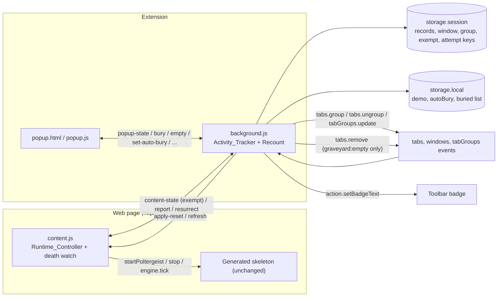
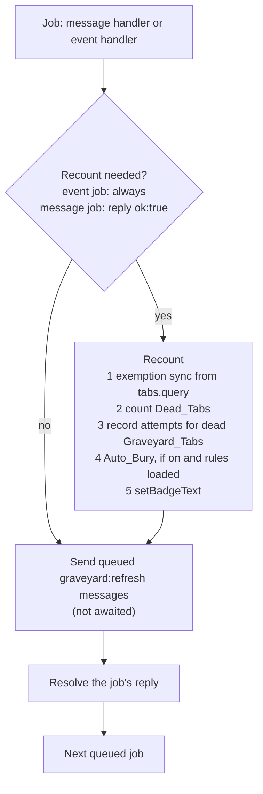
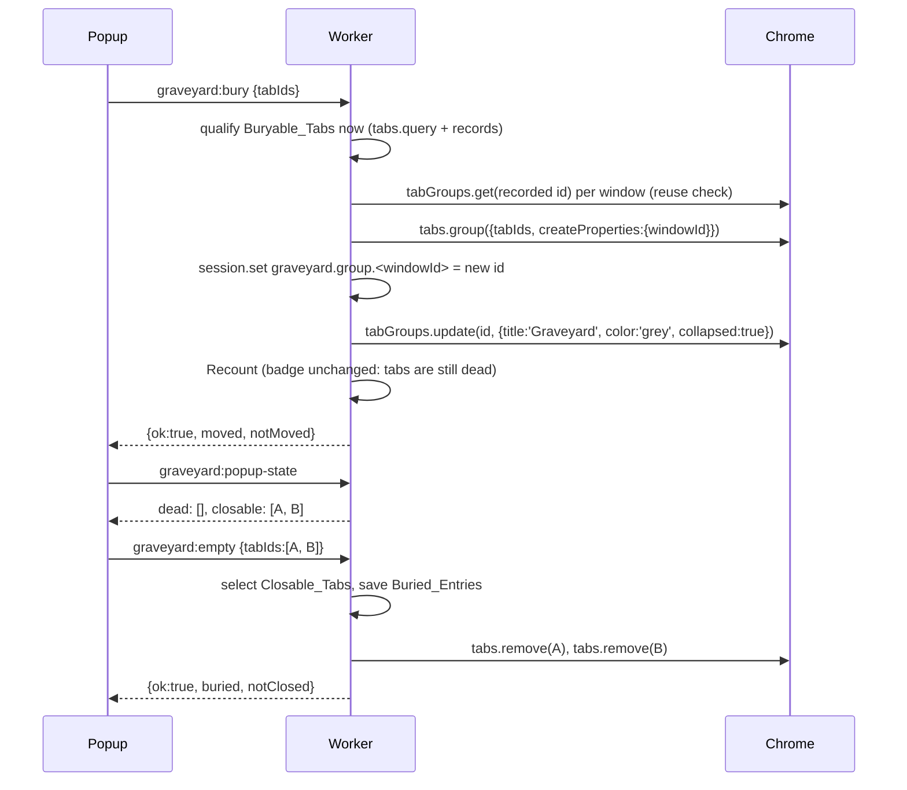

# Graveyard Groups Design

## Overview

Graveyard Groups changes what Tab Graveyard does with dead tabs. `Bury all` now moves dead tabs that are in no tab group into one grey, collapsed `Graveyard` group per window and closes nothing. A new `Empty graveyard` command saves the tabs in that group to the Buried_List and then closes them. Resurrect takes a tab out of the group. Pinned and audible tabs never decay. The toolbar badge shows the number of dead tabs. An optional `Auto-bury dead tabs` setting moves tabs into the group as they die.

All new logic lives in the app: `background.js`, `content.js`, and the popup. `skeleton/` and both Generated_Skeletons are unchanged, because every new behaviour depends on Chrome tab and group APIs, which the skeleton must not use.

### Current-to-target delta

| Area | Current state | Target | Requirements |
|---|---|---|---|
| Manifest | `permissions: ["storage"]` | `["storage", "tabGroups"]`; every other key unchanged | 1 |
| Validator | Requires `["storage"]` | Requires `["storage", "tabGroups"]`, with the comment of 1.5 | 1 |
| Bury | Saves Buried_Entries, then closes | Moves Buryable_Tabs into the window's Graveyard_Group; closes nothing | 2, 3 |
| Closing | `graveyard:bury` | `graveyard:empty` only, save before close | 4 |
| Resurrect | Resets Registers | Also ungroups a Graveyard_Tab | 5 |
| Exemption | None | Pinned or audible tabs hold Registers at 0; pages get `graveyard:refresh` | 6 |
| Badge | None | Dead_Tab count after every job; pages report deaths through `graveyard:report` | 7 |
| Auto_Bury | None | Local flag; runs inside the Recount | 8 |
| Popup | Bury closes; one checkbox | Bury moves; `Empty graveyard (M)` button; `Auto-bury dead tabs` checkbox | 3, 4, 8 |
| Prior spec | Bury closes tabs | Amended text, reasons, and notes | 10 |
| Tests | Bury-closes suites | Updated unit suites, Property 3 renamed, three new browser tests | 11 |

### Goals

- `graveyard:empty` from an extension page is the only path that closes a tab, and every closed tab has a saved Buried_Entry first.
- Groups the user made are never touched (decision 12).
- `tabGroups` is the only new permission; the worker still never reads a tab's URL or title from Chrome.
- The work fits seven cohesive change sets (see "Change sets").

### Non-goals

- Keeping Graveyard_Groups across a browser restart, per-window emptying, badge colour, per-site exemptions.
- Any change to `skeleton/`, the Generated_Skeletons, `rules.json`, `web_accessible_resources`, `package.json` scripts, Doomscroll, or `demo-site/`.
- New property-based tests. The only fast-check code touched is the existing Property 3 block (Requirement 11.1).

### Design decisions for review

These choices fill gaps the requirements leave open. Each is cheap to change before implementation.

1. **Pages report deaths with the existing `graveyard:report`.** While its document is hidden, the Runtime_Controller runs a death watch: once per second it calls `engine.tick()` and reads `meters.values().timeAway`. The first time the value reaches the active profile's Tombstone threshold, it sends one `graveyard:report` with the usual payload (type, title, `heldSeconds`, epoch). The worker's existing max-merge raises the Register, and the Recount that follows the message counts the tab. No new message type is needed, and the payload stays inside Requirement 9.8. The explicit `engine.tick()` keeps the read fresh: under Chrome's one-wake-up-per-minute throttling, the engine's own timer and the watch fire in the same wake-up in an unknown order.
2. **The Recount runs inside the queue link of every job, before the job's reply resolves.** This meets Requirement 7.2 and gives Requirement 8.7 ("move before replying") without extra code in `graveyard:set-auto-bury`. Recount failures are caught and logged, so the job's reply and writes do not change (7.8).
3. **The Recount also syncs exemption state.** It already queries every tab for `pinned`, `audible`, and `groupId`, so it applies any exemption change that an earlier job saw but did not save. This makes the Recount the backstop for Requirement 6.1. Jobs that only read Tab objects (`graveyard:bury`, `graveyard:empty`, `graveyard:popup-state`) decide exemption from their own query result, and the Recount saves the change right after them.
4. **`tabs.onReplaced` moves exemption state and the Auto_Bury attempt to the added id, then re-reads exemption.** A discard replaces the tab but not the user's intent: a tab the user dragged out of the Graveyard group must not be auto-buried again after a discard. After the move, `tabs.get(added)` is the newest source and decides exemption (Requirement 9.9).
5. **`tabs.onUpdated` creates a job only when `changeInfo` has a `pinned`, `audible`, or `groupId` key.** Loading-status and other changes are dropped before the queue, so they cause no job and no Recount.
6. **`graveyard:popup-state` lists no Dead_Tabs and no Closable_Tabs when `tabs.query` fails.** Without `groupId` the worker cannot tell Buryable_Tabs from grouped ones, and an empty list offers no command that could act on the wrong tabs. One diagnostic is logged.
7. **Leaving an exemption sets `since` to the handling time.** Registers stay 0 (6.5), and the report cap (`now − since`) then stops any report from crediting time spent while exempt.
8. **`graveyard:refresh` is sent after the job and its Recount, and is not awaited inside the queue.** A frozen or slow page cannot stall the queue. A content-state request that itself caused the exemption change also gets a refresh; the extra round trip changes nothing and ends there.
9. **The popup's red `danger` style moves from `Bury all` to `Empty graveyard`**, because only Empty closes tabs now.
10. **`closable` ids are ordered like the dead list**: longest Away_Time first, then ascending tab id. The order matters only for the 500-id limit in Requirement 4.3.

### Research findings

- `tabs.group({tabIds, createProperties})` creates the group in the *current* window unless `createProperties.windowId` is given, and moves the tabs there. The worker therefore always passes the tabs' own `windowId` and groups only tabs of one window per call ([chrome.tabs](https://developer.chrome.com/docs/extensions/reference/api/tabs)).
- Group ids are unique within a browser session. Moving a group to another window fires `tabGroups.onRemoved` and a creation in the new window, not a move event. The worker's record is therefore deleted when a group leaves its window. `tabGroups.update` changes only the properties it is given ([chrome.tabGroups](https://developer.chrome.com/docs/extensions/reference/api/tabGroups)).
- When a group that holds the active tab collapses, Chrome activates the first tab to the right of the group, or the tab to its left ([MDN: tabGroups.update](https://developer.mozilla.org/en-US/docs/Mozilla/Add-ons/WebExtensions/API/tabGroups/update)).
- Hidden pages get timer wake-ups once per second. After five minutes hidden, chained timers (every `setInterval` iteration counts) wake up once per minute, unless the page made sound in the last 30 seconds ([Chrome 88 timer throttling](https://developer.chrome.com/blog/timer-throttling-in-chrome-88)). The death watch is a 1-second `setInterval`. It reports within about 2 seconds of the threshold in Demo_Mode (24 s, before throttling becomes intensive) and within about 60 seconds in normal mode.
- `Tab.audible` reports whether the tab produced sound in the last couple of seconds, including when the tab is muted. Chrome keeps it true for about 2 seconds after the sound stops ([chrome.tabs](https://developer.chrome.com/docs/extensions/reference/api/tabs); [Stack Overflow: audible stays true after stop](https://stackoverflow.com/questions/51117985/chrome-extension-audible-property-from-tabs-query-return-true-even-after-the-pl)).

Content from these sources was rephrased for compliance with licensing restrictions.

### Permission justification

The requirements document's "Permission rationale" table holds the full reasoning. In short: `tabGroups` is needed only for `tabGroups.get`, `tabGroups.update`, `tabGroups.onUpdated`, and `tabGroups.onRemoved`. `tabs.group`, `tabs.ungroup`, `tabs.onUpdated`, the `pinned`, `audible`, and `groupId` properties, and `action.setBadgeText` need no permission. `tabs`, `alarms`, and host permissions stay out.

## Architecture

### Runtime boundaries



### Job lifecycle

Every read-modify-write still runs through one Promise chain. A link now has three steps, and the next link starts only after all three finish.



### Bury all, then Empty graveyard



### A hidden page reports its death

```mermaid
sequenceDiagram
  participant Pg as Page A (hidden)
  participant W as Worker
  participant B as Badge
  Note over Pg: visibilitychange to hidden: report heldSeconds 0, arm death watch
  loop every 1 s while hidden
    Pg->>Pg: engine.tick(); v = meters.values().timeAway
  end
  Pg->>W: graveyard:report {title, heldSeconds: v, epoch} when v reaches the Tombstone threshold
  W->>W: raise Register (max-merge, capped), Recount
  W->>B: setBadgeText(count)
```

## Components and Interfaces

### Change sets

The implementation plan maps one task to each set. Unit tests ship with the code they cover.

| # | Change set | Files |
|---|---|---|
| 1 | Manifest, validator, packaging tests | `manifest.json`, `scripts/validate-graveyard-package.mjs`, `test/package.test.js`, `test/sync.test.js`, permission comment in `test/browser/discard-reload.pw.js` |
| 2 | Groups, Bury, Empty, Resurrect ungroup | `background.js`, `test/background.test.js` (bury and empty tests, Property 3, source scan, group identity, privacy) |
| 3 | Recount, badge, Auto_Bury | `background.js`, `test/background.test.js` |
| 4 | Exemptions and page refresh, death watch | `background.js`, `content.js`, `test/background.test.js`, `test/content.test.js` |
| 5 | Popup | `popup.html`, `popup.js`, `popup.css`, `test/popup.test.js` |
| 6 | Prior spec documents | `.kiro/specs/tab-graveyard-app/requirements.md`, `design.md` |
| 7 | Browser tests | `test/browser/bury-reopen.pw.js`, new `test/browser/graveyard-groups.pw.js`, helpers in `test/browser/extension-fixture.js` |

All paths without a directory are under `app2-tab-graveyard/`.

### Manifest and Graveyard_Validator (set 1)

- `manifest.json`: `"permissions": ["storage", "tabGroups"]`. No other byte changes.
- `validate-graveyard-package.mjs`: the check becomes `if (!same(m.permissions, ['storage', 'tabGroups'])) errors.push('manifest.json: permissions must be exactly ["storage", "tabGroups"]')`. `same` compares JSON, so a missing key, a non-array, a missing or duplicated entry, an extra entry, or another order each give exactly that one error (1.3). The comment required by 1.5 sits directly above it. The forbidden-key loop is unchanged (1.4).

### Activity_Tracker (`background.js`, sets 2 to 4)

#### Constants and Tab fields

```js
export const MESSAGE = Object.freeze({ ...existing,
  EMPTY: 'graveyard:empty',                 // popup -> worker
  SET_AUTO_BURY: 'graveyard:set-auto-bury', // popup -> worker
  REFRESH: 'graveyard:refresh',             // worker -> content (rejected by the worker, 1.9)
});
export const GROUP_KEY_PREFIX = 'graveyard.group.';          // session: Graveyard_Group id of a window
export const EXEMPT_KEY_PREFIX = 'graveyard.exempt.';        // session: true while saved as exempt
export const ATTEMPT_KEY_PREFIX = 'graveyard.buryAttempt.';  // session: true once Auto_Bury has had its attempt
export const AUTO_BURY_KEY = 'graveyard.autoBury';           // local: Boolean
export const GRAVEYARD_TITLE = 'Graveyard';
export const GRAVEYARD_COLOR = 'grey';
export const NO_GROUP = -1;                                  // tabGroups.TAB_GROUP_ID_NONE
export const MAX_EMPTY_IDS = 500;                            // ids a graveyard:empty may carry
// MAX_BURIED (200) also caps the tabs one graveyard:empty selects.

/** The only place a Tab object is read (Requirement 9.3). */
export function tabView(tab) {
  return {
    id: tab.id, windowId: tab.windowId, active: tab.active !== false, incognito: tab.incognito === true,
    exempt: tab.pinned === true || tab.audible === true,
    groupId: Number.isInteger(tab.groupId) ? tab.groupId : NO_GROUP,
  };
}
```

`contentSender`, `openTabActive`, `leftTabRecord`, `seedTabs`, the `tabs.onUpdated` handler, and a new `openTabs()` helper all go through `tabView`. `openTabs()` calls `tabs.query({})` and returns a `Map` from tab id to view for non-incognito tabs, or throws. `isBuryable(record)` is renamed `isSaveable(record)` to match the Glossary; its rule is unchanged (URL reported, at most 2048 characters).

Classification within a job uses the job's newest view:

```js
const graveyardIds = (stored) => Map windowId -> groupId from GROUP_KEY_PREFIX keys
isGraveyardTab(view, groups) = view.groupId !== NO_GROUP && groups.get(view.windowId) === view.groupId
isDead(view, record, ...)    = view && !view.exempt && isSaveable(record) && stage(away) === 'dead'
isBuryableTab                = isDead && view.groupId === NO_GROUP
isClosableTab(view, record)  = view && !view.exempt && isSaveable(record) && isGraveyardTab(view, groups)
```

#### Queue

```js
let queue = Promise.resolve();
const refreshQueue = new Set(); // tab ids owed a graveyard:refresh

function enqueue(job, { recount = 'never' } = {}) {          // 'never' | 'ok' | 'always'
  const run = queue.then(async () => {
    let result; let error = null;
    try { result = await job(); } catch (err) { error = err ?? new Error('job failed'); }
    if (recount === 'always' || (recount === 'ok' && !error && result?.ok === true)) await recountSafely();
    for (const tabId of refreshQueue) void sendToTab(tabId, { type: MESSAGE.REFRESH });
    refreshQueue.clear();
    if (error) throw error;
    return result;
  });
  queue = run.then(() => undefined, () => undefined);
  return run;
}
```

- Message handlers call `enqueue(job, { recount: 'ok' })`. Validation failures return before the queue, so they cause no job and no Recount.
- Event handlers go through `guarded(kind, job)`, which now passes `{ recount: 'always' }`.
- `sendToTab` already swallows a missing receiver. An undelivered refresh is not retried (6.10).
- `resurrectTab` keeps sending `graveyard:apply-reset` after its job, outside the queue.

#### Exemption sync (set 4)

```js
/** Apply one source's view to the saved exemption state. Writes go into `batch`. Returns the view's exempt flag. */
async function syncExemption(batch, view, record, t, profile) {
  const saved = (await readKey(session, exemptKey(view.id))) === true;
  if (view.exempt && !saved) {           // 6.2: enter
    batch.set[exemptKey(view.id)] = true;
    if (record) batch.record = { ...record, since: t, leftAt: null, normal: { heldMs: 0 }, demo: { heldMs: 0, epoch: profile.epoch } };
    batch.remove.add(attemptKey(view.id)); // a Reset clears the Auto_Bury attempt (8.6)
    refreshQueue.add(view.id);             // 6.8
  } else if (!view.exempt && saved) {    // 6.5, 6.14: leave
    batch.remove.add(exemptKey(view.id));
    const away = !view.active;
    batch.record = record ? { ...record, since: t, leftAt: away ? t : null } : (away ? createRecord({ t, away, profile }) : null);
    refreshQueue.add(view.id);
  }
  return view.exempt;
}
```

The Recount runs the same logic over a session snapshot for every open tab, so it does not read per-tab keys. Sync points, all inside queue jobs:

| Source (6.1) | Where | Effect while exempt |
|---|---|---|
| `sender.tab` | `contentState`, `report`, `resurrect` | content-state: new record gets no Absence, reply `exempt: true`, seeds 0 (6.6). report: `{ok:true, applied:false}`, Registers unchanged (6.12) |
| `tabs.get(previous)` | `leftTabRecord` in `tabs.onActivated` | No Absence starts (6.3) |
| `tabs.query` | `seedTabs`, Recount | No stub Absence on startup (6.3) |
| `tabs.onUpdated` `tab`, when `changeInfo` has `pinned` or `audible` | `handleUpdated` | Same as above |

Exempt tabs are left out of the dead list, `closable`, the badge count, and Auto_Bury (6.4), because every classification starts with `!view.exempt`. Exemption never calls `tabs.ungroup` (5.6). When Chrome removes a pinned tab from its group, `tabs.onUpdated` reports the new `groupId` and the Recount sees it.

#### Graveyard_Group helpers (set 2)

```js
/** The recorded Graveyard_Group of a window if it is still usable, else null (record deleted). 2.9 */
async function usableGroup(windowId) {
  const id = await readKey(session, groupKey(windowId));
  if (!Number.isInteger(id) || id < 0) return null;
  let group;
  try { group = await tabGroups.get(id); } catch { group = null; }
  // windowId is checked before title, so a title is read only while the id is recorded for the group's window (9.4).
  if (!group || group.windowId !== windowId || group.title !== GRAVEYARD_TITLE) {
    await session.remove(groupKey(windowId));
    return null;
  }
  return id;
}

/**
 * Move tabIds (one window, all in no group) into that window's Graveyard_Group.
 * collapse: 'always' for Bury (3.4); 'unless-active' for Auto_Bury (8.13), with the window's active tab id.
 * Returns { moved, notMoved }.
 */
async function moveIntoGraveyard(windowId, tabIds, { collapse, activeTabId = null, views }) {
  const style = { title: GRAVEYARD_TITLE, color: GRAVEYARD_COLOR };
  const reused = await usableGroup(windowId);
  if (reused !== null) {
    try { await tabs.group({ groupId: reused, tabIds }); }
    catch (err) { logFailure('tabs.group', err); return settle(windowId, tabIds); }
    const keepOpen = collapse === 'unless-active' && views.get(activeTabId)?.groupId === reused;
    try { await tabGroups.update(reused, keepOpen ? style : { ...style, collapsed: true }); }
    catch (err) { logFailure('tabGroups.update', err); } // the tabs are in the group, so they count as moved (3.7)
    return { moved: tabIds, notMoved: [] };
  }
  let created;
  try { created = await tabs.group({ tabIds, createProperties: { windowId } }); }
  catch (err) { logFailure('tabs.group', err); return settle(windowId, tabIds); }
  try {
    await session.set({ [groupKey(windowId)]: created });                 // recorded before styling (2.5)
    await tabGroups.update(created, { ...style, collapsed: true });       // 2.3; a new group never holds the active tab
  } catch (err) {                                                         // 2.13
    logFailure('graveyard group setup', err);
    await session.remove(groupKey(windowId)).catch((e) => logFailure('group record delete', e));
    return { moved: [], notMoved: tabIds };
  }
  return { moved: tabIds, notMoved: [] };
}
```

`settle(windowId, tabIds)` runs only after a failed `tabs.group`. It reads each tab's `groupId` with `tabs.get` and puts the tab in `moved` when it is now in the window's recorded Graveyard_Group, otherwise in `notMoved`. A tab that cannot be read counts as `notMoved`. Every Chrome call that fails is logged once (3.7).

#### Message handlers

Handlers are declared in this order, so the source scan (11.3) can bound the one `tabs.remove` between `async function emptyGraveyard(` and `async function reopen(`.

**`bury` (set 2)**: same sender and payload checks as now (3.9), then `rules unavailable` when thresholds cannot load (3.8). In the job: read demo flag, profile, session snapshot, and `openTabs()`. Take distinct requested ids that are Buryable_Tabs now, group them by `view.windowId`, and call `moveIntoGraveyard(windowId, ids, { collapse: 'always' })` once per window. An attempt key is written for each moved tab (8.6). No Register, Buried_Entry, or `tabs.remove` is touched (3.5). Reply `{ok: true, moved, notMoved}` (3.6). Exempt or grouped tabs never qualify, so they appear in neither array (6.13, decision 12).

**`emptyGraveyard` (set 2)**: checks an extension-page sender and an array of at most 500 non-negative integer ids (4.10). It does not load thresholds (4.11).

```js
return enqueue(async () => {
  const t = now();
  const [demoMode, profile, stored, existing, views] = await Promise.all([readDemo(), readProfile(), readAllSession(), readBuried(), openTabs()]);
  const records = recordsIn(stored); const groups = graveyardIds(stored);
  const selected = [];
  for (const tabId of new Set(tabIds)) {
    if (selected.length >= MAX_BURIED) break;                     // 4.4
    const view = views.get(tabId); const record = records.get(tabId);
    if (!isClosableTab(view, record, groups)) continue;
    const awaySeconds = Math.floor(awayMs(record, modeOf(demoMode), profile, t) / 1000);
    selected.push({ tabId, entry: { id: randomId(), title: record.title, url: record.url, buriedAt: t, awaySeconds } });
  }
  if (selected.length === 0) return { ok: true, buried: [], notClosed: [] };
  try { await local.set({ [BURIED_KEY]: [...selected.map((s) => s.entry), ...existing].slice(0, MAX_BURIED) }); }
  catch (err) { logFailure('buried list save', err); return fail('could not save buried tabs'); }   // 4.6
  // The only tabs.remove in the extension: after the save, one call per selected tab (4.5, 4.7, 4.9).
  const results = await Promise.allSettled(selected.map(({ tabId }) => tabs.remove(tabId)));
  ...collect buried / notClosed; one diagnostic per failed call...
  return { ok: true, buried, notClosed };                         // 4.8
}, { recount: 'ok' });
```

If `openTabs()` throws, the job throws and the dispatcher replies `{ok: false, error: 'internal error'}`, so nothing closes.

**`resurrect` (content) and `resurrectTab` (popup) (set 2)**: after the reset record is written, the same job deletes the tab's attempt key and calls `ungroupIfGraveyard(tabId)`. That function reads the tab with `tabs.get`, compares its `groupId` with the window's recorded group, and calls `tabs.ungroup(tabId)` once when they match (5.1, 5.2). A failed `tabs.ungroup` is logged once and the Resurrect finishes as usual (5.3). `tabs.ungroup` appears nowhere else (5.6). The ungroup happens inside the job, and `graveyard:apply-reset` and the reply come after it.

**`setAutoBury` (set 3)**: requires an extension-page sender and a Boolean `enabled` (8.4). It writes `{[AUTO_BURY_KEY]: enabled}`. A failed write returns `{ok: false, error: 'could not save auto-bury'}`. Otherwise it returns `{ok: true, autoBury: enabled}` (8.11). The trailing Recount moves the current Buryable_Tabs before the reply resolves (8.7).

**`contentState`, `report` (set 4)**: run `syncExemption` from `sender.tab` first. `contentState` replies with an `exempt` Boolean and sends 0 for both seeds when it is true (6.6). `report` returns `{ok: true, applied: false}` for an exempt tab (6.12).

**`popupState` (sets 2, 3)**: also reads Auto_Bury and `openTabs()`. When the query fails, it logs one diagnostic and lists no `dead` and no `closable` (decision 6). For every reported, open, non-exempt record: a Graveyard_Tab goes to `closable` whatever its Stage (4.1, also with `rulesLoaded: false`); a dead tab in no group goes to `dead` (3.13); a dead tab in a user group goes nowhere.

**`handleMessage`**: adds `EMPTY` and `SET_AUTO_BURY` to the handler map. `graveyard:refresh` gets the same rejection as `graveyard:apply-reset` (1.9).

#### Event handlers

| Event | Job (all `recount: 'always'`) | Requirements |
|---|---|---|
| `tabs.onUpdated(tabId, changeInfo, tab)` | No job unless `changeInfo` has `pinned`, `audible`, or `groupId` (checked with `Object.hasOwn`, which reads no values). With `pinned` or `audible`: `syncExemption(tabView(tab))`. With only `groupId`: no writes; the Recount does the rest | 2.10, 6.1, 7.2 |
| `tabGroups.onUpdated(group)` | Reads `group.id` and `group.windowId` only. If the id is recorded for that window: `tabGroups.get(id)`. A failed get logs one diagnostic and keeps the record (2.12). A different `windowId`, or a title that is not exactly `Graveyard`, deletes the record (Release). No `tabGroups.update` | 2.4, 2.6, 9.4 |
| `tabGroups.onRemoved(group)` | Deletes every `graveyard.group.*` key whose value is `group.id` | 2.7 |
| `windows.onRemoved(windowId)` | Also deletes `graveyard.group.<windowId>` | 2.8 |
| `tabs.onRemoved(tabId)` | Also deletes the tab's exempt and attempt keys. No Buried_Entry | 2.11, 9.9 |
| `tabs.onReplaced(added, removed)` | Moves the record (as now), the exempt flag, and the attempt key to `added`, deletes the `removed` keys, then syncs exemption from `tabs.get(added)` when it succeeds | 9.9, decision 4 |
| `tabs.onActivated`, `onInstalled`, `onStartup` | As now, plus exemption sync from the Tab objects they read | 6.3 |

`registerBackground` adds `tabs.onUpdated`, `tabGroups.onUpdated`, and `tabGroups.onRemoved` in the same synchronous step as the existing listeners (1.7).

#### Recount (set 3)

```js
async function recountSafely() {
  try { await recount(); } catch (err) { logFailure('badge recount', err); } // badge left as it was (7.6, 7.8)
}

async function recount() {
  const [stored, views] = await Promise.all([readAllSession(), openTabs()]);   // a throw here leaves the badge (7.6)
  const t = now();
  const [base, demoMode, autoBury] = await Promise.all([readBaseThresholds(), readDemo(), readAutoBury()]);
  const profile = normalizeProfile(stored[PROFILE_KEY]);
  const batch = newBatch();
  // 1. Exemption sync for every open tab (decision 3), against the snapshot.
  // 2. Dead_Tabs: open, non-exempt, saveable, stage 'dead'. base null -> none (7.5).
  // 3. Attempt key for each dead Graveyard_Tab without one (8.6).
  // 4. Auto_Bury when autoBury && base: candidates are dead, groupId NO_GROUP, not active, no attempt key (8.5).
  //    Group them per window; moveIntoGraveyard(w, ids, {collapse:'unless-active', activeTabId, views});
  //    write an attempt key for every candidate whatever the outcome (8.6, 8.10).
  // 5. Commit the batch only when it has writes, then:
  await action.setBadgeText({ text: dead.length > 0 ? String(dead.length) : '' });  // no tabId: all windows (7.1)
}
```

- The Recount writes storage only when something changed, so existing tests that assert "no writes" keep passing.
- Auto_Bury reads `GROUP_KEY_PREFIX` records through `usableGroup`, so it never moves a tab into a user group and never changes one (decision 12).
- Moves made by the Recount fire `tabs.onUpdated` and `tabGroups.onUpdated` events. Their jobs find the attempt keys already written and the title `Graveyard` in place, so the chain ends.
- Timing: Requirements 7.3 and 7.7 rely on the page's death watch (decision 1). A discarded or frozen tab is counted at the next Recount of any kind (7.4).

#### Diagnostics

`logFailure` keeps the `[poltergeist:graveyard]` prefix and a fixed description. It now also removes URLs from Chrome error messages, with the same pattern `content.js` uses (`<url>` replaces any `scheme://…` text). Titles, group titles, and records are never passed to it (9.6).

### Runtime_Controller (`content.js`, set 4)

`graveyardCreateController` gains three dependencies with defaults: `every(fn, ms)` (default `setInterval`), `cancel(id)` (default `clearInterval`), and `isHidden()` (default `() => false`). The bootstrap passes the window's timers and `doc.visibilityState === 'hidden'`.

- **State reply.** `parseState` also requires `typeof reply.exempt === 'boolean'`. A reply that lacks it is a failed state request: one diagnostic and no instance (6.11). When `exempt` is true, `refreshOnce` calls `stopCurrent()` and returns without loading the package (6.7). `stop()` undoes every effect with its configured fade, so no artifact remains after at most 600 ms.
- **`graveyard:refresh`.** `handleWorkerMessage` accepts it (the existing listener already requires `sender.id === runtime.id`). It calls `refresh()` and replies `{ok: true}`, or replies `{ok: false, error}` when the controller is disposed or faulted. The refresh is the existing serialized, generation-guarded path, so within one state round trip the page holds no instance (exempt) or exactly one started from the new seeds (6.9).
- **Death watch.** Each started entry stores `deadAt`, the `trigger.threshold` of the rule `graveyard-tombstone` in the profile it started (24 in Demo_Mode, 86400 otherwise), or `null` if absent.
  - Armed by `visibilityChanged(false)` (after the existing hidden report), by a start while `isHidden()`, and by `applyCommittedReset()` while hidden.
  - Each 1000 ms firing checks that the entry is still current and the controller is not disposed or faulted. It then calls `entry.ghost.engine.tick()` and reads `entry.ghost.meters.values().timeAway`. When the value is at least `deadAt`, it disarms and calls the existing `sendReport(entry, value)`. A throw disarms and reports one diagnostic.
  - Disarmed by `visibilityChanged(true)`, `stopCurrent()`, `dispose()`, a fault, and after its one report.
  - The report payload is unchanged: `{type, title, heldSeconds, epoch}` (9.8). The controller still reads nothing from `chrome.tabs` (6.11).

### Popup (set 5)

`popup.html` changes inside the Graveyard section and the footer:

```html
<div class="actions">
  <button type="button" id="bury" disabled>Bury all (0)</button>
  <button type="button" id="empty" class="danger" hidden>Empty graveyard (0)</button>
</div>
...
<footer class="footer">
  <label class="control" for="demo">…Demo mode…</label>
  <label class="control" for="auto-bury">
    <input type="checkbox" id="auto-bury" name="auto-bury" disabled>
    <span>Auto-bury dead tabs</span>
  </label>
</footer>
```

`popup.css` adds one static rule for `.actions` (flex row, 8 px gap, wrapping) and lets `.footer` stack its two labels. No animation or transition is added; the global `transition: none; animation: none` stays.

`popup.js`:

| Item | Change |
|---|---|
| `POPUP_MESSAGE` | Adds `EMPTY`, `SET_AUTO_BURY` |
| `TEXT` | Adds `noDeadOutsideGroups: 'No dead tabs outside tab groups.'`, `emptyFailed: 'Could not empty the graveyard. Try again.'`, `autoBuryFailed: 'Could not change auto-bury. Try again.'` |
| Helpers | `emptyLabel(m)` gives `Empty graveyard (m)`. `notMovedText(n)` gives `Could not move n tab to the Graveyard group.` or `…tabs…` |
| `parseState` | Adds `autoBury: reply.autoBury === true` and `closable` (the integer tab ids of `reply.closable`, or `[]` when it is not an array) |
| `render` | Empty text: `rulesMissing` when `rulesLoaded` is false, else `noDeadOutsideGroups` when `closable` is not empty, else `noDead` (3.12). `#empty` is hidden unless the state is confirmed and M > 0 (4.16), and disabled while busy (4.15). `#auto-bury` is checked from `pendingAutoBury ?? data.autoBury` and disabled while busy or unconfirmed (8.1) |
| `buryAll` | Accepts a reply only with arrays `moved` and `notMoved`; warns with `notMovedText` (3.10, 3.11) |
| `emptyGraveyard` | `command('empty', {type: EMPTY, tabIds: closable.slice(0, 500)}, …)`. Accepts a reply only with arrays `buried` and `notClosed`; warns with the existing `notClosedText` (4.3, 4.13, 4.14) |
| `setAutoBury` | Mirrors `setDemo` with `pendingAutoBury`; accepts only `reply.autoBury === enabled` (8.3, 8.12) |

The popup calls no `tabGroups`, `tabs.group`, `tabs.ungroup`, or `action` API (1.10), and still reads only the active tab's `id` (9.5).

### Prior spec documents (set 6)

Requirement 10 lists every edit and its position, so the docs task follows that list directly. The table gives the substance of each new text.

| Document | Position | Content |
|---|---|---|
| requirements.md | R1.3, R1.6 | Permissions `["storage", "tabGroups"]`; API list of graveyard-groups 1.6; Tab fields of 9.3, keeping the ban on `url`, `pendingUrl`, `title`, `favIconUrl` |
| requirements.md | R7.7, R7.8, R7.9 | Bury moves Buryable_Tabs; Empty saves then closes; `tabs.remove` only for `graveyard:empty` |
| requirements.md | R7.15, R7.17 | Browser criteria of 11.8 and 11.9 (keeps `(BROWSER-VERIFIED)`); popup replies of 3.10, 3.11, 4.13, 4.14 |
| requirements.md | R8.1, R8.2, R10.4 | Storage rules of 9.1 and 9.2; worker tests name Empty save-before-close and close only on `graveyard:empty` |
| requirements.md | Glossary Dead_Tab, Bury, Buried_Entry | Definitions from graveyard-groups |
| requirements.md | Notes after the Out-of-scope paragraph, R5.2, R5.4, R5.5, R5.10, R6.3, R6.8, R7.1, R7.5 | As listed in 10.2 |
| design.md | End of "Permission justification", after Property 3, after "Bury" | As listed in 10.3 |

Each replaced text ends with `(amended by graveyard-groups)` followed by a one- or two-sentence `Reason (graveyard-groups):` paragraph (10.5). No number, term, or haunt-polish text changes, and the Prior_Spec `tasks.md` stays as it is (10.4, 10.6).

## Data Models

### Storage

| Area | Key | Value | Written by | Deleted by |
|---|---|---|---|---|
| session | `graveyard.tab.<tabId>` | Tab_Record (unchanged shape) | as now; exemption Reset | `tabs.onRemoved`, `tabs.onReplaced` |
| session | `graveyard.window.<windowId>` | active tab id | as now | as now |
| session | `graveyard.profile` | `{epoch, startedAt}` | as now | – |
| session | `graveyard.group.<windowId>` | Graveyard_Group id (integer ≥ 0) | `moveIntoGraveyard` on creation | Release, `tabGroups.onRemoved`, `windows.onRemoved`, `usableGroup`, failed setup |
| session | `graveyard.exempt.<tabId>` | `true` | exemption entry | exemption exit, `tabs.onRemoved`, `tabs.onReplaced` (moved) |
| session | `graveyard.buryAttempt.<tabId>` | `true` | Bury move, Auto_Bury attempt, Recount on a dead Graveyard_Tab | Resurrect, exemption entry, `tabs.onRemoved`, `tabs.onReplaced` (moved) |
| local | `graveyard.demoMode` | Boolean | as now | – |
| local | `graveyard.autoBury` | Boolean; missing, malformed, or unreadable means off | `graveyard:set-auto-bury` | – |
| local | `graveyard.buried` | Buried_Entry[] (unchanged shape), newest first, ≤ 200 | `graveyard:empty` only | Reopen |

No tab group title is stored anywhere (9.4).

### Fields read from Chrome objects

| Object | Fields read |
|---|---|
| `Tab` (sender.tab, `tabs.get`, `tabs.query`, `tabs.onUpdated` tab) | `id`, `windowId`, `active`, `incognito`, `pinned`, `audible`, `groupId`, all in `tabView` |
| `tabs.onUpdated` changeInfo | presence of `pinned`, `audible`, `groupId` keys only |
| `TabGroup` from `tabGroups.onUpdated` / `onRemoved` | `id`, `windowId` |
| `TabGroup` from `tabGroups.get` | `windowId`, then `title` only when the id is recorded for that window |

### Messages (new and changed)

| Type | From → to | Payload | Reply |
|---|---|---|---|
| `graveyard:content-state` | content → worker | `{title}` | adds `exempt: boolean`; `heldSeconds` and `currentSeconds` are 0 when exempt |
| `graveyard:report` | content → worker | `{title, heldSeconds, epoch}` (unchanged; also sent once by the death watch) | `{ok, applied}`; `applied: false` when exempt |
| `graveyard:popup-state` | popup → worker | `{tabId}` | `{ok, demoMode, autoBury, rulesLoaded, current, dead, closable, buried}` |
| `graveyard:bury` | popup → worker | `{tabIds}` (0 to 500) | `{ok: true, moved: number[], notMoved: number[]}` |
| `graveyard:empty` | popup → worker | `{tabIds}` (0 to 500) | `{ok: true, buried: number[], notClosed: number[]}` |
| `graveyard:set-auto-bury` | popup → worker | `{enabled: boolean}` | `{ok: true, autoBury: boolean}` |
| `graveyard:refresh` | worker → content | `{}` | `{ok: true}`; the worker rejects it as a received message |

`dead` rows keep the shape `{tabId, title, url, awaySeconds}`, longest away first. `closable` is a list of tab ids in the same order (decision 10).

## Error Handling

| Failure | Behaviour | State after |
|---|---|---|
| `rules.json` unreadable | Bury: `rules unavailable`; badge `''`; no Auto_Bury; Empty works as usual; popup still gets `closable` | No tab moved by Bury or Auto_Bury |
| `tabs.group` fails | One diagnostic; `settle` sorts the tabs into `moved`/`notMoved`; other windows continue | Tabs stay where Chrome left them |
| `tabGroups.update` fails on a reused group | One diagnostic; the tabs count as `moved` | Group may keep the user's colour or expanded state |
| Recording or styling a new group fails | Record deleted; no further call on that group; that window's tabs go in `notMoved` | Unrecorded group left as Chrome made it |
| `tabGroups.get` fails in the title check | One diagnostic; record kept | `usableGroup` or `tabGroups.onRemoved` clears it later if the group is gone |
| Buried_List save fails in Empty | `{ok:false, error:'could not save buried tabs'}` | Nothing closed, groups unchanged |
| `tabs.remove` fails for one tab | Entry kept; id in `notClosed`; one diagnostic | Other tabs closed |
| `tabs.ungroup` fails on Resurrect | One diagnostic; Reset kept; reply as on success | Tab may stay in the group |
| `tabs.query` fails in popup-state | One diagnostic; empty `dead` and `closable` | Popup offers no Bury or Empty |
| `tabs.query`, session read, or `setBadgeText` fails in a Recount | One diagnostic; badge unchanged; job's reply unchanged | Next job recounts |
| Auto_Bury move fails | One diagnostic per affected tab; attempt kept | No retry until the next Reset |
| Auto_Bury save fails | `{ok:false, error:'could not save auto-bury'}` | Flag unchanged; popup rolls back |
| `graveyard:refresh` undelivered | Ignored; no retry | Page takes exemption from its next content-state |
| content-state reply lacks `exempt` | One diagnostic; no instance | Page clean |
| Death watch read throws | One diagnostic; watch off | Badge catches up at the next Recount |

## Testing Strategy

### No property-based tests

This spec adds no property-based tests, at the user's request (Requirement 11.1). Most new behaviour is orchestration of Chrome calls (grouping, closing, badge), which example-based tests with mocks cover directly. The selection rules already have a fast-check test. The existing block in `background.test.js` is renamed "Property 3: Nothing closes without Empty graveyard", in the `describe` title and the header comment. It keeps 100 runs per property:

- The first property adds popup `graveyard:bury`, content-script `graveyard:empty`, and `graveyard:set-auto-bury` actions and still asserts that `tabs.remove` is never called.
- The second sends `graveyard:empty`. Its generated tabs vary in being requested, open, Graveyard_Tabs (recorded group and matching `groupId` in the mock), and Exempt_Tabs (`pinned: true`). It asserts that exactly the requested Closable_Tabs close, each after a saved Buried_List holds its URL.

### Unit tests (Vitest, example-based)

The worker mock in `background.test.js` grows to cover exactly what `background.js` uses:

- Tab mocks gain `pinned`, `audible`, and `groupId` (default `-1`). The existing Proxy still records reads of `url`, `pendingUrl`, `title`, and `favIconUrl`. The `tabs.onUpdated` changeInfo mock is a Proxy too.
- `tabs.group` and `tabs.ungroup` keep an in-memory group map. `tabGroups.get` returns a Proxy that records a `title` read whenever the session record for the group's window does not equal its id at read time. The `tabGroups.onUpdated` argument is the same kind of Proxy. Both feed the privacy assertions of 11.4.
- `action.setBadgeText` stores `env.badge` and does not write to `env.log`. Because the Recount writes storage only on change, existing tests that assert exact `env.log` sequences keep passing.
- Failure switches exist for `tabs.group`, `tabGroups.get`, `tabGroups.update`, `tabs.ungroup`, `tabs.query`, and `setBadgeText`.

| File | Cases (Requirement 11) |
|---|---|
| `background.test.js` | Existing bury tests rewritten (11.2). New `describe` blocks for: Bury (new group, reuse, two windows, style incl. a recoloured or expanded reused group, skips, no close or entry, `notMoved` on a failed `tabs.group`, `moved` when `tabGroups.update` fails, dead list = Buryable_Tabs); user groups (decision 12); group identity (rename Release, no Release during creation or on colour/collapse, failed get keeps the record, failed creation, `tabGroups.onRemoved`, `windows.onRemoved`, stale record replaced); Empty (save-before-close, selection, save failure, remove failure, 201 → 200, sender/payload); Resurrect ungroup (both paths, user group, failure); exemption (pinned, audible, held at 0, ignored report, `exempt` field, refresh on entry and exit, fresh Absence on exit); badge (one trigger of each kind in 7.2, grouped dead tabs counted, `''` at 0 and without rules); Auto_Bury (default off, once per death, Bury counts as the attempt, active-tab skip, off, turning on, collapse kept when the group holds the active tab); `tabs.onReplaced` moving exempt and attempt keys. The listener-registration test adds the three new listeners. The privacy test allows the new key prefixes and `graveyard.autoBury`, and checks that no group title reaches storage or a diagnostic (11.4). The source scan is renamed "closes tabs only from the Empty graveyard handler (source scan)" (11.3) |
| `content.test.js` | Harness default reply gains `exempt: false`. New cases: `exempt: true` starts nothing; refresh stops a running instance on `exempt: true`; refresh starts one instance on `exempt: false` for a dead tab; a reply without `exempt` fails with one diagnostic; death watch sends one report with exactly `type`, `title`, `heldSeconds`, `epoch` when the value reaches 24 in Demo_Mode, none while visible, none after stop or dispose, and re-arms after apply-reset while hidden (11.5) |
| `popup.test.js` | `popupState()` helper gains `autoBury: false, closable: []`. Bury with `moved`/`notMoved` (N = 1, 2, rollback on a missing array); Empty hidden at M = 0, shown at M ≥ 1, ids sent, disabled in flight, warnings, rollback; Auto-bury checked from state, message sent, rollback text; `No dead tabs outside tab groups.`; source scan that `popup.js` calls no `tabGroups`, `tabs.group`, `tabs.ungroup`, or `action` API (1.10, 11.5) |
| `package.test.js` | Committed permissions `["storage", "tabGroups"]`; the new error text; cases for a missing `tabGroups`, an added `alarms`, a duplicated `tabGroups`, and `["tabGroups", "storage"]`, each reporting only that error; read-only `check:graveyard` still fails on an added `tabs` and leaves files unchanged (11.6) |
| `sync.test.js` | Expected error text updated (11.6) |

### Browser tests (Playwright, bundled Chromium)

New helpers in `extension-fixture.js`, all evaluated in the worker:

- `tabInfo(id)` gives `{windowId, active, pinned, audible, groupId}` from `chrome.tabs.get`.
- `groupInfo(id)` gives `{title, color, collapsed, windowId}` from `chrome.tabGroups.get`. The worker holds the permission, and this is test-only reading.
- `recordedGroupId(windowId)` reads `graveyard.group.<windowId>`.
- `badgeText()` reads `chrome.action.getBadgeText({})`.

Every test runs on a fresh profile with a 90 s timeout and ends with `diagnostics.expectClean()`.

| File and test | Steps | Evidence |
|---|---|---|
| `bury-reopen.pw.js` "Bury all moves without closing" (replaces the old test) | Demo on; A and B left ≥ 26 s with C in front; popup opened as a foreground tab; real click on `Bury all (2)` | Within 10 s: A and B share the recorded group id; group `Graveyard`, `grey`, collapsed; C and the popup tab have `groupId -1`; tab count unchanged; Buried_List empty; `Bury all (0)` disabled and `Empty graveyard (2)` (11.8) |
| `bury-reopen.pw.js` "Empty graveyard closes and saves" | Same setup and Bury; real click on `Empty graveyard (2)`; real click on `Reopen` for A | A and B closed, C open, two entries with A's and B's URLs, Empty hidden; a new tab at A's URL and only B's entry left (11.9) |
| `graveyard-groups.pw.js` "Resurrect ungroups" | A left ≥ 26 s; `graveyard:bury` through `sendControl`; activate A (Chrome expands the group); Tombstone visible; confirm A's group is the recorded one; trusted click on `Resurrect` | Within 5 s: A open in its window, `groupId -1`, no artifact, Registers 0 (11.10) |
| `graveyard-groups.pw.js` "Pinned and audible tabs are exempt" | Pin A while in front (`chrome.tabs.update(id, {pinned: true})` from the worker); make B audible while in front (below); C in front for ≥ 26 s; activate A, then B | Badge `''`; neither tab in `dead` or `closable`; records with `leftAt` null and Registers 0; no artifact at any 250 ms sample for 5 s after each activation; `pinned`/`audible` true at every sample, ≤ 2 s apart (11.11) |
| `graveyard-groups.pw.js` "Badge counts dead tabs" | Demo on and the control page opened first; A leaves, then B leaves, C stays in front | `''` at a reading after B left and < 22 s after A left; `2` by 29 s after B left with no switch or control message in between; `1` within 5 s of `graveyard:resurrect-tab` for A; `''` within 5 s of closing B (11.12) |

**Producing audio for B (Requirement 11.11).** Chrome's autoplay policy keeps a new `AudioContext` suspended until the page has a user activation, so the test supplies a real one:

1. With B in front, `page.evaluate` installs a one-shot `click` listener in B's main world. The listener creates an `AudioContext`, an `OscillatorNode` at 440 Hz through a `GainNode` at 0.02, starts it, and keeps the context on `window`.
2. The test clicks B's page with `page.mouse.click`, a trusted input event, which counts as the user activation.
3. The test polls `tabInfo(B).audible` every 200 ms for up to 10 s. If it never becomes true, the test fails with a message that gives the `AudioContext` state and whether the run was headless, for example `Chrome never reported audible: true for tab B (AudioContext state "running", headless)`. There is no skip and no fallback.
4. The fixture's launch flags are not changed. The fixture starts Chromium itself, so Playwright's default `--mute-audio` is not present, and no autoplay flag is added.
5. The oscillator plays for the rest of the test. Background tabs keep playing Web Audio, and Chrome keeps `audible` true while sound is produced.

A sampler loop reads `pinned` for A and `audible` for B every 1 s from the moment each tab leaves the front until the last assertion. The test asserts that every sample is true and that no gap exceeds 2 s.

### Final check

`npm test`, `npm run build:skeletons` (same `git status --porcelain` before and after), and `npm run test:browser`, each exiting 0 with no skipped test. Doomscroll and skeleton test files are unchanged (11.13).

### Requirement mapping

| Requirement | Code | Unit | Browser |
|---|---|---|---|
| 1 Permissions and protocol | manifest, validator, `handleMessage`, `registerBackground` | package, sync, background, popup scan | all (load) |
| 2 Group identity | `usableGroup`, `moveIntoGraveyard`, group events | background | Bury test |
| 3 Bury | `bury`, popup | background, popup | Bury test |
| 4 Empty | `emptyGraveyard`, popup | background (Property 3, scan), popup | Empty test |
| 5 Resurrect | `ungroupIfGraveyard` | background | Resurrect ungroups |
| 6 Exemption | `syncExemption`, content refresh | background, content | Exempt test |
| 7 Badge | Recount, death watch | background, content | Badge test |
| 8 Auto_Bury | Recount, `setAutoBury`, popup | background, popup | – |
| 9 Privacy | `tabView`, key layout, `logFailure` | background, popup | – |
| 10 Docs | Prior_Spec edits | – (read review) | – |
| 11 Verification | – | all | all |

## Risks and Limitations

| Risk | Effect | Mitigation or accepted boundary |
|---|---|---|
| Headless Chromium may not report `audible` (no audio output path) | Exempt test fails | The test fails loudly with the cause. If the first run shows headless never reports audible, that test runs headed (`test.use({ headless: false })`, which the fixture supports), and the reason is recorded in its header comment |
| Tab-group behaviour under new headless mode | Grouping or collapse could differ from headed Chrome | The first browser task checks group title, colour, and collapsed state; headed runs are the fallback, as above |
| Collapsing a group that holds every tab of a window | Chrome must activate or open another tab | Chrome's behaviour; the worker tracks the resulting activation like any other (decision 9 of the requirements) |
| `audible` flips on and off with a tab's sound | Each start resets the tab's Registers and refreshes its page | Accepted: a tab that plays sound is in use |
| Recount after every job | One `tabs.query` and one session read per job | Linear in open tabs; no writes unless something changed |
| Frozen or discarded pages run no death watch | Badge counts the tab only at the next Recount | Accepted (Requirement 7.4); any tab, window, group event, or popup open triggers one |
| Group ids do not survive a browser restart | The next Bury creates a new group; the old one becomes an ordinary user group | Accepted (requirements decision 2) |
| Chrome's saved or shared tab groups | Chrome may save the Graveyard group to the user's account | Outside the extension's storage (requirements decision 10) |
| Death watch adds a 1 s timer per hidden haunted page | Small CPU cost | Aligned with the engine's own 1 s tick; Chrome batches both in one wake-up |
