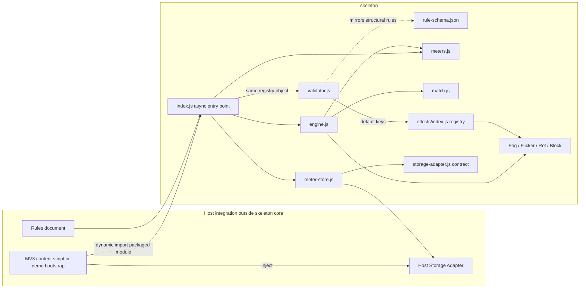
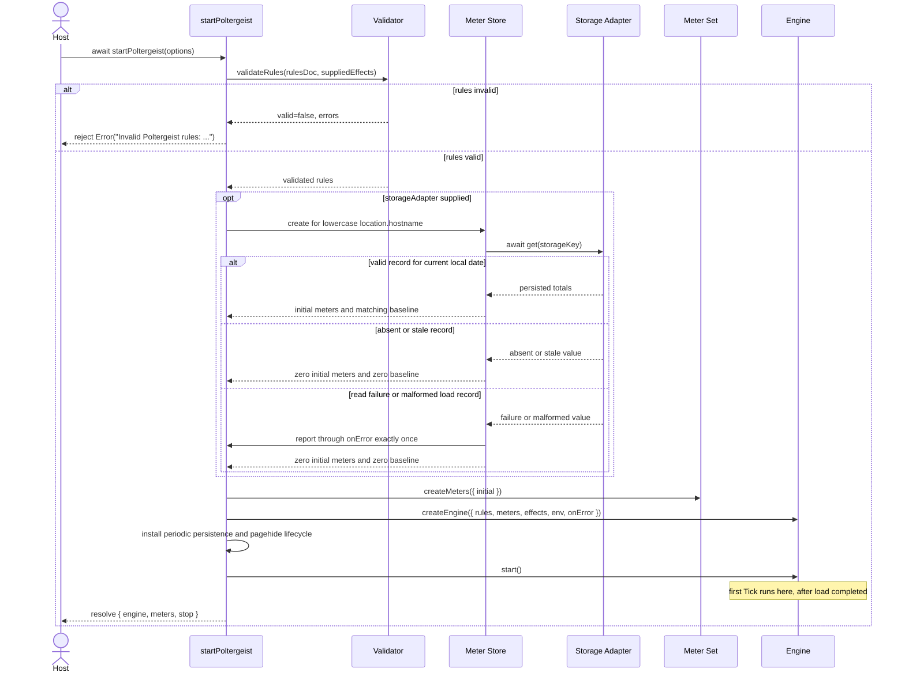
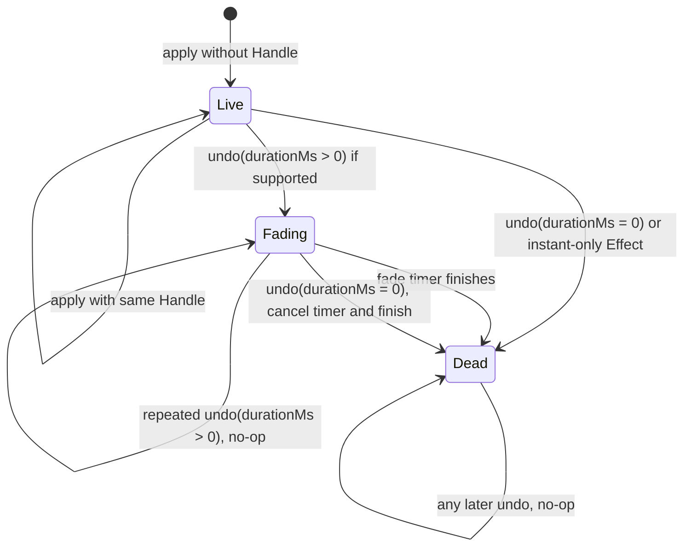

# Haunt Engine Design

## Overview

This design evolves the framework in `skeleton/` from its current synchronous, page-style-mutating implementation to the target defined by the approved requirements. The existing Rule Validator, URL Matcher, Meter Set, Engine, four built-in Effects, and `startPoltergeist` entry point remain the architectural base. Requirements 9 through 14 add inner-container scrolling, sibling overlays, registry-derived effect validation, persisted per-site meters, detached-node pruning, and restoration/browser tests.

The design treats Requirements 1 through 8 as the current compatibility baseline. Requirement 10 intentionally replaces the current Fog and Flicker writes to `documentElement` and the current Block placement under `body`. Requirement 12 intentionally replaces the synchronous entry-point and shutdown behavior. All other existing behavior remains in force.

### Current-to-target delta

| Area | Current implementation | Target design | Requirements |
|---|---|---|---|
| Scroll metering | One passive listener on `window`; one `lastScrollY` value | A viewport listener plus a document capture-phase listener, a viewport position, and per-element positions in a `WeakMap` | 3, 9 |
| Fog | `filter` and `transition` on `documentElement` | A fixed `documentElement` child using `backdrop-filter` | 6, 10 |
| Flicker | `animation` and `opacity` on `documentElement` | A fixed black `documentElement` child with animated or static opacity | 6, 10 |
| Block | Fixed overlay appended to `body` when present | Fixed overlay always appended to `documentElement` | 6, 10 |
| Effect cleanup | Shared handle teardown; duplicate positive-duration fade calls currently need stricter no-op semantics | Explicit live/fading/dead lifecycle, timer preservation for repeated fades, and immediate fade interruption | 5, 10, 14 |
| Effect validation | Fixed `EFFECT_TYPES` array and schema enum | Allowed values derived from the supplied registry, defaulting to `builtinEffects`; schema declares a string | 1, 11 |
| Rot references | Strong `Map` entries remain until undo | Detached entries are pruned before each application | 6, 13 |
| Entry point | Synchronous validation/start and synchronous `stop` | Async validation/load/start, private persistence lifecycle, async explicit stop, synchronous best-effort `pagehide` cleanup | 7, 8, 11, 12 |
| Persistence | None | Injected async adapter and a per-site delta-merging Meter Store | 12 |

### Goals

- Preserve the rule, matcher, engine, meter, and effect semantics already documented in Requirements 1 through 8 except where Requirements 10 and 12 supersede them.
- Keep `skeleton/` independent of extension APIs, storage products, and site-specific DOM selectors.
- Make every built-in visual change reversible and owned by one effect Handle.
- Load persisted meters before the first Engine Tick.
- Preserve local meter deltas across known adapter failures and serialize writes made by one Meter Store.
- Make the accepted cross-tab limitation explicit: adapter `get` plus `set` is not a transaction.
- Give third-party effect authors a stable contract without exposing Engine internals.

### Non-goals

- Atomic cross-tab updates, compare-and-swap, transactions, or a background coordinator.
- Guaranteed persistence during page termination.
- Exact five-second scheduling while a tab is throttled.
- Site-specific selectors, shadow-DOM traversal, or a `MutationObserver` for Rot Effect churn.
- A compatibility wrapper that makes the new asynchronous `startPoltergeist` return synchronously.
- Host adapter implementations inside the engine core.

### Research findings informing the design

- Chrome content scripts can obtain packaged extension files through runtime URLs, but resources loaded from a page context must be declared in `web_accessible_resources`; exposing a resource also makes it reachable to scripts on the allowed origins. The host manifest should therefore expose only the skeleton module graph and use narrow match patterns. See [Chrome content scripts](https://developer.chrome.com/docs/extensions/develop/concepts/content-scripts) and [web-accessible resources](https://developer.chrome.com/docs/extensions/reference/manifest/web-accessible-resources).
- Manifest V3 requires executable logic to ship in the extension package rather than being remotely hosted. The dynamic import described here loads packaged code only. See [Chrome's MV3 security guidance](https://developer.chrome.com/docs/extensions/develop/migrate/improve-security).
- Chrome throttles JavaScript timers in background pages, so interval callbacks are scheduling opportunities rather than exact clocks. Meter arithmetic therefore uses elapsed timestamps and cumulative snapshots. See [Chrome background-tab timer throttling](https://developer.chrome.com/blog/timer-throttling-in-chrome-88).
- `pagehide` is not guaranteed, especially on mobile. It can support a final best-effort request, but cannot provide a durability guarantee. See [MDN: `pagehide`](https://developer.mozilla.org/en-US/docs/Web/API/Window/pagehide_event).
- Listener removal must match the capture flag used at registration. The Meter Set therefore uses the same `capture: true` value during disposal. See [MDN: `removeEventListener`](https://developer.mozilla.org/en-US/docs/DOM/element.removeEventListener).
- A `WeakMap` does not keep its object keys alive, which makes it suitable for per-scroll-container positions. Rot Effect still needs an enumerable `Map` for restoration and therefore prunes it explicitly. See [MDN: `WeakMap`](https://developer.mozilla.org/en-US/docs/Web/JavaScript/Reference/Global_Objects/WeakMap).
- `backdrop-filter` affects painted content behind the overlay up to the relevant backdrop root. Real-browser checks are required for the visual result and compositing behavior. See [MDN: `backdrop-filter`](https://developer.mozilla.org/en-US/docs/Web/CSS/backdrop-filter).
- Vitest supports a jsdom environment for DOM-structure tests, while Playwright supports browser assertions and screenshot comparisons. Browser rendering varies by platform, so the required Chrome checks should favor computed-style and geometry assertions over broad pixel snapshots. See [Vitest environments](https://vitest.dev/config/environment) and [Playwright visual comparisons](https://playwright.dev/docs/test-snapshots).
- `fast-check` works with Vitest and allows an explicit `numRuns`; this design selects it for the required minimum of 100 runs per property. See [fast-check run configuration](https://fast-check.dev/docs/advanced/fuzzing/).

Content from the cited sources was rephrased for compliance with licensing restrictions.

### Delivery ordering

Implementation tasks must preserve this dependency order:

1. Implement Requirement 9 (`meters.js` capture-phase container tracking).
2. Implement Requirement 10 (Fog, Flicker, and Block overlays and teardown behavior).
3. Implement Requirement 11 (registry-driven validation and schema change).
4. Implement Requirement 13 (Rot Effect detached-node pruning).
5. Add or update the corresponding focused tests, including the Requirement 14 restoration coverage that depends on the final effect shapes.
6. Only then implement Requirement 12 (`meter-store.js`, the Storage Adapter contract, and asynchronous `index.js` integration).

Requirements 9, 10, 11, and 13 therefore precede Requirement 12. This is a hard ordering constraint because `app1-doomscroll` depends on those foundations.

## Architecture

### System boundaries



The Engine does not know about persistence. It continues to consume the synchronous Meter Set interface. The Entry Point owns orchestration, while the Meter Store owns asynchronous load, delta writes, write serialization, and persistence timers.

### Startup sequence



`startPoltergeist` is declared `async`, so validation failures reject its Promise even though validation executes before the first `await`. No Env, Meter Set, Engine, persistence timer, lifecycle listener, or adapter operation is created before successful validation.

When no adapter is supplied, the optional storage branch is skipped. The Meter Set starts from `initialMeters`, with omitted persisted meters defaulting to zero, and no persistence interval or storage operation is created. When the initial adapter read throws or rejects, startup reports one error, uses zeros rather than `initialMeters`, and still resolves normally.

### Shutdown sequences

The Entry Point implements one private `beginShutdown(mode)` guarded by a `stopping` flag and a cached `stopPromise`.

**Explicit `await stop()`**

1. If shutdown already began, return the cached Promise.
2. Read `meters.values()` synchronously before calling `engine.stop()`.
3. Cancel the five-second persistence interval.
4. Queue one final write with the captured values. If another write is in flight, the final snapshot becomes the latest pending snapshot.
5. Call `engine.stop()` immediately. This clears evaluation timers, interrupts fades, and undoes active Effects synchronously; it does not wait for storage.
6. Dispose the Meter Set and remove the `pagehide` listener.
7. Return a Promise that resolves after the current write and the queued final write have settled. Adapter failures are reported and consumed, so cleanup completion is represented by resolution rather than rejection.

**Non-awaitable `pagehide`**

1. Run the same idempotency guard and synchronous meter capture.
2. Cancel the persistence interval and issue the final queued write without awaiting it.
3. Stop the Engine, dispose meters, and remove the listener synchronously.
4. Retain no claim that the browser will keep the page alive long enough for the Promise to finish.

Only the first explicit stop or `pagehide` path issues the final write. A later call returns the cached final-drain Promise and performs no second cleanup.

### Manifest V3 host loading

The engine core remains an ES-module graph. An MV3 content-script bootstrap owned by an app can load it as packaged code:

```js
// Host-side example, outside skeleton/.
const { startPoltergeist } = await import(
  chrome.runtime.getURL('skeleton/index.js')
);

const storageAdapter = {
  async get(key) {
    const result = await chrome.storage.local.get(key);
    return result[key];
  },
  async set(key, value) {
    await chrome.storage.local.set({ [key]: value });
  },
};

const ghost = await startPoltergeist({ rules, storageAdapter });
```

The app manifest declares `skeleton/index.js` and every statically imported JavaScript dependency in its `web_accessible_resources` entry for only the origins where that app runs. A constrained wildcard such as `skeleton/*.js` plus `skeleton/effects/*.js` is acceptable when it maps exactly to the shipped core graph; explicit paths reduce exposure further. `use_dynamic_url` may be enabled as defense in depth. All imported JavaScript remains locally packaged to satisfy MV3 CSP and remote-code rules.

Target production `.js` files under `skeleton/`, including their comments, contain no exact case-sensitive `chrome.` token. All extension API references, including the dynamic import URL and the extension storage adapter, remain in app-owned integration files such as `app1-doomscroll/` or `app2-tab-graveyard/`. The demo owns an async wrapper around `localStorage` under `demo-site/`. No host adapter lives in `skeleton/`.

The eventual `index.js` usage comment therefore shows only core-level usage:

```js
const ghost = await startPoltergeist({ rules, storageAdapter });
```

It cannot show the host dynamic-import call or any extension API access. A source-scan test enforces this boundary.

## Components and Interfaces

### Concrete module layout

#### Production core

| File | Plan | Responsibilities and requirement mapping |
|---|---|---|
| `skeleton/index.js` | Modify | Make `startPoltergeist` async; validate with the exact supplied registry; load persisted meters before constructing meters/engine; install periodic and shutdown lifecycle; expose exact `{ engine, meters, stop }`; forward `onError`; update the usage comment to awaited startup with injected storage and no forbidden token. Requirements 7, 8, 11.6, 12.6, 12.12, 12.23-33. |
| `skeleton/engine.js` | Keep persistence-free; update contract comments only if needed | Preserve URL re-read, intensity, active/fading state, immediate start Tick, restart, effect isolation, and synchronous cleanup. It receives the selected registry and shared error reporter from `index.js`; it never calls storage. Requirements 4, 5, 7.1-6, 7.9. |
| `skeleton/meters.js` | Modify | Add document capture-phase scroll handling, viewport normalization, per-element `WeakMap` baselines, and matching listener removal while retaining visibility/time behavior. Requirements 3 and 9. |
| `skeleton/meter-store.js` | Add | Derive site/storage keys and local date; validate records; load seed values; hold last-success baselines; serialize/coalesce writes; merge nonnegative deltas; schedule/cancel five-second writes; report adapter failures. Requirement 12. |
| `skeleton/storage-adapter.js` | Add | Export a JSDoc `StorageAdapter` contract only. It contains no browser- or product-specific adapter and has no global API dependency. Requirements 12.1-6. |
| `skeleton/validator.js` | Modify | Accept an optional Effect Registry, derive allowed own string keys, default to `builtinEffects`, preserve non-mutation, and export default `EFFECT_TYPES` derived from built-in keys. Requirements 1 and 11. |
| `skeleton/rule-schema.json` | Modify | Replace the `effect.type` enum with `{ "type": "string" }`; retain all structural constraints. Runtime registry membership remains hand-validated. Requirements 1 and 11.7. |
| `skeleton/match.js` | No target change | Continue compiling/caching match patterns and evaluating the current URL. Requirement 2. |
| `skeleton/effects/index.js` | Keep registry composition; update comments if needed | Continue exposing exactly `fog`, `flicker`, `rot`, and `block`. It is the source for default validator effect names. Requirements 6.19, 11.3-4, 11.7-8. |
| `skeleton/effects/fog.js` | Modify | Own one fixed Fog Overlay per Handle, use `backdrop-filter`, update in place, and support interruptible fade removal. Requirements 5, 6, 10.1, 10.3-4, 10.7-9, 10.11-15. |
| `skeleton/effects/flicker.js` | Modify | Own one fixed black Flicker Overlay and one style element per Handle, animate opacity or use a static reduced-motion opacity, update in place, and always remove synchronously. Requirements 5, 6, 10.2, 10.5-7, 10.10-15. |
| `skeleton/effects/block.js` | Modify | Append the fixed Block Overlay directly to `documentElement`, preserve intensity/pointer blocking/fade behavior, and never style page roots. Requirements 5, 6.13-18, 10.11-16. |
| `skeleton/effects/rot.js` | Modify | Prune detached text-node entries before walking the body, then retain deterministic rot/update/undo behavior. Requirements 6.8-12, 6.20, 13. |
| `skeleton/effects/util.js` | Modify | Formalize live/fading/dead teardown: repeated positive fades are no-ops with the original timer intact; zero-duration undo cancels a pending fade and finishes once; dead/missing Handles are ignored. Requirements 5.7-11. |

#### Planned tests under `skeleton/`

| File | Plan |
|---|---|
| `skeleton/test/meters.test.js` | Extend for capture registration/removal, target normalization, first-element baseline, independent containers, viewport plus container sums, same-position events, and disposal. |
| `skeleton/test/validator.test.js` | Extend for custom/default/empty registries, input immutability, schema shape, and built-in key synchronization. |
| `skeleton/test/engine.test.js` | Extend lifecycle/error/fade cases as needed without coupling Engine to storage. |
| `skeleton/test/index.test.js` | Add async startup order, exact result shape, no-adapter behavior, validation-before-storage, load failure, explicit stop, `pagehide`, and idempotency tests. |
| `skeleton/test/meter-store.test.js` | Add record/date/key, delta, coalescing, failure, daily reset, and property tests. |
| `skeleton/test/effects.test.js` | Add jsdom structural, update-in-place, complete restoration, fade, interruption, reduced-motion, idempotency, composition-order, and Rot pruning tests. |
| `skeleton/test/source-boundary.test.js` | Add recursive exact-text scan over production `.js` files under `skeleton/`, excluding `skeleton/test/`, for the prohibited case-sensitive token. |
| `skeleton/test/browser/effects.pw.js` | Add real-Chrome computed-style and geometry coverage for Requirement 10.13-14; the `.pw.js` suffix keeps it outside Vitest's test match. |

A later implementation phase will add test-runner configuration and dependencies outside `skeleton/` for jsdom, Playwright, and `fast-check`. This design phase changes only `design.md`.

### Entry Point API and orchestration

Target public shape:

```js
async function startPoltergeist({
  rules,
  window = globalThis.window,
  document = window.document,
  effects = builtinEffects,
  tickMs = DEFAULT_TICK_MS,
  initialMeters,
  storageAdapter,
  onError = defaultOnError,
} = {}) => Promise<{ engine, meters, stop }>
```

`stop` has the shape `() => Promise<void>`. The returned object has exactly those three own properties. The Meter Store remains private to prevent callers from bypassing the lifecycle and issuing overlapping writes.

Orchestration pseudocode:

```js
async function startPoltergeist(options = {}) {
  const effects = options.effects === undefined ? builtinEffects : options.effects;
  const validation = validateRules(options.rules, effects);
  if (!validation.valid) throw invalidRulesError(validation.errors);

  const win = options.window ?? globalThis.window;
  const doc = options.document ?? win.document;
  const report = options.onError ?? defaultOnError;

  let store;
  let initial;
  if (options.storageAdapter) {
    store = createMeterStore({
      adapter: options.storageAdapter,
      siteKey: win.location.hostname.toLowerCase(),
      onError: report,
      nowDate: () => new Date(),
      setInterval: (fn, ms) => win.setInterval(fn, ms),
      clearInterval: (id) => win.clearInterval(id),
    });
    initial = await store.load();
  } else {
    initial = options.initialMeters;
  }

  const meters = createMeters({ window: win, document: doc, initial });
  const env = createEffectEnv(win, doc);
  const engine = createEngine({
    rules: validation.rules,
    meters,
    effects,
    env,
    getUrl: () => win.location.href,
    tickMs: options.tickMs ?? DEFAULT_TICK_MS,
    onError: report,
  });

  if (store) store.startPeriodic(() => meters.values(), 5000);
  const stop = createIdempotentStop({ store, meters, engine, window: win });
  win.addEventListener('pagehide', stop.onPageHide);
  engine.start();
  return { engine, meters, stop: stop.explicit };
}
```

Window/document resolution occurs only after validation, so even environment lookup cannot trigger runtime construction on invalid rules. `createEffectEnv` retains the live `reducedMotion` getter and bound timer functions. The exact same `effects` object used by the Engine is passed to validation before any Env or persistence object is created.

### Engine integration

The Engine remains a synchronous state machine:

- One Tick reads the URL once, updates meters once, then evaluates enabled rules.
- `apply` creates a Handle only when it returns a non-`undefined` value.
- A live Handle is updated only when intensity changes by at least 0.01.
- An inactive or unmatched rule is removed from `active` before `undo` is called.
- A fading Handle is tracked separately. Retriggering first forces `undo(..., { durationMs: 0 })` on the old Handle, then creates a new Handle.
- `stop()` remains synchronous. This lets the Entry Point restore the DOM without waiting for storage.
- Effect exceptions are reported once for that operation, do not abort evaluation of later rules, and do not turn an undefined/failed application into active state.

Persistence observes the Meter Set from outside the Engine. This avoids async Tick behavior and keeps the 250 ms evaluation interval independent from the five-second storage interval.

### Third-party Effect contract after Requirement 10

Every registry entry has this public shape:

```js
{
  description: string,
  apply(env, params, intensity, existingHandle?) => Handle | undefined,
  undo(handle, { durationMs = 0 } = {}) => void,
}
```

#### Application and updates

- `description` is a human-readable string with no runtime side effects.
- `intensity` is treated as a value in `[0, 1]`. Built-ins clamp defensively; third-party Effects should do the same.
- On first application, `existingHandle` is absent. The Effect creates all owned DOM/style resources and returns an opaque Handle.
- On update, `existingHandle` is the same live Handle returned earlier. The Effect updates its resources in place and returns that Handle. It must not create duplicate artifacts, change overlay identity, or discard cleanup state.
- Returning `undefined` tells the Engine that application failed or intentionally produced no active effect. The Engine does not record the rule as active.
- `apply` is synchronous. Third-party code must not return a Promise because Tick and cleanup ordering depend on an immediate Handle.

#### Handle lifecycle

A Handle is opaque to the Engine. Built-in Effects and the shared teardown helper maintain these lifecycle concepts internally:

```js
{
  env,                 // exact environment used at creation
  dead: false,
  fading: false,
  timer: null,
  // effect-owned element/style/map references and immutable restoration data
}
```

State transitions are:



`finish` runs at most once. An Effect removes only nodes/listeners/styles it owns. It does not restore a guessed value over page changes. For any page state it temporarily replaces, it captures the exact prior inline value and restores it only according to that Effect's documented conflict policy. After Requirement 10, the overlay Effects do not need to capture or restore root styles because they never write them.

#### Cleanup, fades, and errors

- `undo(handle, { durationMs: 0 })` completes cleanup before returning.
- A fade-capable Effect may begin a transition and schedule final removal for a positive duration. A repeated positive-duration call leaves the first timer and transition unchanged.
- A zero-duration call during a fade cancels that timer and finishes immediately.
- Instant-only Effects may ignore a positive duration but must still fully clean up in the same call.
- Missing or dead Handles are accepted as no-ops.
- Effect code should make cleanup internally idempotent even though the Engine also guards state.
- The Engine catches synchronous `apply`/`undo` exceptions, calls `onError(error, rule)` once for the failed operation, and continues other rules. An Effect must not rely on a later retry to repair partial DOM work; it should construct resources before attaching them where practical and make `undo` tolerant of already-removed nodes.

#### DOM ownership and stacking

The built-in overlay stack is exact:

| Effect | Parent | Position | z-index | Pointer behavior |
|---|---|---|---:|---|
| Fog | `documentElement` | fixed, `top/right/bottom/left: 0` | 2147483645 | `none` |
| Flicker | `documentElement` | fixed, `top/right/bottom/left: 0` | 2147483646 | `none` |
| Block | `documentElement` | fixed, `top/right/bottom/left: 0` | 2147483647 | `none` below `blockAt`, `auto` at or above it |

All three are direct siblings under `documentElement`, whether or not `body` exists. The Effect contract prohibits writing inline style properties to `documentElement` or `body`; whole-page visuals use owned sibling overlays instead. Fog, Flicker, and Block therefore leave the pre-apply root/body `style` attributes byte-for-byte unchanged through apply, update, and undo. A third-party Effect removes only its own nodes, styles, timers, and listeners.

#### Built-in overlay behavior

- **Fog:** the transparent Fog Overlay receives `backdrop-filter: blur(Bpx) grayscale(G)`, where `B = maxBlur * clamp01(intensity)` and `G = maxGrayscale * clamp01(intensity)`. A live update modifies this element. Positive-duration undo transitions its `backdrop-filter` to `blur(0px) grayscale(0)` and then removes it; zero-duration undo removes it immediately.
- **Flicker:** the Flicker Overlay has a black background. Without reduced motion, it uses an infinite `pg-flicker` opacity animation with period `periodMs`, minimum opacity 0, and a peak equal to `maxDepth * clamp01(intensity)`. The owned style rule can refer to an overlay-scoped custom property so multiple Handles share the required keyframe name without sharing peak values. With reduced motion, animation is cleared and static opacity is `maxDepth * clamp01(intensity) * 0.5`. Undo removes both overlay and owned style immediately for every duration.
- **Block:** the Block Overlay keeps its existing message, opacity, status role, and threshold-based pointer behavior, but is now a `documentElement` child. Positive-duration undo disables pointer events and fades its own opacity before removal.

`env.reducedMotion` remains a getter. A motion-producing Effect reads it on every `apply` invocation, including updates, and chooses a non-animated static alternative when true. The Effect contract does not require an Effect to subscribe to media-query changes between Engine updates. If a third-party Effect adds such a listener, its Handle owns and removes that listener.

### Meter Set and scroll-target normalization

The Meter Set keeps time-based state unchanged and adds two scroll paths:

```js
let lastWindowScrollY = window.scrollY ?? 0;
const lastElementScrollTop = new WeakMap();

document.addEventListener('scroll', onDocumentScroll, {
  capture: true,
  passive: true,
});
window.addEventListener('scroll', onWindowScroll, { passive: true });
```

The window is initialized at Meter Set creation, preserving Requirement 3.4: its first later movement is measured from the initial `scrollY`. New element targets are not pre-discovered; their first observed event records `scrollTop` and contributes zero.

Target normalization follows these rules:

1. A direct window listener event uses the viewport token and reads `window.scrollY ?? 0`.
2. A document-capture event targeted at `document`, `document.scrollingElement`, or the element currently representing the viewport also uses the viewport token. If both listeners observe the same viewport movement, the second observation adds zero because both share `lastWindowScrollY`.
3. Any other Element-like target with a numeric `scrollTop` is an inner Scroll Container and uses its own `WeakMap` entry.
4. An unrecognized target is ignored without throwing.

For an existing target with previous position `p` and current position `q`, the contribution is `|q - p|`, after which `q` becomes the previous position. Equal positions contribute zero. Contributions from viewport and element targets all add to one `scrollDistance` counter.

`dispose()` removes the document listener with the same callback and `capture: true`, and removes the window and visibility listeners with their registration capture settings. The `WeakMap` permits detached element targets to be collected; no enumeration or explicit clearing is required.

### Registry-derived Rule Validator

The validator obtains allowed Effect types per invocation:

```js
const allowedTypes = Object.keys(effectsRegistry);
```

Only own enumerable string keys count. Validation checks that `effect.type` is a string and is included in that list. It never writes to the Rule or registry. Error output uses a deterministic key order and an explicit bracketed list, including `[]` for an empty registry.

Public call shapes preserve the existing path-aware single-rule helper while adding registry injection:

```js
validateRule(rule, path = 'rule', effects = builtinEffects) => string[]
validateRule(rule, effectsRegistry) => string[] // convenience overload; path is "rule"
validateRules(document, effects = builtinEffects) => {
  valid: boolean,
  errors: string[],
  rules: Rule[],
}
```

The overload distinguishes a string path from an object registry, preserving existing path-aware calls while making direct custom-registry validation natural. `validateRules` passes its selected registry to every `validateRule` call. `startPoltergeist` passes the exact selected registry object to `validateRules` and later to `createEngine`.

`EFFECT_TYPES` is an immutable snapshot of `Object.keys(builtinEffects)` and remains a public export for default-registry introspection and schema-sync testing. `rule-schema.json` validates `effect.type` as a string but does not enumerate runtime registry values. The sync test verifies:

- Meter and undo enums still match their validator constants.
- The schema's effect type is a string and has no enum.
- The set of `EFFECT_TYPES` equals the set of `builtinEffects` keys.

### Rot Effect detached-node pruning

`rot.apply` performs pruning immediately after it has a live Handle and before it reads `document.body` or starts a tree walk:

```js
for (const [node] of handle.nodes) {
  if (!node.isConnected) handle.nodes.delete(node);
}
```

Deletion does not inspect or modify `node.data`. Connected entries and their `{ orig, out, serial }` values pass through the pruning phase unchanged. The existing walk can then update connected entries if page text changed, discover new nodes, and apply deterministic rot.

The enumerable `Map` remains necessary because undo must inspect every retained node and conditionally restore it. Undo still restores only when `node.data === entry.out`, leaves page-rewritten text unchanged, and clears the Map. A detached entry can survive until the next `apply` or `undo`, but every `apply` removes it before other processing. No observer or background pruning process is added.

### Meter Store

#### Public core interface

```js
createMeterStore({
  adapter,
  siteKey,
  onError,
  nowDate = () => new Date(),
  setInterval,
  clearInterval,
}) => {
  load(): Promise<MeterSeed>,
  requestWrite(snapshot: MeterSnapshot): Promise<void>,
  startPeriodic(readMeters: () => MeterSnapshot, periodMs = 5000): void,
  stopPeriodic(): void,
}
```

`load()` is called exactly once before periodic or final writes. `requestWrite` copies the two persisted meter values synchronously so later mutation cannot change the queued snapshot. The method returns a drain Promise that settles after that snapshot or a newer coalesced snapshot has been processed. All adapter errors are caught and reported through `onError` once per failed operation.

#### Storage Adapter contract

`storage-adapter.js` exports a JSDoc type, with no implementation tied to a host:

```js
/**
 * @typedef {object} StorageAdapter
 * @property {(key: string) => Promise<unknown>} get
 * @property {(key: string, value: MeterRecord) => Promise<void>} set
 */
export {};
```

A synchronous throw is equivalent to a rejected Promise. A resolved `set` means the supplied value was written. In the required failure model, a rejected `set` is a failed, non-committed operation; if an adapter can report an ambiguous outcome after committing, exactly-once retry cannot be guaranteed and that adapter is outside the contract's guarantee.

#### Key and date helpers

- Site key: `window.location.hostname.toLowerCase()`. It excludes port, path, query, and fragment by construction.
- Storage key: ``poltergeist:meters:v1:${encodeURIComponent(siteKey)}``. The prefix/version and encoding make the mapping deterministic and collision-resistant for hostnames, including an empty hostname.
- Date: local `YYYY-MM-DD`, built from `getFullYear()`, `getMonth() + 1`, and `getDate()` with two-digit padding. `toISOString()` is not used because it is UTC-based.

#### Load

The Store reads one key. A same-date record with a string date and finite, nonnegative `timeOnSite` and `scrollDistance` seeds both the Meter Set and baseline. An absent or stale-date record yields zeros without an error. A malformed record yields zeros and one `onError` notification. A thrown/rejected `get` also yields zeros and one notification. `timeSinceActive` is neither read nor persisted and starts at zero through Meter Set behavior.

#### Delta write and same-store serialization

```mermaid
sequenceDiagram
    participant Caller
    participant Queue as Store queue
    participant Store
    participant Adapter

    Caller->>Queue: requestWrite(meters.values())
    Note over Queue: copy timeOnSite and scrollDistance synchronously
    alt another Store write is active
        Queue->>Queue: replace pending snapshot with latest snapshot
        Queue-->>Caller: Promise for queue drain
    else Store is idle
        Queue->>Store: begin write(snapshot)
        Store->>Adapter: await get(storageKey)
        alt get fails
            Adapter-->>Store: throw/reject
            Store->>Store: report once; keep baseline
        else get succeeds
            Adapter-->>Store: current value or undefined
            Store->>Store: sample local date
            Store->>Store: absent/malformed/stale => persisted totals (0,0)
            Store->>Store: d = max(snapshot - lastSuccessBaseline, 0) per field
            alt both deltas are zero
                Store->>Store: skip set; keep baseline
            else at least one delta is positive
                Store->>Adapter: await set(key, persisted totals + d, current date)
                alt set succeeds
                    Adapter-->>Store: resolved
                    Store->>Store: advance each nonnegative component baseline to snapshot
                else set fails
                    Adapter-->>Store: throw/reject
                    Store->>Store: report once; keep baseline
                end
            end
        end
        Store->>Queue: settle current; run latest pending snapshot if present
        Queue-->>Caller: resolve when queue drains
    end
```

The queue allows only one `get`/`set` chain from a Store at a time. While busy, it retains the latest cumulative snapshot rather than every intermediate snapshot. Once the current operation settles, that latest value subsumes older pending values:

- After success at snapshot `C1`, baseline becomes `C1`; a pending `C2` contributes `max(C2 - C1, 0)`.
- After failure, baseline remains `B`; a pending `C2` retries the full `max(C2 - B, 0)`.

Baseline advancement is component-wise. For meter component `i`, with baseline `B_i` and captured `C_i`:

```text
D_i = max(C_i - B_i, 0)
B'_i = C_i  only if set succeeds and C_i >= B_i
B'_i = B_i  if C_i < B_i or the operation fails
```

If both `D_i` values are zero, no `set` occurs and no baseline component advances. This includes an unchanged snapshot and a snapshot where both counters moved backward.

On every write, an absent, malformed, or different-date current record supplies persisted totals `(0, 0)`. The Store writes the current local date. This is the specified daily reset. A delta whose measurement interval crosses midnight is attributed according to the write-time reset and last-success baseline; no extra midnight timer or in-memory meter reset is introduced.

#### Periodic and final writes

`startPeriodic` schedules a best-effort request every 5000 ms through the injected window timer. Callback delay does not alter delta arithmetic because snapshots contain cumulative meter values. `stopPeriodic` is idempotent and clears the timer.

Explicit stop captures a snapshot, cancels the interval, queues that snapshot, performs synchronous Engine/Meter cleanup, and returns the Store drain Promise. `pagehide` performs the same capture/cancel/queue operation but discards the Promise before synchronous cleanup. If no adapter exists, neither timer nor Store exists and `stop` resolves after synchronous cleanup.

#### Cross-tab arithmetic and limitation

Treat the two persisted meters as vectors with component-wise addition.

For one tab, let a valid same-date stored value and initial baseline be `S >= 0`. If local activity adds `D >= 0`, then captured meters are `C = S + D`, the computed delta is `C - S = D`, and a successful write stores `S + D`. A subsequent same-date load returns `S + D`.

For two tabs that both loaded initial value `S`, let their local deltas be `D1` and `D2`. If complete read-modify-write operations are serialized:

```text
Tab 1: get S       -> set S + D1
Tab 2: get S + D1  -> set S + D1 + D2
```

The reverse serialized order produces the same sum. This is the Requirement 12.35 guarantee.

The adapter exposes no transaction or compare-and-swap. With simultaneous operations, both tabs can read `S`, then write `S + D1` and `S + D2`; the last write wins and loses the other tab's delta for that cycle. The design does not claim strict cross-tab correctness for this interleaving. An adapter-level atomic increment, CAS loop, Web Locks coordinator, or extension-background serialization could address it later, but all are out of scope.

## Data Models

### Rule and registry

```js
/** @typedef {{
 *   id: string,
 *   description?: string,
 *   enabled?: boolean,
 *   match: string[],
 *   trigger: { meter: 'timeOnSite'|'scrollDistance'|'timeSinceActive', threshold: number, rampTo?: number },
 *   effect: { type: string, params?: Record<string, unknown> },
 *   undo: { mode: 'instant'|'fade', durationMs?: number },
 * }} Rule */

/** @typedef {Record<string, {
 *   description: string,
 *   apply: Function,
 *   undo: Function,
 * }>} EffectRegistry */
```

A registry's own keys are its runtime effect-type enum. `builtinEffects` has exactly four keys: `fog`, `flicker`, `rot`, and `block`.

### Meter values

```js
/** @typedef {{
 *   timeOnSite: number,
 *   scrollDistance: number,
 *   timeSinceActive: number,
 * }} MeterValues */

/** @typedef {{
 *   timeOnSite: number,
 *   scrollDistance: number,
 * }} MeterSnapshot */

/** @typedef {MeterSnapshot} MeterSeed */
```

All persisted values are finite and nonnegative. `timeSinceActive` is transient.

### Persisted record

```js
/** @typedef {{
 *   date: string,           // local YYYY-MM-DD
 *   timeOnSite: number,     // cumulative seconds for site/date
 *   scrollDistance: number, // cumulative pixels for site/date
 * }} MeterRecord */
```

Record validity is all-or-nothing. A malformed field discards the complete record rather than mixing trusted and untrusted components.

### Meter Store state

```js
{
  adapter: StorageAdapter,
  storageKey: string,
  baseline: { timeOnSite, scrollDistance },
  inFlight: Promise<void> | null,
  pendingSnapshot: MeterSnapshot | null,
  drainWaiters: Set<Function>,
  intervalId: unknown | null,
  loaded: boolean,
}
```

`baseline` means the local meter values represented by the last successful write, or the same-date loaded seed if no write has succeeded. It is not the latest persisted total from other tabs.

### Scroll state

```js
{
  lastWindowScrollY: number,
  lastElementScrollTop: WeakMap<Element, number>,
  disposed: boolean,
}
```

The viewport state is separate because `window` position is known at creation and document/window events can describe the same movement. Element positions are weakly keyed by target identity.

### Effect Handle models

Common lifecycle fields:

```js
{ env, dead: boolean, fading: boolean, timer: unknown | null }
```

Effect-owned fields:

- Fog: `{ overlay }`.
- Flicker: `{ overlay, style }`.
- Block: `{ overlay }`.
- Rot: `{ nodes: Map<Text, { orig, out, serial }>, serial }`.

Overlay Handles never store prior `documentElement` or `body` styles because those nodes are never modified. Handle references are removed from Engine active/fading maps after cleanup; owned DOM nodes and timers are removed during finish.


## Correctness Properties

*A property is a characteristic or behavior that should hold true across all valid executions of a system-essentially, a formal statement about what the system should do. Properties serve as the bridge between human-readable specifications and machine-verifiable correctness guarantees.*

The prework classified pure validation, matching, arithmetic, state-machine, transformation, and persistence behavior as suitable for property-based testing. Property reflection consolidated criteria that express the same invariant: validator field checks become one reference-model property; Engine activation/removal cases become one state-model property; Block's above/below threshold cases become one equivalence; delta calculation, negative clamping, zero-write suppression, and component baseline advancement become one arithmetic property; and Rot pruning criteria become one exact-partition property. Concrete DOM shape, timer call order, async lifecycle boundaries, repository configuration, and real-browser layout remain example, smoke, or integration tests. Requirement 12.22 is deliberately not converted into a strict accumulation property because it defines an accepted non-atomic interleaving.

### Property 1: Rule validation agrees with the structural reference model

For all rule-document values, the Rule Validator reports every violated structural/field predicate and every duplicate id without short-circuiting, and it returns `valid: true` with the original full rule list exactly when the error list is empty; otherwise it returns `valid: false` with an empty rule list.

**Validates: Requirements 1.1, 1.2, 1.3, 1.4, 1.5, 1.6, 1.7, 1.8, 1.9, 1.10, 1.11, 1.12, 1.13, 1.14, 1.15, 1.16**

### Property 2: URL matching agrees with component-wise OR semantics

For all pattern lists and URL strings, `matchUrl` is true exactly when the URL is parseable and at least one valid pattern matches its allowed scheme, case-insensitive host, and complete case-sensitive pathname-plus-search according to the wildcard rules; invalid patterns are inert, fragments are irrelevant, and unparseable URLs yield false.

**Validates: Requirements 2.1, 2.2, 2.3, 2.4, 2.5, 2.6, 2.7, 2.8, 2.9, 2.11**

### Property 3: Pattern compilation is repeatable and cached

For all pattern strings and all positive repetition counts, repeated compilation returns the same cached compiled value and repeated matching produces the same validity and match result.

**Validates: Requirements 2.10**

### Property 4: Time meters agree with the visibility state model

For all finite sequences of injected clock readings, visibility transitions, and matched flags, `timeOnSite` equals its initial value plus only nonnegative elapsed visible-and-matched seconds, `timeSinceActive` is zero while visible and otherwise equals the nonnegative elapsed time from the last active instant, and backward clock steps add no elapsed time.

**Validates: Requirements 3.1, 3.2, 3.3, 3.5, 3.6, 3.7, 3.8, 3.11**

### Property 5: Scroll distance is the summed path length per target

For all finite interleavings of viewport and element scroll positions, `scrollDistance` equals its initial value plus the sum of absolute consecutive position differences independently per target, where the viewport starts from its creation-time `scrollY`, each element's first event establishes a zero-contribution baseline, and repeated equal positions contribute zero.

**Validates: Requirements 3.4, 9.1, 9.3, 9.4, 9.6, 9.7**

### Property 6: Intensity follows the bounded monotone ramp

For all finite meter values and Trigger-shaped inputs with a finite threshold, a missing or non-increasing `rampTo` produces intensity 1; otherwise intensity equals the specified linear fraction clamped to `[0.01, 1]`, remains within that interval, and never decreases as the meter value increases.

**Validates: Requirements 4.1, 4.2**

### Property 7: Engine transitions agree with an active-rule state model

For all finite sequences of rule sets, URLs, meter values, and synchronous Effect outcomes, each Tick updates meters once with the any-match flag; applies exactly newly eligible successful rules; reuses Handles only for intensity changes of at least 0.01; leaves disabled, missing-effect, failed, and undefined-Handle rules inactive as specified; undoes rules that become ineligible, disabled, or removed; returns the corresponding disjoint change arrays; and exposes exactly the modeled active ids.

**Validates: Requirements 4.4, 4.5, 4.6, 4.7, 4.8, 4.9, 4.10, 4.11, 4.12, 4.13, 5.1, 5.2, 5.3, 5.5, 5.6**

### Property 8: Teardown finishes each Handle at most once

For all finite sequences of positive- and zero-duration teardown calls on a live Handle, at most one fade begins, repeated positive calls preserve the first pending timer, the first zero-duration call cancels any pending timer and finishes immediately, timer completion finishes once, and every call after death is a no-op.

**Validates: Requirements 5.7, 5.8, 5.9, 5.10, 5.11**

### Property 9: Rot is deterministic and monotone by intensity

For all eligible text, node serials, nonempty glyph sets, valid maximum fractions, and intensities `0 <= i1 <= i2 <= 1`, repeated Rot transformation with identical inputs yields identical text and every character position changed at `i1` is also changed at `i2`, while whitespace positions remain unchanged.

**Validates: Requirements 6.8, 6.9**

### Property 10: Rot adopts rewrites and restores conditionally

For all eligible text nodes and arbitrary page replacement strings, reapplying Rot after the page changes a previously rotted node adopts the replacement as the new original; undo restores nodes still equal to Rot's last output and preserves nodes changed again by the page.

**Validates: Requirements 6.11, 6.12**

### Property 11: Fog overlay scaling is exact and monotone

For all finite nonnegative `maxBlur` and `maxGrayscale` values and all intensities in `[0, 1]`, the Fog Overlay's blur and grayscale equal the configured maxima multiplied by intensity, both equal zero at intensity zero, and neither decreases when intensity increases.

**Validates: Requirements 10.3, 10.4**

### Property 12: Flicker maps parameters to the selected motion mode

For all finite nonnegative depths, positive periods, and intensities in `[0, 1]`, normal-motion Flicker has an infinite animation with the configured period, zero minimum, and peak `maxDepth * intensity`, while reduced-motion Flicker has no animation and static opacity `maxDepth * intensity * 0.5`.

**Validates: Requirements 10.5, 10.6**

### Property 13: Block opacity and interaction follow intensity

For all valid Block parameters and intensities in `[0, 1]`, overlay opacity equals `maxOpacity * intensity`, its text equals the configured message, and pointer events are `auto` exactly when intensity is at least `blockAt` and `none` otherwise.

**Validates: Requirements 6.14, 6.15, 6.16**

### Property 14: Built-in updates and cleanup preserve ownership invariants

For all built-in Effects, static fixture documents, and finite sequences containing at least three distinct intensities in `[0, 1]`, live updates reuse the same Handle and owned artifact identities without increasing artifact counts, never alter the inline `style` attributes of `documentElement` or `body`, and repeated instant undo leaves the same fully restored snapshot as the first undo without throwing.

**Validates: Requirements 6.20, 10.7, 10.10, 10.12, 14.2, 14.3, 14.7**

### Property 15: Effect validation is registry membership and is pure

For all otherwise valid rules, Effect Registries, and candidate Effect type values, validation with a supplied registry accepts the type exactly when it is a string equal to an own registry key; validation without a supplied registry uses exactly the `builtinEffects` keys; validation changes neither rule nor registry; and every rejection lists the complete selected key set, including the empty set.

**Validates: Requirements 8.6, 11.1, 11.2, 11.3, 11.4, 11.5**

### Property 16: Site partition keys and local dates are deterministic

For all parseable page URLs and local Date values, the site key is exactly the lowercased hostname with no port, path, query, or fragment; equal site keys produce equal versioned storage keys; and the record date is the zero-padded local calendar `YYYY-MM-DD` rather than the UTC date.

**Validates: Requirements 12.7, 12.8, 12.9**

### Property 17: Stored record validation and daily reset are all-or-nothing

For all candidate stored values and local dates, load preserves both persisted meters exactly when the value is a complete nonnegative finite record for the current date; absent or stale values produce zeros; malformed values produce zeros and one error; and write-time absent, malformed, or stale values contribute zero persisted base before local deltas are added.

**Validates: Requirements 12.13, 12.14, 12.15, 12.17**

### Property 18: Delta arithmetic is nonnegative and baseline advancement is success-only

For all nonnegative finite persisted totals, baselines, and captured meter vectors, a write adds `max(captured - baseline, 0)` component-wise; skips `set` when both components are zero; advances on success only those baseline components whose captured value did not move backward; and leaves every baseline component unchanged when its delta is negative or the operation does not successfully set.

**Validates: Requirements 12.10, 12.16, 12.18, 12.19**

### Property 19: Single-tab persistence round trip preserves totals

For all nonnegative finite same-date stored vectors `S` and local activity vectors `D`, loading `S`, reaching local meters `S + D`, successfully writing, and loading again produces exactly `S + D` for both persisted meters.

**Validates: Requirements 12.34**

### Property 20: Serialized two-tab writes accumulate commutatively

For all nonnegative finite initial vectors `S` and tab-local deltas `D1` and `D2`, if the two complete tab writes do not interleave, either serial order stores exactly `S + D1 + D2` component-wise.

**Validates: Requirements 12.35**

### Property 21: Failed writes retain the full retry delta

For all nonnegative finite baselines and later captured vectors, if one Store `get` or `set` operation fails under the contract's non-commit failure model, the baseline remains unchanged and the next successful write includes exactly the full nonnegative delta from that unchanged baseline, with one error report for the failed operation.

**Validates: Requirements 12.20**

### Property 22: One Store serializes and coalesces write requests

For all finite interleavings of write requests and deferred adapter resolutions or rejections within one Meter Store, at most one read-modify-write chain is active, the pending slot contains the latest cumulative snapshot, every successful drain computes from the last successful baseline, and completion leaves no unprocessed pending snapshot.

**Validates: Requirements 12.21**

### Property 23: Rot pruning is an exact non-mutating partition

For all Rot Handle node maps and all partitions of their nodes into connected and detached sets at application time, pruning removes every and only detached key without changing any node's text or any retained entry's identity/content; an all-connected map is unchanged by pruning, and later undo completes without throwing while conditionally restoring all retained connected nodes.

**Validates: Requirements 13.1, 13.2, 13.3, 13.4, 13.5, 13.6**

## Error Handling

### Error channels

| Failure | Required behavior | State after handling |
|---|---|---|
| Invalid rules document | Reject the async `startPoltergeist` Promise with `Error` text beginning `Invalid Poltergeist rules:` and the collected errors. Do this before any adapter access or runtime construction. | No Env, Store, Meter Set, Engine, timer, listener, or Effect exists. |
| Unknown custom Effect type | Return a normal validation error containing the field and complete selected registry key list. | Input Rule and registry remain unchanged. |
| Effect `apply` throws | Call `onError(error, rule)` once, skip activation for that attempt, and continue later rules in the Tick. | No active state is added for an unsuccessful first apply; a failed update retains the prior Handle/intensity state. |
| Effect `undo` throws | Call `onError(error, rule)` once and continue cleanup/evaluation. | Engine state still removes the rule so one broken Effect cannot block others; the third-party Effect is responsible for making partial DOM cleanup unlikely and retry-safe. |
| Initial adapter `get` throws/rejects | Report once and continue startup with zero persisted meters/baseline. | Startup resolves and the first Tick runs after the failed load settles. |
| Malformed load record | Create an explanatory Error, report once, and use zeros. | The malformed object is not mutated or partially trusted. |
| Absent or stale load record | Treat as a normal reset, without an error. | Initial meters and baseline are zero. |
| Write-time absent, malformed, or stale record | Treat persisted totals as zero for that write. | Local delta is retained; baseline advances only after successful `set`. No error report is required for this recovery branch. |
| Write `get` throws/rejects | Report once, perform no `set`, and keep baseline. | Latest pending snapshot can retry the complete delta. |
| Write `set` throws/rejects | Report once and keep baseline. | A later request retries the complete delta under the adapter's non-commit failure model. |
| Final write fails | Report once, consume the failure, complete synchronous cleanup, and resolve explicit `stop()` after the failed operation settles. | No evaluation/persistence timer or listeners remain. |
| Missing `body` | Fog, Flicker, and Block do not depend on it and append directly to `documentElement`; Rot returns its live Handle without walking. | No exception; later update/undo remains valid. |
| Invalid pattern or URL | Return no match rather than throwing. | Other patterns/rules continue. |
| Missing/dead Handle or repeated cleanup | No-op. | Snapshot and timer state remain unchanged. |

The default `onError` writes a scoped diagnostic to the console. Engine calls retain the existing second argument of the Rule. Meter Store calls use a context object such as `{ source: 'meter-store', operation: 'load'|'get'|'set', siteKey }` and do not include stored browsing totals. A private safe reporter invokes the callback no more than once per source failure; if the callback itself throws, that secondary exception is contained and is not reported recursively, preserving Tick/startup/shutdown guarantees.

Record parsing accepts only plain object records with exactly usable required fields; extra fields may be ignored for forward compatibility, while any invalid required field invalidates the whole record. Arithmetic never propagates `NaN`, infinity, or negative persisted data because malformed records are reset before calculations.

## Testing Strategy

### Test layers and dependencies

The implementation keeps Vitest as the unit runner and adds these development dependencies during the later implementation phase:

- `jsdom` for DOM structure and restoration tests, selected with a per-file `@vitest-environment jsdom` annotation or an equivalent Vitest include rule.
- `fast-check` for JavaScript property-based tests integrated with Vitest.
- `@playwright/test` for the dedicated real-Chrome checks, or Playwright MCP for an equivalent recorded real-Chrome run.

No framework is added to production code. The browser suite is separate from `npm test` unless the package scripts are deliberately expanded during implementation. A root Playwright configuration should match `skeleton/test/browser/**/*.pw.js` and launch the installed Chrome channel; Vitest should continue matching only its unit-test files.

Every property test runs at least 100 generated cases and implements one numbered design property with one `fc.assert` call. Each test includes a comment in this exact form:

```js
// Feature: haunt-engine, Property 17: Stored record validation and daily reset are all-or-nothing
```

The number and title match this document. A fixed seed is printed by `fast-check` on failure so the minimized counterexample can be replayed. Generated numeric domains exclude values the corresponding public contract rejects, except in properties specifically testing invalid data.

### Requirement-to-test mapping

| Requirement | Primary tests | Coverage |
|---|---|---|
| 1. Rule validation | `validator.test.js`, Properties 1 and 15 | Valid and invalid rule/document shapes, full error collection, unknown fields, ids, numeric boundaries, duplicate ids, result invariant, and schema/default sync. |
| 2. URL matching | Existing matcher tests plus Properties 2 and 3 | Schemes, wildcard hosts/paths, casing, search/fragment behavior, malformed inputs, OR semantics, and cache consistency. |
| 3. Behaviour meters | `meters.test.js`, Properties 4 and 5 | Visible/hidden time, unmatched pauses, injected/backward clock, initialization, viewport scrolling, values, and disposal. |
| 4. Engine evaluation | `engine.test.js`, Properties 6 and 7 | Intensity boundaries, one URL read/update, apply/update epsilon, disabled/missing/throwing Effects, undefined Handles, result shape, and active ids. |
| 5. Undo/fade | `engine.test.js`, `effects.test.js`, Property 8 | Rule deactivation, default/explicit duration, fading/retrigger order, removal/disable, duplicate fade no-op, zero interruption, at-most-once finish, and dead Handle no-op. |
| 6. Built-in Effects | `effects.test.js`, Properties 9-14 | Rot transform/skip/rewrite/conditional restore; target overlay versions of superseded Fog/Flicker/Block behavior; exact built-in keys; update in place. Historical root-style assertions are replaced by Requirement 10 target assertions. |
| 7. Stop and cleanup | `engine.test.js`, `index.test.js`, Property 7 | Immediate/periodic start, duplicate start, stop/restart, active/fading cleanup, entry cleanup, pagehide, and repeated stop. Async entry semantics follow Requirement 12. |
| 8. Entry setup | `index.test.js`, Property 15, export smoke test | Validation before construction, exact resolved object, live reduced-motion getter, replacement registry, initial no-adapter meters, and named exports. Rejection/Promise behavior follows Requirement 12. |
| 9. Inner scrolling | `meters.test.js`, Property 5 | Document capture registration, viewport/document/element normalization, per-target baseline, interleaving/summing, equal positions, `WeakMap` behavior by observable results, and same-capture removal. |
| 10. Overlay Effects | `effects.test.js`, Properties 11-14; `browser/effects.pw.js` | jsdom covers overlay shape, exact z-index stack, formulas, reduced motion, update identity/count, immediate/faded cleanup, no-body behavior, root parent, and no root/body style mutation. Real Chrome alone covers criteria 13 and 14. |
| 11. Registry validation | `validator.test.js`, `index.test.js`, Property 15 | Supplied/default/empty registries, complete diagnostics, immutability, exact registry object/order in startup, schema string shape, and `EFFECT_TYPES` sync. |
| 12. Meter persistence | `meter-store.test.js`, `index.test.js`, Properties 16-22, source-boundary smoke test | Adapter contract/failures, key/date/record, load order, deltas, serialization, five-second timer, daily reset, explicit/pagehide shutdown, async API, no-adapter path, exact forbidden-token scan, and the six required persistence property families. |
| 13. Rot pruning | `effects.test.js`, Property 23 | Mixed/all-connected maps, non-mutating prune, no detached references after apply, safe undo, connected restoration, and retained entry identity/content. |
| 14. Restoration suite | `effects.test.js` in jsdom plus separate browser suite | Exact snapshots for every Effect, at least three updates, fade completion/interruption, both Flicker modes, repeated undo, Rot scenarios, and combined Effects in required undo orders. The jsdom suite explicitly does not claim Requirements 10.13-14. |

### jsdom structural and restoration coverage

The restoration snapshot is captured by value, not by node reference:

```js
function snapshot(document) {
  return {
    html: document.documentElement.outerHTML,
    documentElementStyle: document.documentElement.getAttribute('style'),
    bodyStyle: document.body?.getAttribute('style') ?? null,
  };
}
```

For each built-in Effect, parameterized jsdom tests:

1. Capture the snapshot before application.
2. Call `apply` on the same target at three or more distinct intensities in `[0, 1]`, passing the returned Handle to every update.
3. Assert required structure, exact overlay identities/counts, and unchanged root/body style attributes after each update.
4. Call `undo(handle, { durationMs: 0 })` and require strict snapshot equality.
5. Call undo again and require no throw and no snapshot change.

Fog and Block also use fake timers for a positive fade: assert intermediate transition state, advance by exactly `durationMs`, then require the original snapshot. A second test starts the fade and calls `undo(..., { durationMs: 0 })` before advancing time; restoration must be immediate and the old timer must never run finish twice. Flicker is tested with reduced motion both false and true and must remove its overlay/style synchronously for every requested duration.

Rot receives separate fixtures for normal text, every skipped element/content-editable case, and page rewrites. To satisfy both conditional restoration (Requirement 6.12) and the restoration scenario (Requirement 14.8), the rewrite test uses this sequence: initial apply, page rewrite, capture the rewritten baseline, reapply with the live Handle so the rewrite becomes `orig`, then undo and compare with that rewritten baseline. A companion test that rewrites and undoes without reapply requires the page's rewrite to remain untouched rather than incorrectly restoring stale text.

The combined-Effects test applies Fog, Flicker, Rot, and Block to one fixture and restores them in applied order, reverse order, and an interleaving such as Flicker, Block, Fog, Rot. Enumerating all 24 permutations is inexpensive and preferable if runtime remains small.

### Real-Chrome coverage for Requirement 10.13-14

A dedicated Playwright test launched against real Chrome, or an equivalent Playwright MCP run attached to real Chrome, loads a deterministic local fixture and the packaged Effect modules. While Fog, Flicker, and Block are active it asserts:

- Block's `parentElement` is `documentElement`.
- `getComputedStyle(block).filter === 'none'`.
- Block's computed `backdropFilter` is `none` (accepting the browser's canonical property spelling only in the test adapter).
- Parsed computed Block opacity equals its configured own opacity within a narrow floating-point tolerance.
- Bounding-client-rect `{ x, y, top, right, bottom, left, width, height }` values for representative pre-existing fixed elements are unchanged before versus during each Effect and all three together.

These checks run in a fixed viewport with fixture animations/transitions disabled except the Flicker Overlay. They use computed values and geometry rather than a broad screenshot baseline because browser/OS rendering variance does not add evidence for the two criteria. jsdom performs no layout or trustworthy visual-style computation and is never cited as coverage for these criteria.

### Persistence property coverage

The required Requirement 12 property families map directly to one test each:

| Property test | Design property | Generated model |
|---|---:|---|
| Record validation/date reset | 17 | Candidate record shape, current/stored date relation, absent/malformed/stale write bases. |
| Nonnegative delta arithmetic | 18 | Persisted, baseline, and captured two-component vectors, including independently negative/zero deltas. |
| Single-tab round trip | 19 | Same-date `S` and `D`; load, write, reload. |
| Serialized two-tab accumulation | 20 | `S`, `D1`, `D2`, and both complete serial orders. No overlapping order is asserted to accumulate. |
| Failed-write retention/retry | 21 | Fail `get` or `set` once, then succeed and compare the full retried delta/baseline. |
| One-store operation interleavings | 22 | Model commands for request, resolve, and reject with deferred adapter Promises; active operation count never exceeds one and latest pending snapshot drains. |

A separate deterministic test constructs the accepted two-tab lost-update schedule where both reads occur before either set. It asserts the modeled last-write-wins outcome and explicitly does not assert strict accumulation; its purpose is to prevent future documentation or tests from claiming atomicity.

### Async lifecycle and failure tests

`index.test.js` uses deferred Promises and fake timers to prove boundaries rather than relying on elapsed wall time:

- Invalid rules reject before adapter/factory access.
- A pending load prevents Meter Set/Engine creation and the first Tick.
- Same-date load seeds meters before `engine.start`.
- Missing/stale/malformed/read-failure load paths follow their distinct error rules.
- No adapter uses `initialMeters` and schedules no persistence.
- The supplied registry reaches validation by object identity before it reaches Engine application.
- At 5000 ms (with ±500 ms acceptance in integration-style timing, exact under fake timers), periodic persistence requests a snapshot.
- Explicit stop captures before Engine stop, cancels the interval, stops effects immediately, and resolves only after queued storage settles.
- `pagehide` performs the same capture and immediate cleanup while storage remains pending.
- Repeated explicit/pagehide sequences issue one final request and remove listeners once.

### Exact source-boundary scan

The scan recursively reads every `.js` file beneath `skeleton/` except paths beneath `skeleton/test/`, including full comments and strings. It performs a case-sensitive literal search for the prohibited lowercase host API namespace followed immediately by `.`. The test reports every violating relative path. Capitalized prose such as the matcher comment is intentionally not a match. Host integration tests and adapter implementations belong outside the scanned production core.

## Risks and Limitations

| Risk or limitation | Effect | Mitigation within scope |
|---|---|---|
| Non-atomic cross-tab read-modify-write | Two tabs can read the same total and the later `set` can overwrite the other delta. | Serialize within each Store, merge against the latest value read, test both serialized orders, and document that simultaneous writes remain best-effort. Atomic increment/CAS/background coordination is future work only. |
| Ambiguous adapter failure after commit | If an adapter writes and then rejects, retaining baseline can duplicate that delta on retry. | Define rejection as non-commit for the contract guarantee; host adapters resolve only after confirmed writes and should not translate an uncertain committed result into rejection. |
| Background-tab/MV3 timer throttling | The 250 ms evaluation and five-second persistence callbacks can run late. | Compute elapsed time from clocks rather than callback counts and persist cumulative snapshots/deltas. Treat intervals as best-effort scheduling, not deadlines. |
| `pagehide` may not fire or async work may be terminated | The final delta can remain unwritten. | Write every five seconds, issue a fire-and-forget final write when possible, and make no durability claim for page termination. No unload-blocking mechanism is added. |
| `backdrop-filter` support and compositing vary | Fog strength or backdrop boundaries can differ by browser/GPU/page composition. | Target supported Chrome, keep a transparent fixed sibling overlay, and verify computed behavior in real Chrome. Do not mutate content ancestors to force a visual result. |
| Maximum z-index is not the browser top layer | Page dialogs, popovers, fullscreen/top-layer UI, or unusual root stacking behavior can appear above overlays. | Use the specified sibling order and exact maximum-range z-indices. Do not move page nodes or alter root transforms; top-layer takeover is outside scope. |
| Host CSS can target Poltergeist attributes | Page selectors could override non-critical overlay styles. | Put required geometry, pointer behavior, background, opacity, and z-index inline on owned overlays. Real-browser tests use hostile representative fixture CSS where useful. |
| DOM churn and Rot's enumerable Map | Detached text nodes remain strongly referenced until the next Rot apply or undo; a stable intensity may delay pruning. | Prune first on every apply and clear on undo. Avoid adding a MutationObserver or periodic Rot pass in this scope. |
| Dynamic import and web-accessible resources | Exposed module URLs increase fingerprinting/resource access surface; omitted graph files break imports. | Keep all code packaged, list the complete module graph with narrow origin matches, consider dynamic URLs, and test the host manifest separately. Keep every host API reference outside `skeleton/`. |
| MV3 CSP | Runtime code generation or remote executable code would be rejected. | Retain hand-written validation, plain static ES modules, and locally packaged dependencies; do not introduce `eval`, `new Function`, CDN imports, or runtime-generated code. |
| Async API compatibility | Existing callers that use `startPoltergeist` synchronously will receive a Promise; invalid rules no longer throw synchronously. | Treat this as the approved Requirement 12 breaking change, update all hosts/docs together, require `await`, and expose no misleading synchronous wrapper. |
| Local date/clock changes | Midnight or manual timezone/clock changes can reset a record; a delta interval crossing midnight is assigned to the new write date. | Re-evaluate local date on every load/write and use the approved reset arithmetic. Do not add a midnight scheduler. |
| Third-party Effect partial failure | A throwing Effect can leave artifacts it attached before throwing. | Document attach-last construction, owned resources, and idempotent undo. Engine isolates the error but cannot safely infer third-party DOM ownership. |
| Real-browser test variance | Chrome versions, OS rendering, fonts, animation timing, and CI load can make visual tests flaky. | Pin the test environment where practical, fix viewport/fixture data, prefer computed styles and geometry to screenshots, use deterministic waits, and record browser version on failure. |

## Traceability

| Requirement | Design decisions |
|---|---|
| 1 | Structural validator remains hand-written; Property 1 and field-focused unit tests preserve aggregation and result invariants. Requirement 11 supplies target Effect type semantics. |
| 2 | `match.js` remains isolated and cached; Properties 2-3 model component and list behavior. |
| 3 | Meter time model stays synchronous; viewport state is retained while Requirement 9 extends scroll targets. |
| 4 | Engine remains a synchronous Tick state machine with one URL read/one meter update and error isolation. |
| 5 | `util.js` formalizes live/fading/dead cleanup and Engine preserves fade interruption ordering. |
| 6 | Rot behavior remains text-map based; Block parameters remain. Fog/Flicker/Block rendering follows the superseding Requirement 10 sibling-overlay design. |
| 7 | Engine start/stop remains synchronous and restartable. Entry cleanup wraps it with Requirement 12's async final-write Promise. |
| 8 | Required exports and live reduced-motion Env remain; entry setup becomes Promise-based under Requirement 12 and validates the selected registry under Requirement 11. |
| 9 | `meters.js` adds document capture, viewport normalization, per-element weak state, and matching disposal. |
| 10 | Exact fixed sibling overlays, z-index stack, formulas, no root/body mutation, jsdom structure tests, and real-Chrome visual/layout tests. |
| 11 | Registry keys define runtime type membership; defaults derive from `builtinEffects`; schema retains only the string type; entry passes the same registry before all work. |
| 12 | `storage-adapter.js` defines the injected contract; `meter-store.js` owns site/date records, baseline/delta arithmetic, one-store queueing, periodic/final writes, and the explicit non-atomic limitation; `index.js` owns async ordering. |
| 13 | `rot.js` performs an explicit non-mutating detached-key prune before every walk, while retaining an enumerable Map for undo. |
| 14 | `effects.test.js` owns exact jsdom restoration scenarios; the Playwright suite remains the only coverage claim for Requirement 10.13-14. |

No task or implementation action may schedule Requirement 12 before Requirements 9, 10, 11, and 13 are complete.