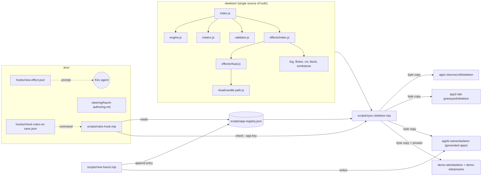
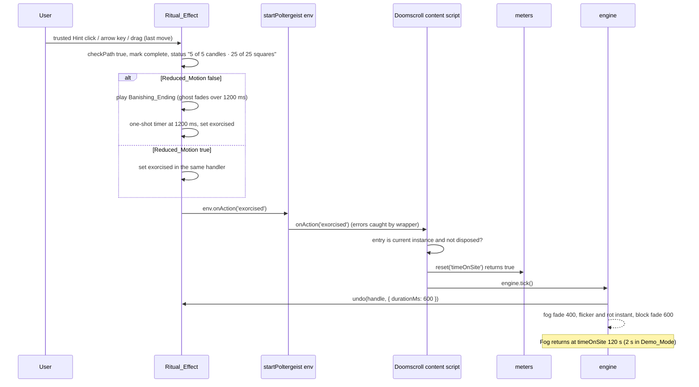
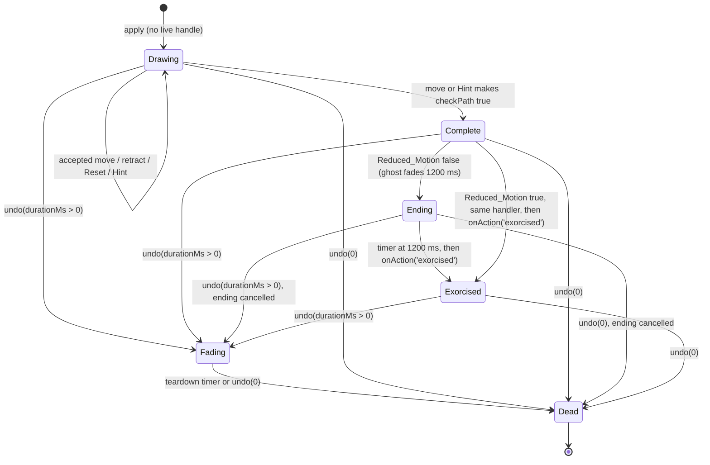

# Design Document: Haunt Kit

## Overview

Haunt Kit turns the Poltergeist skeleton into a template for third-party habit-breaking extensions. It adds a Kiro authoring workflow, one interactive ritual (Candle Path), Doomscroll's new finale, a scaffolder, a browser Playground and two README guides. The design is split into six parts, in the order the task list will build them:

| Part | Content | Requirements | Change markers |
|---|---|---|---|
| 1. Authoring workflow | Steering doc, Effect_Hook, Rules_Hook, App_Registry file, README effect list | 1, 2, 3 | AUTHORING, PACKAGING, DOCS |
| 2. Candle Path ritual | Generator, Ritual_Effect (created through the Effect_Hook), `meters.reset('timeOnSite')`, schema docs | 4 to 9, 10.8 | SKELETON, TEST |
| 3. Doomscroll finale and packaging | Fifth rule, content-script `onAction`, both manifests, Doomscroll validator, finale browser test | 10, 11 | APP, PACKAGING, TEST |
| 4. Scaffolder | `npm run new-haunt`, templates, Generic_Validator, registry and npm wiring, rollback | 12, 13 | PACKAGING, TEST |
| 5. Playground | `demo-site/` page, its sync target, local server, one browser test | 14 | SITE, PACKAGING, TEST |
| 6. README | "Build your own haunt in 10 minutes", "Write your own ritual" | 15 | DOCS |

Requirement 16 (compatibility) is handled in every part and summarised in "Compatibility and edited tests" below.

**No property-based testing.** Every new test is an example-based Vitest or Playwright test. Where a statement must hold "for all" inputs, the test loops over a fixed, hard-coded list (for example a fixed list of generator seeds). No property-based testing library is used by new code. `fast-check` stays in `devDependencies` only because existing haunt-engine and app tests use it.

### Research findings

- **Kiro hooks.** Hook files are `.kiro/hooks/<id>.json` in the `v1` format with a `hooks` array. File triggers (`PostFileCreate`, `PostFileSave`) test the matcher regex against the file path. A `command` action runs in the project root and receives the event as JSON on STDIN. An `agent` action injects a fixed prompt into the conversation ([Kiro hooks](https://kiro.dev/docs/hooks/), [Hook triggers](https://kiro.dev/docs/hooks/types/), [Hook actions](https://kiro.dev/docs/hooks/actions/)). The docs do not name the STDIN field that carries the file path, so the Rules_Hook script searches the payload for a `rules.json` path (section 1.4). Agent prompts take no variables, which constrains the Effect_Hook prompt (section 1.2). The existing Doomscroll hook's matcher uses no regex lookaround (its test pins this), and the new matchers follow the same rule.
- **Kiro steering.** `inclusion: fileMatch` with `fileMatchPattern` accepts a single glob or an array of globs ([Kiro steering](https://kiro.dev/docs/steering/)).
- **npm arguments.** `npm run` parses `--flag` arguments itself unless they follow `--` ([npm run-script](https://docs.npmjs.com/cli/v10/commands/npm-run-script)). The README therefore shows `npm run new-haunt <name> -- --hosts <pattern,...>` (decision 9).
- **Random Hamiltonian paths.** Start from a serpentine path and apply random "backbite" moves. Each move joins one path end to a grid neighbour and reverses the tail, so the result is always a Hamiltonian path. This is the move set used for unbiased lattice Hamilton path sampling by Mansfield ([ndmansfield docs](https://github.com/jewettaij/ndmansfield/blob/master/doc/doc_ndmansfield.md), [definition in arXiv 2610.05068](https://arxiv.org/html/2610.05068v1)). The method never backtracks and runs in bounded time, which suits a pure generator with an injected `random`. Candle Path does not need unique solutions: completion is decided by `checkPath`, so any valid path wins.
- **Existing code this design builds on.** `tombstone.js` (shadow-root overlay, trusted-click guard, handlers exposed on the handle so jsdom tests can pass `{ isTrusted: true }` objects), `util.js` (`teardown`, `handleState`, `numberIn`), `index.js` (`env.onAction` wrapper that already catches callback errors), `engine.js` (`tick()` is public; `remove` undoes with the rule's own undo mode), `sync-skeleton.mjs` (registry-driven mirrors and validators), `package-checks.mjs` (`resolveGraph`, `expandWar`, `scanSource`).

### Key design decisions

1. **The App_Registry moves to `scripts/app-registry.json`.** The Rules_Hook must read it on every run and the Scaffolder must append to it and restore it byte-for-byte. A JSON data file does both without editing JavaScript source. `sync-skeleton.mjs` loads it at import and still exports a deep-frozen `APPS`, so every existing importer and `sync.test.js` assertion keeps working.
2. **The Playground is a sync target, not an app.** `demo-site/` is not added to the App_Registry, because `sync.test.js` pins the registered app list and the default `parseArgs([])` result. The Skeleton_Sync processes the site whenever no `--app` argument is given (`build:skeletons`, `check:skeletons`).
3. **`npm test` keeps its `test` script; `pretest` becomes `npm run check:skeletons`.** That single change drift-checks every registered app and the Playground copies before Vitest starts. It edits one existing assertion instead of two (section 7).
4. **Completion uses `checkPath`.** The ritual completes when `checkPath(board, playerPath)` is true, so any correct path wins, not only `board.solution`. Hint is the only feature that reads `solution`.
5. **Input handlers live on the handle**, as in `tombstone.js`. jsdom cannot create trusted events, so unit tests call `handle.on.<name>({ isTrusted: true, ... })` for the trusted path and dispatch real (untrusted) DOM events for the rejection path.
6. **`env.onAction('exorcised')` is the last statement of its code path.** The app may undo the ritual from inside the callback (Doomscroll does, through `engine.tick()`), so the ritual sets its `exorcised` flag first and touches nothing after the call.
7. **Doomscroll ticks the engine right after the reset.** `meters.reset('timeOnSite')` followed by `ghost.engine.tick()` makes the reset take effect at once instead of up to 250 ms later. Without it the finale browser test's 2-second budget (Requirement 10.10) would be 1300 + 250 + 600 = 2150 ms in the worst case. `engine.js` does not change; `tick()` is already public.
8. **Reduced motion turns the fade-out into an instant opacity drop.** The Ritual_Contract forbids CSS transitions while Reduced_Motion is true, and Requirement 9.3 requires the host to stay until `durationMs`. Under Reduced_Motion, `undo` with a positive duration sets opacity 0 before it returns with no transition, stops input at once and removes the host after `durationMs` with the one-shot teardown timer.
9. **README uses `--` for scaffolder flags.** Without `--`, npm would swallow `--hosts`. The README shows `npm run new-haunt <name> -- --hosts <pattern,...>`, the command in Requirement 15.1(a).
10. **The Playground controls sit in the top layer.** The speed slider goes up to 3600×, the same scale as Tab Graveyard's `DEMO_TIME_SCALE`. At 600× the Doomscroll preset's Block overlay blocks pointers within 2.4 seconds and covers the whole page; at 3600× it does so within 0.4 seconds. The control panel is a `popover="manual"` element shown at load, which the browser draws above every `z-index`, so Apply, Stop and the presets always stay usable.

The open points from earlier drafts (the Effect_Hook file path, the README scaffolder command and repeated undo while fading) were resolved in the requirements (Requirements 2.3, 15.1(a) and 9.4 to 9.6).

## Architecture



Runtime structure is unchanged: an app's classic content script dynamically imports its Generated_Skeleton's `index.js` and calls `startPoltergeist`. The engine applies effects, and effects report actions through `env.onAction`. The only new runtime path is the Doomscroll finale:



New and changed files by part:

| Part | New files | Changed files |
|---|---|---|
| 1 | `.kiro/steering/haunt-authoring.md`, `.kiro/hooks/new-effect.json`, `.kiro/hooks/check-rules-on-save.json`, `scripts/app-registry.json`, `scripts/rules-hook.mjs`, `README.md` (effect list only), `test/authoring.test.js`, `test/rules-hook.test.js` | `.kiro/hooks/README.md`, `scripts/sync-skeleton.mjs` (registry loader, validator receives the app entry), `vitest.config.js` (include `test/**`, `app*/test/**`) |
| 2 | `skeleton/ritual/candle-path.js`, `skeleton/effects/ritual.js`, `skeleton/test/candle-path.test.js`, `skeleton/test/ritual.test.js`, `skeleton/test/ritual-compat.test.js` | `skeleton/effects/index.js`, `skeleton/rule-schema.json`, `skeleton/meters.js`, `skeleton/test/restoration.test.js`, `skeleton/test/meters.test.js`, every Generated_Skeleton (rebuilt), `README.md` (effect list) |
| 3 | `app1-doomscroll/test/finale.test.js`, `app1-doomscroll/test/browser/finale.pw.js`, `test/packaging.test.js` | `app1-doomscroll/rules.json`, `app1-doomscroll/content.js`, `app1-doomscroll/manifest.json`, `app2-tab-graveyard/manifest.json` (two resource strings), `scripts/validate-doomscroll-package.mjs`, three Doomscroll test assertions |
| 4 | `scripts/new-haunt.mjs`, `scripts/templates/haunt/*.tpl`, `scripts/validate-app-package.mjs`, `test/scaffolder.test.js` | `package.json` (`pretest`, `new-haunt`), one Graveyard test assertion, `KIRO_FILES.md` (manual Chrome check) |
| 5 | `demo-site/index.html`, `demo-site/playground.css`, `demo-site/playground.js`, `demo-site/playground-core.js`, `demo-site/skeleton/**` (generated), `demo-site/presets/*.json` (generated), `scripts/serve-playground.mjs`, `test/playground.test.js`, `test/browser/playground.pw.js` | `scripts/sync-skeleton.mjs` (site target), `package.json` (`playground` script), `playwright.config.js` (`playground` project) |
| 6 | none | `README.md` (two guides) |

## Components and Interfaces

### 1. Authoring workflow

#### 1.1 Steering doc: `.kiro/steering/haunt-authoring.md`

Front matter (Requirement 1.1):

```yaml
---
inclusion: fileMatch
fileMatchPattern: ["skeleton/effects/**", "skeleton/ritual/**", "**/rules.json"]
---
```

The patterns are workspace-relative, so `skeleton/effects/**` matches only the root skeleton and never a Generated_Skeleton. `**/rules.json` matches `rules.json` in any folder, including the root.

Body outline. Each lettered rule is one list item, in the order given, worded as in Requirement 1:

- `## Effect contract`: items (a) to (j) from Requirement 1.2. Item (h) points to `definitions.params-<name>` in `skeleton/rule-schema.json` for documented ranges.
- `## Meter rules`:
  - (a) `- Meters: \`timeOnSite\` (seconds), \`scrollDistance\` (pixels), \`timeSinceActive\` (seconds), \`timeAway\` (seconds).`
  - (b) effects read meters only through `env.readMeter`.
  - (c) `- Only app code resets meters, only through \`meters.reset\`, and only \`timeAway\` and \`timeOnSite\` are resettable.`
  - (d) escalation through `threshold` and `rampTo`; the lowest-threshold rule in each app never uses `block` or `tombstone`.
- `## Ritual contract`: items (a) to (f) from Requirement 1.4. The README's "Write your own ritual" bullets reuse the same sentences (Requirement 15.2).
- `## Adding an effect`: a numbered list with the six steps of Requirement 1.5, in order.

The doc test (Requirement 1.6) parses the document with fixed rules: the front matter is the text between the first two `---` lines, and `fileMatchPattern` is read with `JSON.parse` (a YAML flow sequence of double-quoted strings is valid JSON). A section is the list items between its `##` heading and the next `##`. The meter set is the backticked names in the first "Meter rules" item. The resettable set is the backticked names in the third item that are also schema meter names.

#### 1.2 Effect_Hook: `.kiro/hooks/new-effect.json`

```json
{
  "version": "v1",
  "hooks": [
    {
      "name": "Wire up a new skeleton effect",
      "trigger": "PostFileCreate",
      "description": "When Kiro creates skeleton/effects/<name>.js, finish the wiring the haunt-authoring steering doc requires.",
      "matcher": "^(?:.*[\\\\/]poltergeist[\\\\/]|\\.[\\\\/])?skeleton[\\\\/]effects[\\\\/][^\\\\/]+\\.js$",
      "action": { "type": "agent", "prompt": "<see below>" }
    }
  ]
}
```

Matcher, unescaped: `^(?:.*[\\/]poltergeist[\\/]|\.[\\/])?skeleton[\\/]effects[\\/][^\\/]+\.js$`.

- It accepts `skeleton/effects/<name>.js`, `./skeleton/effects/<name>.js` and absolute paths whose workspace root folder is named `poltergeist`, with `/` or `\`. This is the convention the existing Doomscroll hook already uses and documents. A renamed checkout needs a matcher update, and `.kiro/hooks/README.md` says so.
- It rejects `skeleton/test/**` (wrong folder), `skeleton/ritual/**`, every Generated_Skeleton (the segment before `skeleton` must be the workspace root or nothing), subfolders of `skeleton/effects/` (`[^\\/]+` contains no separator) and non-`.js` files (anchored `\.js$`).
- It uses no lookaround.

Prompt (fixed text; the numbered order is the order of Requirement 2.3):

> Kiro created a file directly under skeleton/effects/. This hook matches only skeleton/effects/<name>.js, so the created file is the skeleton/effects/<name>.js file you just created, and <name> is its base name without ".js". Follow .kiro/steering/haunt-authoring.md.
> First open that file. If it does not export a function named apply (for example skeleton/effects/util.js or another helper module), stop now and do not create, edit or delete any file.
> Otherwise do these steps in order:
> 1. Register the effect in skeleton/effects/index.js under <name>, unless <name> is already registered.
> 2. Document the effect and each of its params, with default and allowed range, in skeleton/rule-schema.json under definitions["params-<name>"]. Do not change effect.properties.type.
> 3. Add a restoration test for the effect to skeleton/test/restoration.test.js (and add <name> to the registry list asserted there), and add a reduced-motion test for the effect.
> 4. Run npm run build:skeletons to rebuild every generated skeleton. Never edit app*/skeleton/ or demo-site/skeleton/ by hand.
> 5. Add the effect to the effect list in README.md, with its registered name and its description export.

`.kiro/hooks/README.md` gains an `## new-effect.json` section (Requirement 2.5) naming the file, listing the accepted and excluded paths above, the folder-name convention, and stating that the hook fires only on file-create events Kiro emits. Files created from a terminal, by git or in another editor do not trigger it. A `## check-rules-on-save.json` section describes the Rules_Hook the same way.

#### 1.3 App_Registry: `scripts/app-registry.json`

One entry per line, so an appended entry leaves the existing entries' text unchanged:

```json
{
  "doomscroll": { "dir": "app1-doomscroll", "label": "Doomscroll", "validator": "./validate-doomscroll-package.mjs", "buildScript": "build:doomscroll" },
  "graveyard": { "dir": "app2-tab-graveyard", "label": "Tab Graveyard", "validator": "./validate-graveyard-package.mjs", "buildScript": "build:graveyard" }
}
```

`scripts/sync-skeleton.mjs` changes:

```js
export const REGISTRY_PATH = path.join(SCRIPTS_DIR, 'app-registry.json');
/** Read, shape-check and deep-freeze the registry. Throws with the file path and the bad field. */
export function loadRegistry(file = REGISTRY_PATH) { /* ... */ }
export const APPS = loadRegistry();
```

Shape rules checked by `loadRegistry`: key matches `^[a-z][a-z0-9-]{1,29}$`; `dir` is one path segment matching `^[A-Za-z0-9][A-Za-z0-9._-]*$`; `label` is a non-empty string; `validator` matches `^\./[a-z0-9-]+\.mjs$`; `buildScript` equals `build:<key>`. `runValidator` now calls `validatePackage(repoRoot, { key, ...APPS[key] })`. The two existing validators ignore the second argument, and the Generic_Validator needs it (section 4.4). `parseArgs`, `check`, `build`, messages and exit codes do not change.

#### 1.4 Rules_Hook: `.kiro/hooks/check-rules-on-save.json` and `scripts/rules-hook.mjs`

```json
{
  "version": "v1",
  "hooks": [
    {
      "name": "Check the app package when its rules.json is saved",
      "trigger": "PostFileSave",
      "description": "Runs the Package_Check of the registered app whose folder directly contains the saved rules.json. Read-only.",
      "matcher": "(?:^|[\\\\/])rules\\.json$",
      "action": { "type": "command", "command": "node scripts/rules-hook.mjs" },
      "timeout": 120
    }
  ]
}
```

The matcher accepts any path whose last segment is exactly `rules.json`, relative or absolute, with `/` or `\`. It rejects `myrules.json` and `rules.json.bak`.

`scripts/rules-hook.mjs` (Node built-ins only):

```js
/** First string value anywhere in the event JSON whose last path segment is "rules.json", or null. */
export function findRulesPath(event) {}
/**
 * Registry key whose dir directly contains filePath, or null.
 * Backslashes become "/" first, then the path is resolved against repoRoot and made repo-relative.
 * Matches only "<dir>/rules.json" exactly; paths outside repoRoot return null.
 */
export function appForRulesPath(filePath, { repoRoot, apps }) {}
/** Returns the exit code. check(key) defaults to sync-skeleton main(['--check','--app',key], repoRoot). */
export async function run({ filePath, repoRoot, apps, check }) {}
```

CLI flow:

1. The path comes from `argv[2]` when given (manual runs and tests). Otherwise, when STDIN is not a TTY, the script reads STDIN to the end, parses it as JSON and calls `findRulesPath`. A relative path is resolved against the event's `cwd` when present, else the repository root.
2. `apps` is the `APPS` export of `./sync-skeleton.mjs`, which reads `scripts/app-registry.json` when the process starts. Kiro starts a new process for every save, so a Generated_App registered by the Scaffolder is found on the next save with no hook edit (Requirement 3.7).
3. No app: print `rules-hook: <path> is not directly inside a registered app folder; nothing to check.` and exit 0 (Requirement 3.6).
4. App found: print `rules-hook: running check:<key> for <dir>/rules.json`, run that one Package_Check in-process, and exit with its code. The check prints its own errors to stderr and writes nothing, so the saved `rules.json` is never changed (Requirements 3.3 to 3.5).

#### 1.5 README seed

Part 1 creates `README.md` with a short introduction and an `## Effects` section: one line per registered effect in the form ``- `<name>`: <description>``. Creating it in part 1 lets the Effect_Hook's last step update a list that already exists when the ritual is created in part 2. Part 6 adds the two guides.

### 2. Candle Path ritual

#### 2.1 Generator: `skeleton/ritual/candle-path.js`

Pure module with no imports, no DOM and no `chrome.*`.

```js
/** @returns {Board} a new Board; never mutates options. */
export function generateBoard({ size, candles, random } = {}) {}
/** @returns {boolean} true exactly when path is a winning Player_Path for board; never throws or mutates. */
export function checkPath(board, path) {}
```

Option resolution (Requirements 4.4, 4.5, 4.10):

- `size`: an integer from 3 to 7, else 5.
- `candles`: an integer from 2 to `min(9, size × size)` for the resolved size, else 5. The default 5 is valid for every size, because 3 × 3 = 9.
- `random`: a function, else `Math.random`. Each draw becomes an index with `randomInt(n) = min(n - 1, max(0, floor(r × n)))`, and a non-finite `r` counts as 0, so a misbehaving `random` cannot produce an out-of-range index.

Path algorithm (backbite):

```text
path  := serpentine over rows: (0,0) (0,1) .. (0,s-1) (1,s-1) .. (1,0) (2,0) ..
pos   := map cell key (row*s+col) -> index in path
repeat STEPS = 30 * s * s times:
  if random() < 0.5: reverse(path) and rebuild pos      # work on either end
  tail := path[n-1]
  nbrs := in-grid neighbours of tail in fixed order (up, down, left, right)
  v    := nbrs[randomInt(nbrs.length)]
  i    := pos[v]
  if i == n-2: continue                                  # v is already linked to tail
  reverse(path[i+1 .. n-1]) and update pos for that range   # new tail is old path[i+1]
solution := path
```

Each move keeps a Hamiltonian path: `path[i]` and the old tail are adjacent, so linking them and reversing the segment after `i` keeps every consecutive pair adjacent and every cell exactly once. With `s ≤ 7` this is at most 1,470 moves of at most 49 steps each. The fixed neighbour order and the single injected `random` make the output a function of the `random` sequence (Requirement 4.6).

Candle placement (Requirement 4.3): candle 1 goes on `solution[0]` and candle N on `solution[L-1]`, where L = s². The N − 2 middle candles take N − 2 distinct indices drawn from 1..L−2 with a partial Fisher–Yates shuffle, sorted ascending and numbered 2..N−1. Distinct, sorted indices give strictly increasing numbers along `solution`. The Board holds fresh objects: `candles[k].cell` is a copy, not a reference into `solution`.

`checkPath` returns false unless all of these hold:

1. `board` has an integer `size` and a `candles` array of `{ number, cell }`.
2. `path` is an array of length `size²`.
3. Every entry has integer `row` and `col` from 0 to `size − 1`, and no cell repeats.
4. Each consecutive pair is Adjacent.
5. Walking the path, the candles met have numbers exactly 1, 2, …, N in that order.

Rule 5 implies that the first cell holds candle 1 and the last cell holds candle N, because every cell is visited and candle 1 must come first. The code also checks both ends explicitly for clarity. It reads its inputs only and never throws.

#### 2.2 Ritual_Effect: `skeleton/effects/ritual.js`

Created by Kiro in part 2 so that the Effect_Hook fires (Requirement 5.1). It imports `teardown`, `handleState`, `LIVE`, `numberIn` and `clamp01` from `./util.js`, and `generateBoard`, `checkPath` from `../ritual/candle-path.js`.

```js
export const description =
  'A full-page candle puzzle: draw one path through every square, passing the numbered candles in order. ' +
  'Finishing it reports the "exorcised" action; blocks interaction once intensity reaches blockAt.';
export function apply(env, params = {}, intensity, handle) {}
export function undo(handle, { durationMs } = {}) {}
```

Param resolution (Requirement 5.5). The result is read once per `apply`, and the input object is never mutated:

| Param | Accepted | Default |
|---|---|---|
| `heading` | string, 1 to 200 characters (code points) | `Light the candles to banish the ghost` |
| `instructions` | string, 1 to 300 characters | `Draw one path through every square, passing the candles in order. Candle <N> must be your last square. Drag back to undo.`, with `<N>` replaced by the Board's candle count |
| `size` | integer 3 to 7 | 5 |
| `candles` | integer 2 to min(9, size²) | 5 |
| `sound` | exactly `true` | `false` |
| `maxOpacity` | finite number 0 to 1 (`numberIn`) | 0.96 |
| `blockAt` | finite number 0 to 1 | 1 |

A `params` value that is not a plain object counts as `{}`. `size` and `candles` are passed to `generateBoard` as given, and the ritual reads the resolved values back from the Board, so the generator is the one place those ranges live.

The `<N>` substitution applies only to the default (Requirement 5.11): when `instructions` is absent or invalid, the shown text is the default with `<N>` replaced by `board.candles.length` of the live Board, so a 5-candle Board shows `Candle 5 must be your last square.` A valid custom `instructions` string is shown exactly as written, with no substitution. The longest default (N = 9) is well under 300 characters.

`apply`:

1. `i = typeof intensity === 'number' && !Number.isNaN(intensity) ? clamp01(intensity) : 0` (Requirement 5.6).
2. If there is no handle or the handle is dead, `create(env, p)` builds the Board, the DOM and the listeners, and appends the host as the last child of `documentElement`. `sound` is read here only.
3. If the handle is not LIVE (fading), return it unchanged.
4. Set `host.style.opacity = String(+(p.maxOpacity * i).toFixed(3))`, and set `host.style.pointerEvents` to `auto` when `i >= p.blockAt`, else `none`.
5. The first time pointer-events becomes `auto` on this handle, remember `document.activeElement` and call `board.focus({ preventScroll: true })` (Requirement 6.10).
6. Set the heading and instructions `textContent` (the instructions default uses the live Board's candle count, as above).

A later `apply` with the same live handle changes only those four things (Requirement 5.7). It never rebuilds the Board, never moves focus again and never re-fires the Exorcised_Action (Requirement 7.4).

DOM built by `create` (Requirements 5.2 to 5.4, 5.9, 5.10). Every node is made with `createElement` or `createElementNS`, all text is set with `textContent`, and nothing is added under `head` or `body`:

```text
div[data-poltergeist="ritual"]            host, inline: all:initial; position:fixed; top:0; right:0; bottom:0; left:0;
                                           z-index:2147483647; display:flex; align-items:center; justify-content:center;
                                           opacity:0; pointer-events:none   (zero light-DOM children)
  #shadow-root (open)
    style                                  static CSS: candle wax, flame, smoke and path-cell looks as gradients
                                           keyed on data attributes; no url(), @import, @font-face, @keyframes,
                                           animation or transition
    div.veil  aria-hidden                  Ritual_Veil: absolute, inset 0, grey radial gradients, inline opacity
    div.card  role="dialog" aria-labelledby=heading   inline background-color #16121c
      h1#ritual-heading                    heading text
      p.instructions                       instructions text
      div.stage                            position: relative
        div.board role="grid" tabindex="0" aria-label="Candle path, <s> by <s>"
                                           touch-action:none; inline background-color #16121c
          div role="row" x s
            div.cell role="gridcell" data-row data-col [data-candle] [data-lit] [data-on-path] [data-end]
                                           inline background-color #221c2a (#3a2f40 when on the path);
                                           candle cells: textContent = number, aria-label "Candle <k>, lit|unlit"
        svg.trail aria-hidden (viewBox 0 0 s s, pointer-events:none)
          polyline                         points = cell centres of the Player_Path
        svg.ghost aria-hidden (hidden until the Banishing_Ending)
      p.status aria-live="polite"          "<Lit_Count> of <N> candles · <Filled_Count> of <S> squares", or
                                           "Candle <N> must be last. Back up and fill the empty squares." (section 2.5)
      div.controls
        button type=button "Reset"
        button type=button "Hint"
```

Every background colour inside the host has red, green and blue channels of at most 64 (`#16121c`, `#221c2a`, `#3a2f40`; the host backdrop is `rgba(8, 6, 12, 0.9)`). Candles are drawn as cream wax, an orange flame when lit, and a grey smoke wisp when unlit, all as CSS gradients on the cell, so cells have no child elements and a pointer target is always a cell. No text, attribute value or class name contains "zip" in any letter case.

#### 2.3 Handle and state machine

```js
handle = {
  env, host, root, els: { style, veil, card, heading, instructions, board, cells /* [row][col] */, trail, ghost, status, reset, hint },
  board,            // Board from generateBoard; never mutated
  path,             // Player_Path: array of { row, col }; Filled_Count is path.length (derived, not stored)
  lit,              // Lit_Count
                    // S = board.size ** 2 (derived, not stored)
  complete: false, exorcised: false, chimed: false,
  sound,            // resolved at creation
  focusedOnce: false, prevFocus: null,
  drag: null,       // { pointerId } while dragging
  endingTimer: null, endingAnim: null,
  audio: null,      // { ctx, osc } after the chime starts
  on: { pointerdown, pointerover, pointerup, keydown, reset, hint },  // exposed for tests (decision 5)
  dead: false, fading: false, timer: null,  // util.js teardown lifecycle
};
```



Input is accepted only in Drawing. An input guard runs first in every handler: `event && event.isTrusted === true && handleState(handle) === LIVE`. Untrusted events, and every event while fading or dead, return before touching path, drag, focus or `preventDefault` (Requirements 6.13, 6.14, 9.2, 9.3, 9.8). Completion is reachable only from Drawing, so a ritual cannot complete while fading (Requirement 7.9).

#### 2.4 Input handling

All moves go through one function:

```text
tryMove(handle, cell):
  if complete: reject
  end := last of path
  if path.length >= 2 and cell equals path[len-2]: pop path; update; return accepted    # retract (6.4)
  if candle N is lit: reject                                    # only retract while N is lit (6.7)
  if cell outside grid, or not Adjacent to end, or on path: reject                      # (6.6)
  k := candle number on cell, if any
  if k exists and k != lit + 1: reject                                                  # (6.2, 6.6)
  push cell; update; if path.length == size² and checkPath(board, path): complete()     # (6.2, 7.1)
```

`update(handle)` recomputes `lit` as the number of candles on the path and calls `render`, which reads Filled_Count as `path.length`, before the handler returns (Requirement 6.3). The first time `lit` reaches N on a handle with `sound` true, `update` starts the chime (section 2.7). A retract from the single-cell path cannot happen because there is no `path[len-2]` (Requirement 6.5).

- **Pointer (Requirement 6.8).** `pointerdown` on the board: guard, primary button only (`button === 0 && isPrimary !== false`), and the target must be the Path_End cell. It then sets `drag = { pointerId }`, releases any implicit pointer capture on the cell (touch) so later events target the cell under the finger, and adds `pointerup` and `pointercancel` listeners on `env.window` so a release outside the Board ends the drag. A `pointerover` on the board while dragging, with the same pointer, is one `tryMove` to the cell under the pointer. Re-entering the Path_End is rejected, and moving back onto the previous cell retracts. `pointerup` or `pointercancel` for that pointer clears `drag` and removes the two window listeners. A press anywhere else starts no drag. Fast drags that skip cells are rejected as non-adjacent moves; no interpolation is done.
- **Keyboard (Requirement 6.9).** `keydown` on the board (the board has `tabindex="0"`, so it only fires while the Board has focus). After the guard, Arrow keys call `preventDefault()` and `stopPropagation()` and then `tryMove` to the neighbouring cell; `tryMove` rejects the move when complete. `stopPropagation` stops page shortcuts that listen in the bubble phase (for example a video player's arrow-key seeking) from acting under the overlay. Other keys are not touched.
- **Reset (Requirement 6.11).** On a trusted `click`, if not complete: `path = [candle 1 cell]`, clear `drag`, `update`. Board, `solution` and candles stay the same object.
- **Hint (Requirement 6.12).** On a trusted `click`, if not complete: let `k` be the length of the longest common prefix of `path` and `board.solution` (at least 1). If `k === size²`, change nothing. Else `path = solution.slice(0, k + 1)` (fresh cell copies), clear `drag`, `update`, and complete if `checkPath` is true. Keyboard activation of a button produces a trusted `click`, so Reset and Hint work from the keyboard.

#### 2.5 Rendering and the Ritual_Veil

`render(handle)` sets everything from `path` and `lit`, with `filled = path.length` (Filled_Count) and `S = board.size ** 2`:

- every cell's `data-on-path` and the Path_End's `data-end`;
- every candle cell's `data-lit` and `aria-label` (`Candle 3, lit` or `Candle 3, unlit`), so each candle's state reaches assistive technology (Requirement 6.3);
- the trail polyline `points` (cell centres in board units);
- the status line `textContent` (Requirements 5.12, 5.13):
  - when candle N is on the path and `filled < S`: `Candle <N> must be last. Back up and fill the empty squares.`, with the real N. This is the stuck state from the playtest: candle N is lit early, the move rule allows only retracts, and the count text alone made the ritual look finished;
  - otherwise: `` `${lit} of ${N} candles · ${filled} of ${S} squares` ``, with a middle dot (U+00B7) and one space each side, for example `3 of 5 candles · 14 of 25 squares`;
- the veil `style.opacity = String(+(0.85 * (S - filled) / (S - 1)).toFixed(3))`. `size` ≥ 3, so S ≥ 9 and the divisor is never 0. The value is 0.85 with one square filled, falls with every square added and is 0 only when the path covers every square (Requirement 5.8). The move rule (only retracts while candle N is lit) means a full path always ends on candle N with every candle in order, so `checkPath` is true and the veil clears fully only on completion.

`render` runs when the Board is built (Requirement 6.1: path is `[candle 1]`, `lit` 1, `filled` 1, status `1 of N candles · 1 of S squares`, veil 0.85) and after every accepted move, retract, Reset or Hint. On completion the status is `N of N candles · S of S squares` and the veil is 0. Rejected moves call nothing, so status and veil stay unchanged (Requirement 6.6). When motion is allowed at creation, the veil gets an inline `transition: opacity 300ms linear`. Under Reduced_Motion it gets none.

#### 2.6 Completion and Banishing_Ending

`complete(handle)` (Requirement 7):

1. `complete = true`, then `render` (status `N of N candles · S of S squares`, veil 0).
2. If `env.reducedMotion` is true: `exorcised = true`, then `fireExorcised(handle)` as the last statement (Requirement 7.3).
3. Otherwise show `svg.ghost` (a ghost silhouette drawn with SVG paths, like the Block ghost but owned by this module). If `ghost.animate` exists, start `animate([{ opacity: 1, transform: 'translateY(0px)', filter: 'blur(0px)' }, { opacity: 0, transform: 'translateY(-32px)', filter: 'blur(6px)' }], { duration: 1200, easing: 'ease-in', fill: 'forwards' })`. Then set a one-shot `endingTimer = env.setTimeout(onEndingDone, 1200)` (Requirement 7.2). The timer, not the animation's `finished` promise, decides when the action fires, because jsdom has no Web Animations API and fake timers can drive a timer.
4. `onEndingDone`: clear `endingTimer`; if the handle is not LIVE, return; hide the ghost; `exorcised = true`; `fireExorcised(handle)` last.

`fireExorcised(handle)`: if `typeof env.onAction !== 'function'`, call `console.error('[poltergeist] ritual: env.onAction is not a function')`. Otherwise `try { env.onAction('exorcised') } catch (err) { console.error('[poltergeist] ritual onAction:', err) }`. The completed Board stays on screen in both failure cases (Requirement 7.6). The `exorcised` flag is set before the call and checked by nothing that runs later, so the action fires at most once per handle (Requirement 7.4).

`undo` during the ending clears `endingTimer` and cancels `endingAnim` in both `begin` and `finish`, so no action fires afterwards (Requirement 7.5). The module never calls `chrome.*`, `window.close`, `location`, or `addEventListener('beforeunload' | 'unload')` (Requirement 7.7). Under Reduced_Motion no `animate()` call is made, no inline `animation` or `transition` is set, and the stylesheet has no `@keyframes`, so every element's computed `animation-name` is `none` (Requirement 7.8).

#### 2.7 Web Audio chime

`startChime(handle)` runs once per handle, the first time candle N lights, and only when `sound === true` (Requirements 8.1 to 8.3):

```text
chimed := true                                   # set first: a failure or a later re-light never retries (8.2)
AC := env.window.AudioContext ?? env.window.webkitAudioContext
if AC is not a function: console.error('[poltergeist] ritual sound: Web Audio API unavailable'); return
try:
  ctx := new AC(); osc := ctx.createOscillator(); gain := ctx.createGain()
  osc.type = 'sine'; osc.frequency 660 Hz ramping to 990 Hz over 0.25 s
  gain 0 -> 0.15 at +0.02 s, exponential decay to 0.001 at +0.9 s
  osc -> gain -> ctx.destination; osc.start(t); osc.stop(t + 0.9)    # stops at most 1 s after start
  handle.audio = { ctx, osc }
catch err: console.error('[poltergeist] ritual sound:', err)       # completion still proceeds (8.5)
```

Candle N lights inside a trusted input handler, so the context is created during a user gesture and Chrome's autoplay policy lets it play. The sound is generated, so no audio file, `url()`, `src` or `href` is involved (Requirement 8.4). `stopChime(handle)` runs in both teardown callbacks for any `durationMs`. It calls `osc.stop()` and `ctx.close()` inside `try`, attaches a no-op `catch` to the promise `close()` returns, and sets `audio = null` (Requirement 8.6). `close()` is called before `undo` returns; the browser finishes closing asynchronously.

#### 2.8 Undo and restoration

```text
undo(handle, { durationMs } = {}):
  d := (typeof durationMs === 'number' && Number.isFinite(durationMs) && durationMs > 0) ? durationMs : 0
  teardown(handle, d, begin, finish)        # util.js: Live -> Fading -> Dead, finish runs once
begin:  endDrag; clear endingTimer; cancel endingAnim; stopChime;
        host.style.pointerEvents = 'none';
        if !env.reducedMotion: host.style.transition = `opacity ${d}ms linear`
        host.style.opacity = '0'
finish: remove board/button listeners; endDrag; clear endingTimer; cancel endingAnim; stopChime;
        if document.activeElement === host and prevFocus?.isConnected: prevFocus.focus({ preventScroll: true })
        host.remove()
```

- `d` 0, absent or invalid: `finish` runs before `undo` returns (Requirement 9.1).
- `d > 0`, Reduced_Motion false: `teardown` sets `fading` first, so every handler's guard rejects input from that moment. `begin` sets a linear opacity transition of `d` ms with the host still in the document, and the one-shot timer removes the host after exactly `d` ms, within the `d + 50` limit (Requirement 9.2).
- `d > 0`, Reduced_Motion true: the same, except `begin` sets no transition, so the opacity is 0 before `undo` returns. The host stays until the timer fires at `d` ms (Requirement 9.3, decision 8).
- Repeated calls follow `teardown`. Dead means no-op (Requirement 9.4). Fading with `d > 0` leaves the running fade unchanged (Requirement 9.5). Fading with `d` 0, absent or invalid runs `finish` before `undo` returns (Requirement 9.6). None of these makes an Exorcised_Action, because `begin` already cleared `endingTimer` and cancelled `endingAnim`.

Restoring focus changes no markup, so the Restored_State comparison is unaffected. The only listeners outside the shadow root are the two `env.window` drag listeners, which `endDrag` removes.

#### 2.9 Registration and schema documentation

- `skeleton/effects/index.js`: `import * as ritual from './ritual.js';` and `builtinEffects = { fog, flicker, rot, block, tombstone, ritual }`. `EFFECT_TYPES` in `validator.js` derives from the registry, so it needs no edit.
- `skeleton/rule-schema.json`: add `definitions["params-ritual"]`, a documentation-only object schema (the validator does not read it) with a `description` for the effect and, for each param, `type`, the range keywords (`minLength`/`maxLength`, `minimum`/`maximum`), `default` and a `description` that states the default and the allowed range in words, for example `"Integer from 3 to 7. Default 5. Other values use the default."` (Requirement 11.3). The `instructions` entry keeps `minLength` 1 and `maxLength` 300, its `default` keyword is `"Draw one path through every square, passing the candles in order. Candle N must be your last square. Drag back to undo."` with the letter N, and its `description` states that N is replaced by the Board's candle count and that a custom string is shown as written. `definitions.rule.properties.effect.properties.type` stays `{ "type": "string" }`.

#### 2.10 Meters change: `skeleton/meters.js`

```js
/** Reset a resettable meter. timeAway and timeOnSite are resettable; returns false for any other name. */
reset(name) {
  if (name === 'timeAway') { heldAway = 0; if (awayStartedAt !== null) awayStartedAt = now(); return true; }
  if (name === 'timeOnSite') { timeOnSite = 0; return true; }
  return false;
}
```

`values().timeOnSite` reads 0 right after the call. The next `update` adds only the time since the last tick, at most 250 ms. `scrollDistance`, `timeSinceActive` and unknown names return false and change nothing (Requirements 10.8, 16.8).

#### 2.11 Hold_Ritual fallback (decision point only)

Decision point: when the Candle Path task closes, run the ritual unit tests and the Restoration_Suite. If any test for Requirements 5 to 8 still fails, replace the Board section of `ritual.js` (2.1 and 2.4) with the Hold_Ritual and keep everything else: host, params other than `size` and `candles`, veil, status line, Banishing_Ending, chime, `fireExorcised`, teardown and guards. The Hold_Ritual has three candles and one hold button. Holding (pointer down on the button, or Space or Enter held while it has focus) runs a chain of three one-shot 1000 ms timers, each lighting one candle. Releasing before the third candle clears the timer and unlights all candles. The third candle completes the ritual at 3000 ms. These are one-shot timers, not a repeating timer, so the Reduced_Motion rule still holds. The decision and its reason are then written into `KIRO_FILES.md` and into this document (Requirement 9.11). The fallback itself follows Requirements 9.9 and 9.10. No Hold_Ritual code is written unless the decision point triggers.

### 3. Doomscroll finale and packaging

#### 3.1 `app1-doomscroll/rules.json`

The four existing rules stay byte-identical and in order. A fifth rule is appended:

```json
{
  "id": "doomscroll-ritual",
  "description": "A candle ritual stands between you and the feed.",
  "enabled": true,
  "match": ["https://www.youtube.com/*", "https://x.com/*", "https://www.instagram.com/*"],
  "trigger": { "meter": "timeOnSite", "threshold": 1500 },
  "effect": { "type": "ritual", "params": { "size": 5, "candles": 5, "sound": false } },
  "undo": { "mode": "fade", "durationMs": 600 }
}
```

The existing `doomscrollCreateDemoProfile` already divides every numeric `threshold` by 60 and skips a missing `rampTo`, so the ritual appears at 25 s of demo time with no code change. That is after Block blocks pointers at 24 s and when Block reaches full intensity at 25 s (Requirement 10.2). The ritual has no `rampTo`, so its intensity is 1 from the first tick and `pointer-events` is `auto` at once (`blockAt` 1). Both overlays use `z-index` 2147483647, and the ritual is appended later, so it paints above Block.

#### 3.2 Content-script `onAction` wiring: `app1-doomscroll/content.js`

Only `doomscrollCreateController` changes. The classic-script shape, the bootstrap, messages and storage stay the same.

```js
// in reconcile(), replacing the start block
const entry = { mode, ghost: null, demoEpoch };
let ghost;
try {
  ghost = api.startPoltergeist({ rules, initialMeters: { ...seed }, onAction: (name) => handleAction(entry, name) });
} catch (error) { /* unchanged fault path */ }
entry.ghost = ghost;
state.current = entry;

/** Exorcised_Action from a ritual. Every other name, and every stale instance, is ignored. */
function handleAction(entry, name) {
  if (name !== 'exorcised') return;                                   // 10.3
  if (state.disposed || state.current !== entry || !entry.ghost) return; // 10.11
  let ok = false;
  try {
    ok = entry.ghost.meters.reset('timeOnSite') === true;             // 10.4
  } catch (error) {
    reportOnce('reset', 'resetting time on site after the ritual failed', error); // 10.12
    return;
  }
  if (!ok) { reportOnce('reset', 'resetting time on site after the ritual failed'); return; }
  try {
    entry.ghost.engine.tick();                                        // decision 7
  } catch (error) {
    reportOnce('reset-tick', 'applying the reset failed; it applies on the next tick', error);
  }
}
```

- The same instance keeps running: no `stop`, no new `startPoltergeist`. `scrollDistance` and `timeSinceActive` are not touched (Requirement 10.4).
- `entry` is the object stored in `state.current`. A pause, a Demo_Mode toggle or a motion restart replaces it, and `dispose` sets `state.disposed`, so an action from an old instance resets nothing (Requirement 10.11).
- `report` in the bootstrap already prefixes every message with `[poltergeist:doomscroll]` and never throws (Requirement 10.12).
- After the reset the engine's normal logic undoes each active rule with its own undo mode: Fog fades over 400 ms, Block and the ritual over 600 ms, Flicker and Rot instantly (Requirement 10.5). The haunt then starts over from `timeOnSite` 0. `captureMeters` reads the live meters on the next pause, so a pause and resume continues from the reset value (Requirement 10.6).
- The content script still sends no tab-closing, reloading or navigating message and adds no `beforeunload` handler. The manifest's permissions do not change (Requirement 10.7).

#### 3.3 Finale timing budget (Requirement 10.10)

| Step | Worst case after the last Hint click |
|---|---|
| Completion and ending timer | 1200 ms (timer set to the lower bound of the 1200 to 1300 ms window) |
| Reset and immediate `engine.tick()` | about 0 ms (same task) |
| Longest undo fade (Block, ritual) | 600 ms (+ at most 50 ms allowed, the teardown timer fires at 600 ms) |
| Total until no `[data-poltergeist]` | about 1800 ms, under the 2000 ms limit |
| Fog back in Demo_Mode | 1200 + 2000 + up to 250 ms tick = about 3450 ms, under the 5000 ms limit |

#### 3.4 Manifests (Requirement 11.2)

Both apps' `web_accessible_resources[0].resources` gain exactly two strings, `skeleton/effects/ritual.js` and `skeleton/ritual/candle-path.js`. Nothing else in either manifest changes. Both Package_Validators already require the exposed list to equal `rules.json` plus the modules reachable from `skeleton/index.js`. Once `effects/index.js` imports the ritual, the two modules become reachable and the validators demand them, with no validator code change.

For Graveyard this is the only edit, and it is stated as "add these two resource strings". It does not depend on the content of Graveyard's `content.js`, `background.js`, popup files or validator internals, so it applies unchanged after the graveyard-groups spec lands. If graveyard-groups adds or reorders resources, the two strings are still added and the rest of the list is left as graveyard-groups left it. Graveyard's Generated_Skeleton is rebuilt by `npm run build:skeletons` like every other copy.

#### 3.5 Doomscroll Package_Validator: `scripts/validate-doomscroll-package.mjs`

`EXPECTED_RULES` gains a fifth entry:

```js
{ id: 'doomscroll-ritual', threshold: 1500, type: 'ritual', params: { size: 5, candles: 5, sound: false }, undo: { mode: 'fade', durationMs: 600 } }
```

The existing per-rule checks then cover it: enabled, the exact hosts in `match`, trigger, effect type and params, and undo. The trigger comparison already drops an undefined `rampTo`. Its message changes to `trigger must be timeOnSite 1500 with no rampTo` when `exp.rampTo` is undefined, so the error names the gap clearly. A missing fifth rule is reported by the existing ids-and-order error, and a missing resource by the existing `web_accessible_resources is missing <file>` error (Requirement 10.9).

### 4. Scaffolder

#### 4.1 CLI: `scripts/new-haunt.mjs`

```text
node scripts/new-haunt.mjs <name> [--hosts <pattern,...>] [--root <dir>]
npm run new-haunt <name> -- --hosts <pattern,...>          (package.json: "new-haunt": "node scripts/new-haunt.mjs")
```

```js
export function parseArgs(argv) {}              // { name, hosts, root } or { error }
export function isAllowedHost(pattern) {}       // isValidPattern(pattern) && scheme is http, https or *
export function nextAppNumber(dirNames) {}      // 1 + max N over /^app(\d+)-/ directory names, or 1
export function renderTemplate(text, vars) {}   // split/join replacement of __HAUNT_NAME__ and __APP_DIR__
export async function scaffold({ name, hosts, root, log }) {}  // { ok: true, dir } | { ok: false, step, error }
export async function main(argv) {}             // exit code
```

Input checks, all before any write (Requirements 12.2, 12.3). Each failure prints `new-haunt: <message naming the input>` and exits 1:

- Haunt_Name matches `^[a-z][a-z0-9-]{1,29}$`.
- `--root` (default: the repository that contains the script) is an existing directory that contains `scripts/app-registry.json`, `scripts/sync-skeleton.mjs` and `package.json`.
- `--hosts` (default `https://example.com/*`) splits on `,` into 1 to 20 non-empty entries, each passing `isAllowedHost`. `<all_urls>`, `file://` and `ftp://` are rejected.
- The name is not an App_Registry key (`Object.hasOwn`), and `package.json` has no `build:<name>` or `check:<name>` script. The second check stops a name such as `skeletons` from overwriting `build:skeletons`.
- The target `app<N>-<name>` does not exist, where N comes from `nextAppNumber` over the directories in the root.

#### 4.2 Steps and rollback

```text
snapshot := { registry: bytes of scripts/app-registry.json, pkg: bytes of package.json }
steps (each has a name used in error messages):
  "create app folder"   mkdir <root>/app<N>-<name>
  "write <file>"        manifest.json, rules.json, content.js, background.js, popup.html, popup.js, popup.css,
                        test/package.test.js, test/background.test.js
  "register app"        append the registry entry (text insert before the final "}")
  "add npm scripts"     package.json scripts build:<name>, check:<name>
  "build skeleton"      spawn node <root>/scripts/sync-skeleton.mjs --app <name>
  "package check"       spawn node <root>/scripts/sync-skeleton.mjs --check --app <name>
on success: print the created folder path, exit 0                                   (12.1)
on any failure after "create app folder":
  rm -r <root>/app<N>-<name>            (guarded: the path must equal the planned folder)
  write snapshot.registry and snapshot.pkg back byte-for-byte
  print "new-haunt: <step> failed: <reason>"  (a write failure names the file)        (12.13, 13.5)
  exit 1
```

The two sync steps run in a child process (`process.execPath`, no shell) because `APPS` is read when `sync-skeleton.mjs` is first imported, and the child must see the new registry entry. The registry append keeps every existing entry's text byte-identical. The new entry is formatted as `  "<name>": { "dir": "app<N>-<name>", "label": "<name>", "validator": "./validate-app-package.mjs", "buildScript": "build:<name>" }`, and the comma that separates it from the previous entry is the only added byte on that line (Requirement 13.1). `package.json` is parsed, given the two scripts at the end of `scripts` (`node scripts/sync-skeleton.mjs --app <name>` and `node scripts/sync-skeleton.mjs --check --app <name>`), and written back with `JSON.stringify(pkg, null, 2) + '\n'`, which matches the current formatting and leaves every other field equal (Requirement 13.2). If the rollback itself fails, both errors are printed and the exit code is still 1.

#### 4.3 Generated_App files

`manifest.json` and `rules.json` are built in code from data. The other files come from `scripts/templates/haunt/*.tpl`, and the `.tpl` suffix keeps template tests out of Vitest's include globs.

- `manifest.json` (Requirement 12.5): `manifest_version` 3; `name` `Poltergeist: <name>`; `version` `0.1.0`; `permissions` `["storage"]`; `host_permissions` = hosts; `background` `{ "service_worker": "background.js", "type": "module" }`; `action.default_popup` `popup.html`; one content script `{ matches: hosts, js: ["content.js"], run_at: "document_idle", all_frames: false }`; one `web_accessible_resources` entry `{ resources: ["rules.json", ...reachable], matches: hosts, use_dynamic_url: false }`. `reachable` is computed at scaffold time with `resolveGraph` over the root skeleton's production files from `skeleton/index.js`.
- `rules.json` (Requirement 12.6): `<name>-fog` (timeOnSite 120 → 300, fog `{ maxBlur: 5, maxGrayscale: 0.8 }`, fade 400) and `<name>-rot` (timeOnSite 300 → 600, rot `{ maxFraction: 0.5 }`, instant), each with `enabled` true and `match` = hosts. The lowest-threshold rule is Fog, which follows Meter rule (d).
- `content.js` (classic script, no static `import`/`export`; Requirement 12.7):
  - `function hauntCreateDemoProfile(doc)`: deep clone; divide each numeric `threshold` and `rampTo` by 60.
  - The bootstrap returns at once without `chrome.runtime.id`. It registers the `runtime.onMessage` listener first. That listener accepts `<name>:apply-paused` only from `sender.id === chrome.runtime.id` with a boolean `paused`, records `paused` and calls `runner?.setPaused(paused)`.
  - It asks the worker `<name>:content-state`. A failure or malformed reply means not paused and Demo_Mode off (Requirement 12.14). Demo_Mode is read once, here.
  - It loads `skeleton/index.js` (dynamic `import` of `chrome.runtime.getURL`) and `rules.json` (`fetch` of `chrome.runtime.getURL`), validates the rules and builds the profile. Errors are logged once with `[poltergeist:<name>]`.
  - `runner.setPaused(p)`: when `p` is true, `ghost.stop()` and drop the ghost, which leaves the Restored_State. When false and no ghost exists, `startPoltergeist({ rules: profile })` with no `initialMeters`, so time on site counts from 0.
  - It uses no DOM selectors at all.
- `background.js` (module worker; Requirement 12.8): `MESSAGE` constants `<name>:content-state`, `<name>:popup-state`, `<name>:set-paused`, `<name>:set-demo`, `<name>:apply-paused`; keys `<name>.pausedTab.<tabId>` in `chrome.storage.session` and `<name>.demoMode` in `chrome.storage.local`.
  - `export function createBackground(chromeApi)` returns `{ handleMessage, onMessage }`. Control messages (`popup-state`, `set-paused`, `set-demo`) need an extension-page sender: `sender.id === runtime.id` and `sender.url` starting with `runtime.getURL('')`. Any other sender gets `{ ok: false }` and storage is untouched.
  - `content-state` needs `sender.id === runtime.id` and an integer `sender.tab.id`. Reads that throw resolve to not paused and Demo_Mode off.
  - `set-paused` stores the flag, then forwards `apply-paused` to the tab's top frame.
  - Listeners are registered at top level when `chrome.runtime.onMessage` exists.
- `popup.html`, `popup.js`, `popup.css` (Requirement 12.9): two checkboxes, "Pause on this tab" and "Demo mode (thresholds ÷ 60, applies on the next page load)", plus a status line with `aria-live="polite"`. `popup.js` gets the active tab id with `chrome.tabs.query({ active: true, currentWindow: true })` (the id needs no `tabs` permission), asks `popup-state`, sets both boxes, and sends `set-paused` or `set-demo` on each `change`. All text is set with `textContent`, and the page has `<script type="module" src="popup.js">` and no inline script.
- `test/package.test.js` (Requirement 12.11): `validatePackage(REPO_ROOT, { key: '<name>', dir: 'app<N>-<name>' })` from `../../scripts/validate-app-package.mjs` is `ok`. `rules.json` passes `validateRules` from `../skeleton/index.js`. `hauntCreateDemoProfile` (content.js run in a `vm` context) divides thresholds and ramps by 60 and does not mutate its input.
- `test/background.test.js`: an in-memory `chrome` mock. `set-paused` from an extension page stores `true`, and `content-state` from that tab returns it. `set-demo` stores Demo_Mode, and `content-state` returns it. A content-script sender's `set-paused` is rejected and storage is unchanged. A throwing `storage.session.get` gives not paused.

#### 4.4 Generic_Validator: `scripts/validate-app-package.mjs`

```js
/** Validate a Generated_App. Never writes. Returns { ok, errors } with one line per failed rule. */
export async function validatePackage(repoRoot = REPO_ROOT, app) {}
```

`app` is the registry entry plus `key`, as passed by `runValidator`. A missing `app.dir` gives `{ ok: false, errors: ['validate-app-package: an app entry with dir is required'] }`. Error lines start with the path relative to the app folder (Requirement 13.4).

| Area | Checks (Requirement 12 criteria 5, 6, 10) |
|---|---|
| `manifest.json` | the fields listed in 4.3. "The hosts" means `host_permissions`: 1 to 20 entries passing `isAllowedHost`, equal to `content_scripts[0].matches` and to the resource entry's `matches`. The exposed list equals `rules.json` plus the modules reachable from `skeleton/index.js` (`expandWar`), and missing and extra files are named. |
| `rules.json` | `validateRules` with the root skeleton's `builtinEffects`; every rule's `match` has the same set of patterns as the hosts; at least one `fog` rule and one `rot` rule on `timeOnSite` with `rampTo > threshold` |
| code | `scanSource` on every `.js`/`.html` outside `skeleton/` and `test/` (eval, `new Function`, string timers, remote URLs, inline scripts and handlers); `resolveGraph` errors (bare, absolute, remote or escaping imports); `content.js` contains none of `querySelector`, `querySelectorAll`, `getElementById`, `getElementsByClassName`, `getElementsByTagName`, `getElementsByName`, `closest(` |

#### 4.5 Registry, npm scripts and `npm test` coverage (Requirement 13.3)

- `package.json`: `"pretest": "npm run check:skeletons"` (was `npm run check:graveyard`) and `"new-haunt": "node scripts/new-haunt.mjs"`. `"test"` stays `npm run check:doomscroll && vitest --run`. `check:skeletons` drift-checks and validates every registry app and the Playground copies, and npm runs `pretest` before `test` and stops on failure.
- `vitest.config.js` `include`: `['skeleton/test/**/*.test.js', 'app*/test/**/*.test.js', 'test/**/*.test.js']`. `app*/test/**` covers both existing apps and every Generated_App.
- The real repository keeps exactly two registered apps. The Scaffolder tests and the manual Chrome check (Requirement 13.9) generate into temporary roots with `--root`.

### 5. Playground

#### 5.1 Sync target (Requirement 14.2)

`scripts/sync-skeleton.mjs` gains:

```js
export const SITE = Object.freeze({
  dir: 'demo-site', label: 'Playground',
  presets: Object.freeze({ 'doomscroll.json': 'doomscroll', 'graveyard.json': 'graveyard' }),
});
/** Read-only. Compares skeleton/ production files with demo-site/skeleton/, and each preset with its app's rules.json. */
export async function checkSite(repoRoot) {}   // { ok, missing, extra, changed, diagnostics }
/** Replaces demo-site/skeleton/ and demo-site/presets/ only. */
export async function buildSite(repoRoot) {}   // { files, presets }
```

- `main(args, repoRoot)` processes the site after the apps when `args` contains no `--app`. `parseArgs` and its return value stay as they are.
- The check compares two maps keyed `skeleton/<rel>` and `presets/<file>`, using the existing `compareFileMaps`. Other `demo-site/` files are hand-written and not compared.
- Failure prints `Playground copies are out of sync (run: npm run build:skeletons):` and one line per file, for example `  changed: skeleton/effects/ritual.js` or `  missing: presets/graveyard.json`. A preset whose app is not registered or whose `rules.json` is missing gives `  missing source: <dir>/rules.json`.
- Success prints `Playground copies are in sync.` A build prints `Synchronized <n> file(s) into demo-site/skeleton/ and 2 preset(s) into demo-site/presets/.` That line does not end in "the package is valid", so the existing `sync.test.js` count of per-app build lines stays 2.
- `buildSite` refuses any target other than `demo-site/skeleton` and `demo-site/presets`, like `build`.

#### 5.2 Page structure

```text
demo-site/
  index.html            static markup; <link rel="stylesheet" href="playground.css">; <script type="module" src="playground.js">
  playground.css
  playground.js         boot: import * as api from './skeleton/index.js'; createPlayground({ document, window, api, fetch })
  playground-core.js    logic, importable by tests (no side effects on import)
  skeleton/             Generated_Skeleton (committed, generated)
  presets/doomscroll.json, presets/graveyard.json   (committed, generated)
```

`index.html` body:

- `header`: title "Haunt Playground" and a one-line introduction.
- `main#feed`: an empty container. `renderFeed` adds 24 `article` posts (title and body from a fixed word list, `min-height` 160 px), so the page is taller than the window (Requirement 14.3).
- `aside#panel[popover="manual"]` (decision 10), shown with `showPopover?.()` at boot and fixed to the right side. It contains:
  - buttons `#preset-doomscroll` ("Doomscroll") and `#preset-graveyard` ("Tab Graveyard"), and the note `p.note` with the exact text "The Tab Graveyard preset decays only while this tab is hidden. Switch to another tab, then come back. At 3600× the tombstone appears after about 24 seconds away." (Requirement 14.8). The Graveyard Preset's tombstone threshold is 86400 s of `timeAway`, and 86400 / 3600 = 24 s;
  - `label[for=speed]`, `input#speed[type=range][min=1][max=3600][step=1][value=1]` and `output#speed-value` showing `1×` (Requirement 14.7);
  - `label[for=rules]`, `textarea#rules`, buttons `#apply` ("Apply") and `#stop` ("Stop haunt"), and `ul#errors[aria-live=polite]`;
  - button `#try-ritual` ("Try the ritual") and `p#ritual-status[aria-live=polite]`.

Every `src` and `href` is relative and inside `demo-site/` (Requirement 14.1). There is no inline script, no inline handler and no remote URL. All runtime text is set with `textContent` (Requirement 14.10).

#### 5.3 `playground-core.js`

```js
/** Deep clone of a rules document (array or { rules }); threshold and rampTo divided by speed; every match = ['<all_urls>']. */
export function scaleRules(doc, speed) {}
export function renderFeed(document, container, count = 24) {}
/** Wires the page. Returns a small API used by playground.js and by tests. */
export function createPlayground({ document, window, api, fetch, presets }) {}
// returns { apply(), stop(), loadPreset(key), setSpeed(n), tryRitual(), state() }
```

- **Apply (Requirements 14.4, 14.5).** Parse `#rules`. If `JSON.parse` throws, show one error line `JSON: <message>`. Otherwise run `api.validateRules(doc, api.builtinEffects)`; if invalid, show one `li` per error. On either failure the running haunt, its effects and the editor text stay as they are. On success: stop the running haunt (`ghost.stop()` undoes with duration 0, so no `[data-poltergeist]` element remains), clear the error list, store a deep clone as `lastAccepted`, and call `api.startPoltergeist({ rules: scaleRules(lastAccepted, speed), window, document, onAction })`. A throw from `startPoltergeist` is shown as an error line.
- **Match rewrite (Requirement 14.6).** `scaleRules` sets every rule's `match` to `['<all_urls>']`, which matches the Playground's own URL on localhost, on GitHub Pages and in the test server, whatever the port. The editor text is not changed.
- **Speed (Requirement 14.7).** `input` updates `#speed-value` to `<n>×`. `change` sets `speed` and, if `lastAccepted` exists, stops and restarts with `scaleRules(lastAccepted, speed)`. Division by a positive number keeps `rampTo > threshold` and keeps both values non-negative, so the scaled rules stay valid.
- **Presets (Requirements 14.8, 14.12).** `fetch('./presets/<key>.json')`. If the request fails or the response is not OK, show `Could not load the <Doomscroll|Tab Graveyard> preset.` and leave the editor and the haunt alone. Otherwise put the response text in the editor and run Apply.
- **Haunt actions.** The haunt's `onAction` mirrors the apps, so a finished ritual or tombstone does not trap the page: `exorcised` → `ghost.meters.reset('timeOnSite')` then `ghost.engine.tick()`; `resurrect` → `ghost.meters.reset('timeAway')`.
- **Try the ritual (Requirement 14.9).** If no trial handle is live, build an env (`window`, `document`, a `reducedMotion` getter on `matchMedia('(prefers-reduced-motion: reduce)')`, timer functions, `readMeter: () => undefined`, `onAction`) and call `api.builtinEffects.ritual.apply(env, {}, 1)`. On `exorcised`, the trial `onAction` calls `ritual.undo(handle, { durationMs: 600 })` and sets `#ritual-status` to `The ghost is banished. The ritual is complete.` The undo runs from inside the ritual's callback, which decision 6 makes safe.
- **Stop.** `ghost.stop()` and clear the reference.

#### 5.4 Local server: `scripts/serve-playground.mjs`

```js
/** Static, read-only server for demo-site/. Binds 127.0.0.1. GET and HEAD only. */
export function startServer({ root = DEMO_SITE, port = 8080, host = '127.0.0.1' } = {}) {}  // Promise<{ url, close }>
```

`/` serves `index.html`. Each path is decoded, resolved under `root` and rejected with 404 unless it stays inside `root` and names a file. There is no directory listing. Content types come from a small extension map (`.html`, `.js`, `.css`, `.json`). The CLI (`npm run playground`, `"playground": "node scripts/serve-playground.mjs"`) prints the URL and runs until stopped; users run it in their own terminal. Chrome refuses ES module scripts on `file://` pages, so README step (e) needs this server.

#### 5.5 Playwright test: `test/browser/playground.pw.js` (Requirement 14.11)

New project in `playwright.config.js`: `{ name: 'playground', testDir: 'test/browser', use: { channel: 'chromium' } }`. The test:

1. Starts `startServer({ port: 0 })` in `beforeAll` and closes it in `afterAll`.
2. Opens the URL. A route aborts and records any request to another origin.
3. Checks that the feed has at least 20 posts and that `document.documentElement.scrollHeight > innerHeight`.
4. Checks that `#speed` has the `max` attribute `"3600"` (Requirement 14.7), then fills `#speed` with `600` (Playwright's `fill` on a range input fires `input` and `change`) and checks `#speed-value` reads `600×`.
5. Clicks `#preset-doomscroll` and expects `[data-poltergeist="fog"]` to be attached within 10 s. The fog threshold at 600× is 0.2 s.
6. Asserts no page errors and no other-origin requests.

### 6. README

Part 6 adds two sections to `README.md`, after the effect list from part 1:

- `## Build your own haunt in 10 minutes`: five numbered steps in the order of Requirement 15.1, each command in a fenced code block: `npm run new-haunt <name> -- --hosts <pattern,...>`; edit `app<N>-<name>/rules.json`; `npm test`; `chrome://extensions`, Developer mode, "Load unpacked", pick the `app<N>-<name>` folder; `npm run playground`, paste the rules into the editor and press Apply.
- `## Write your own ritual`: the six Ritual_Contract bullets (the same sentences as the steering doc) and a sentence stating that the ritual only makes the Exorcised_Action and the app decides what happens after `exorcised`. One `js` code block of at most 40 lines: a "typed vow" ritual that exports `apply`, `undo` and `description`, returns early when `!event.isTrusted`, calls `env.onAction('exorcised')` once behind a `done` flag, and uses neither `innerHTML` nor `chrome.*`. Then at least three suggested rituals with one sentence each: a typed vow, a breathing timer, a riddle.

### 7. Compatibility and edited tests

Files that must stay byte-identical (Requirements 16.3, 16.4): `skeleton/engine.js`, `skeleton/match.js`, `skeleton/effects/{fog,flicker,rot,block,tombstone}.js` in the Skeleton and in every Generated_Skeleton (the copies follow from the drift check), and Graveyard's `rules.json`, `background.js`, `content.js`, `popup.html`, `popup.js`, `popup.css` and existing browser tests. The final task checks them with `git diff --exit-code <base> -- <files>`, where `<base>` is the commit before the first Haunt Kit change (after graveyard-groups lands).

Existing test assertions that change. Each one pins a list from Introduction decision 3, and nothing else in these files changes (Requirement 16.2):

| File | Test | Assertion change | Pinned list (decision 3) |
|---|---|---|---|
| `skeleton/test/restoration.test.js` | "has exactly the five built-in effects" | expected keys become `[...NAMES, 'tombstone', 'ritual']`; the title says "six" | built-in effect registry |
| `skeleton/test/meters.test.js` | "reset of any other meter changes nothing and returns false" | `'timeOnSite'` removed from the names that must return false | meters that `reset` rejects |
| `app1-doomscroll/test/package.test.js` | "has the exact rules (ids, order, meters, params, message, undo)" | undo list gains a fifth `{ mode: 'fade', durationMs: 600 }` | Doomscroll's undo list |
| `app1-doomscroll/test/content.test.js` | "produces the 2-5 / 5-10 / 10-15 / 20-25 second demo stages that validate" | expected stages gain `[25, undefined]`; the title gains "/ 25" | Doomscroll's exact rule list |
| `app1-doomscroll/test/content.boot.test.js` | "demo values are exactly normal/60 and the normal profile is untouched, including nested data" | threshold list becomes `[2, 5, 10, 20, 25]`; the expected `rampTo` list maps a missing `rampTo` to `undefined` instead of `undefined / 60` (NaN) | Doomscroll's exact rule list |
| `app2-tab-graveyard/test/package.test.js` | "runs check:graveyard from pretest and leaves the test script unchanged" | the `scripts.pretest` expectation becomes `npm run check:skeletons`; the `scripts.test` expectation is unchanged | the `npm test` script |

The Graveyard row names the test by its title and the single `scripts.pretest` expectation. It does not depend on the rest of that file, which graveyard-groups may change. No exposed-list assertion needs an edit: both apps' package tests check the exposed list through their validators, which compute it from the import graph.

Assertions edited by the Candle Path playtest amendment (task 13). In a real-Chrome playtest a user lit all five candles with nine squares still empty: the status said `5 of 5 candles lit` and the veil had cleared, so the ritual looked finished, and nothing said that candle N must be the last square or that dragging back undoes a step. The amendment changes the default instructions, the status text and the veil formula (Requirements 5.4, 5.5, 5.8, 5.11 to 5.13, 6.1, 6.3, 7.1, 10.10, 11.3). The move rule and `checkPath` do not change. These tests were written by this spec; decision 3 of the Introduction allows the edits:

| File | Assertion change | Reason |
|---|---|---|
| `skeleton/test/ritual.test.js` | the status expectations (creation, `checkRender`, completion, the `onAction` failure case) use `<Lit_Count> of <N> candles · <Filled_Count> of <S> squares`; the `veilFor` helper becomes `round3(0.85 × (S − Filled_Count) / (S − 1))`; the instructions default expectations use the new text with N substituted; new examples cover the stuck message, the return to the count text after backing up, a custom `instructions` shown as written, and the veil values | pins the ritual's status text, veil opacity and default instructions |
| `test/packaging.test.js` | the `PARAMS.instructions.default` expectation becomes the schema default with the letter N | pins the `params-ritual` instructions default |
| `app1-doomscroll/test/browser/finale.pw.js` | the start status becomes `1 of 5 candles · 1 of 25 squares` and `DONE_STATUS` becomes `5 of 5 candles · 25 of 25 squares` | pins the ritual's start and done status |

Assertions that keep passing without edits, checked during design: `sync.test.js` (registry keys, frozen `APPS`, `parseArgs([])`, build line count), Doomscroll `hook.test.js`, `validator.test.js` (`EFFECT_TYPES` follows the registry; the schema `type` stays a plain string), `demo-time.test.js` (handles a missing `rampTo`; the ritual has no `durationMeter`), `polish-safety.test.js` (scans only fog, block and tombstone), and the existing Doomscroll browser tests. In `doomscroll.pw.js` the Block overlay must be sampled as the top element between 24 s and 25 s, before the ritual covers it. Sampling runs every 100 ms, so the 1 s window is wide enough.

Startup compatibility (Requirements 16.6, 16.7) needs no code change: `startPoltergeist` validates against the given registry before creating meters or the engine. With a registry without `ritual` and rules without `ritual` it behaves as before. With rules that use `ritual` it throws `Invalid Poltergeist rules:` with the line `rules[<i>].effect.type: must be one of [fog, flicker, rot, block, tombstone]`.

## Data Models

```js
/** @typedef {{ row: number, col: number }} Cell  integers, 0 <= row, col < size */
/** @typedef {{ number: number, cell: Cell }} Candle  number 1..N */
/**
 * @typedef {object} Board
 * @property {number} size        3..7
 * @property {Cell[]} solution    every grid cell once, consecutive cells Adjacent
 * @property {Candle[]} candles   sorted by number; candles[0].cell = solution[0], candles[N-1].cell = solution[size²-1]
 */
/**
 * @typedef {object} RitualParams   resolved; see the table in 2.2
 * @property {string} heading @property {string} instructions @property {number} size @property {number} candles
 * @property {boolean} sound @property {number} maxOpacity @property {number} blockAt
 */
/** RitualHandle: see 2.3. Lifecycle flags dead/fading/timer follow util.js teardown. */

/**
 * @typedef {object} AppRegistryEntry   one value in scripts/app-registry.json, keyed by app key
 * @property {string} dir          single path segment, e.g. "app1-doomscroll"
 * @property {string} label        used in sync messages
 * @property {string} validator    "./<file>.mjs", relative to scripts/, exports validatePackage(repoRoot, app)
 * @property {string} buildScript  "build:<key>"
 */
/** @typedef {{ ok: boolean, errors: string[] }} ValidationResult  error lines start with an app-relative path */
/** @typedef {{ ok: boolean, missing: string[], extra: string[], changed: string[], diagnostics: string[] }} DriftResult */

/**
 * @typedef {object} ScaffoldOptions
 * @property {string} name     Haunt_Name, /^[a-z][a-z0-9-]{1,29}$/
 * @property {string[]} hosts  1..20 Chrome match patterns with scheme http, https or *
 * @property {string} root     absolute path of the target repository
 */
/** @typedef {{ ok: true, dir: string } | { ok: false, step: string, error: string }} ScaffoldResult */

/**
 * @typedef {object} GeneratedAppState   stored by the Generated_App service worker
 * session: "<name>.pausedTab.<tabId>": true   (absent = not paused)
 * local:   "<name>.demoMode": boolean         (absent or unreadable = false)
 */

/**
 * @typedef {object} PlaygroundState
 * @property {object|null} ghost          running startPoltergeist result
 * @property {object|null} lastAccepted   deep clone of the last rules document validateRules accepted
 * @property {number} speed               integer 1..3600
 * @property {object|null} trial          live trial ritual handle
 */
```

Files and their formats:

| File | Format | Owner |
|---|---|---|
| `scripts/app-registry.json` | JSON object, one entry per line, keys in registration order | hand-edited for existing apps, appended by the Scaffolder |
| `demo-site/presets/<app>.json` | byte copy of `<app dir>/rules.json` | Skeleton_Sync |
| `.kiro/hooks/*.json` | Kiro hook `v1` (`version`, `hooks[]`) | hand-written |
| Rules_Hook STDIN | Kiro event JSON; the script uses only the first string value whose last segment is `rules.json`, and `cwd` if present | Kiro |
| `skeleton/rule-schema.json` `definitions["params-<effect>"]` | documentation-only JSON Schema object | effect authors |

## Correctness Properties

*A property is a characteristic or behavior that should hold true across all valid executions of a system-essentially, a formal statement about what the system should do. Properties serve as the bridge between human-readable specifications and machine-verifiable correctness guarantees.*

In this spec each property is an **invariant checked by example-based Vitest tests**. "For any" ranges over a fixed, hard-coded list written in the test file (seeds, sizes, paths, params, mutations). No property-based testing library is used, and no inputs are generated at random by a test framework. The Generator tests use a small seeded PRNG (mulberry32, about five lines in the test file) with a fixed seed list, `SEEDS = [1, 2, 3, 7, 42, 99, 1234, 2024, 31337, 65535]`. After the prework, overlapping criteria were merged: option fallback into board validity, opacity rules into apply stability, the individual move rules into one acceptance rule, and the exposed-list checks of all three validators into one validator property.

### Property 1: Generated boards are valid and solvable

*For any* seed in `SEEDS`, any `size` in 3..7, any `candles` in 2..min(9, size²), and any invalid option from the fixed list (size 2, 8, 4.5, `'5'`, `NaN`, `null`; candles 1, 10, 26, `'3'`; random `undefined`, 42, `'x'`), `generateBoard` returns without throwing a Board whose `size` and candle count equal the resolved options (defaults 5 and 5 for invalid values, candles checked against the resolved size). Its `solution` holds every grid cell once with every consecutive pair Adjacent, its candles are numbered 1..N on distinct cells with candle 1 first, candle N last and numbers increasing along `solution`, `checkPath(board, board.solution)` is true, and the options object is deep-equal to a copy taken before the call.

**Validates: Requirements 4.2, 4.3, 4.4, 4.5, 4.8, 4.10**

### Property 2: Generation is determined by the random sequence

*For any* seed in `SEEDS` and any size in 3..7, two calls with fresh PRNGs built from the same seed return deep-equal Boards, and across `SEEDS` at size 5 at least two different `solution` orders appear.

**Validates: Requirements 4.6, 4.8**

### Property 3: checkPath accepts exactly the winning paths

*For any* Board built from `SEEDS` × sizes 3..7, `checkPath` returns true for `board.solution` and false for each defect in the fixed catalogue: empty path, a skipped cell, a repeated cell, a non-Adjacent step, a wrong first cell, a wrong last cell, candles out of order, a non-array, and cells whose `row` or `col` is 1.5, −1, `size`, `'0'` or `null`. It never throws, and `board` and `path` are deep-equal to copies taken before the call.

**Validates: Requirements 4.7, 4.9, 4.11**

### Property 4: apply is stable on a live handle and follows the opacity rule

*For any* intensity in the fixed list (−1, 0, 0.25, 0.5, 0.999, 1, 2, `NaN`, `'x'`, `undefined`) and any `(maxOpacity, blockAt)` pair in the fixed list, including invalid values such as −0.1, 1.5, `'0.5'` and `null`, `apply` sets host opacity to `round3(maxOpacity' × i)` and pointer-events to `auto` exactly when `i ≥ blockAt'`. Here `i` is the clamped intensity (0 for non-numeric) and primes are the resolved values. A later `apply` on the same live handle, even with different `size` and `candles`, keeps the same host element, Board object and Player_Path and changes only opacity, pointer-events, heading and instructions. *For any* invalid `heading`, `instructions`, `size`, `candles` or `sound` value in the fixed list, the default is used and nothing throws. *For any* Board with N in {2, 5, 9}, the default instructions read `… Candle <N> must be your last square. Drag back to undo.` with that N, and a valid custom `instructions` string (including one that contains `<N>`) is shown exactly as written.

**Validates: Requirements 5.2, 5.5, 5.6, 5.7, 5.11**

### Property 5: The move rule accepts exactly the legal moves

*For any* state reached by the scripted sequences on fixed boards (start, mid-path, candle N lit early, complete) and any target in the fixed list (the four neighbours, an outside-grid cell, a non-adjacent cell, a cell on the path, the previous cell, a cell with the wrong candle), a move is accepted exactly when it is the retract to the previous cell (and the ritual is not complete) or it reaches an in-grid, Adjacent cell that is not on the path and holds no candle or candle Lit_Count + 1, while candle N is unlit and the ritual is not complete. A rejected move leaves Player_Path, Lit_Count, status and veil unchanged and throws nothing. Keyboard and pointer-drag inputs give the same result for the same target.

**Validates: Requirements 6.2, 6.4, 6.5, 6.6, 6.7, 6.8, 6.9, 7.1**

### Property 6: The rendered Board always matches the Player_Path

*For any* step of the scripted sequences (Board creation, each accepted move, each retract, Reset, each Hint) on boards with N in {2, 5, 9}, before the handler returns: Lit_Count equals the number of candles on the Player_Path, each candle cell's `data-lit` and `aria-label` say lit exactly when the candle is on the path, Filled_Count equals the Player_Path length, the status line reads `Candle <N> must be last. Back up and fill the empty squares.` when candle N is on the path and Filled_Count < S and `<Lit_Count> of <N> candles · <Filled_Count> of <S> squares` otherwise, and the veil opacity equals `round3(0.85 × (S − Filled_Count) / (S − 1))`. The veil is 0.85 at creation, strictly decreases with each square added, and is 0 only at completion, where the status reads `<N> of <N> candles · <S> of <S> squares`. In the "candle N lit early" script the stuck message shows the real N, and backing up until candle N is off the path brings back the count text.

**Validates: Requirements 5.4, 5.8, 5.12, 5.13, 6.1, 6.3, 7.1**

### Property 7: Reset and Hint keep the Board and move along the solution

*For any* Player_Path reached by the scripted sequences, Reset gives `[candle 1 cell]` on the same Board object, with `size`, `solution` and candles unchanged. Hint gives `solution.slice(0, k + 1)`, where `k` is the longest common prefix of the Player_Path and `solution`, or no change when `k = size²`. Repeating Hint from the start completes the ritual after exactly `size² − 1` activations.

**Validates: Requirements 6.11, 6.12**

### Property 8: The Exorcised_Action happens at most once and never after undo

*For any* completion route (keyboard, drag, Hint) with Reduced_Motion false or true, `env.onAction` receives `'exorcised'` exactly once: at 1200 ms after completion when motion is allowed (no call at 1199 ms), or before the completing handler returns under Reduced_Motion. Re-applying the handle or sending more trusted inputs afterwards adds no call. *For any* `undo` made after completion and before the action (at 0, 600 or 1199 ms; duration 0 or 300), no call happens, even after advancing 2000 ms more. Input arriving while fading never completes the ritual.

**Validates: Requirements 7.2, 7.3, 7.4, 7.5, 7.9, 9.4, 9.5, 9.6, 9.7**

### Property 9: Untrusted and post-undo input changes nothing

*For any* event in the fixed list (untrusted `pointerdown`, `pointermove`, `pointerover`, `keydown` with ArrowUp, ArrowDown, ArrowLeft, ArrowRight, Space and Enter, and `click`) dispatched on a Board Cell, the Board, Reset or Hint, and for any trusted-shaped event sent to a handle that is fading or dead, the Player_Path, Lit_Count, status line, drag state and focus are unchanged, `preventDefault` is not called, and no Exorcised_Action is made.

**Validates: Requirements 6.13, 6.14, 9.2, 9.3, 9.8**

### Property 10: Undo reaches the Restored_State

*For any* case in the fixed list (Reduced_Motion false; Reduced_Motion true; undo 600 ms into the Banishing_Ending; undo with duration 300; durations 0, absent, −5, `NaN` and `Infinity`; sound true with a stubbed audio context), after `undo` and after advancing past the duration, the Restored_State holds, no `div[data-poltergeist="ritual"]` remains, every listener the ritual added to `window` has been removed, and any audio context has had `stop` and `close` called before `undo` returned. A second `undo` changes nothing and throws nothing. With a positive duration the host is still present 1 ms before the duration ends.

**Validates: Requirements 8.6, 9.1, 9.2, 9.3, 9.4, 9.5, 9.6, 9.7**

### Property 11: Reduced_Motion means no motion

*For any* ritual lifetime with Reduced_Motion true (creation, moves, completion, fade undo), no `animate()` call is made, no element inside the host has an inline `animation` or `transition`, the shadow stylesheet contains no `@keyframes`, `animation` or `transition`, and no repeating timer is started.

**Validates: Requirements 7.3, 7.8**

### Property 12: At most one chime, and only when sound is exactly true

*For any* `sound` value in the fixed list (`true`, `false`, absent, `"true"`, 1) and any sequence that lights candle N, retracts it and lights it again, the stubbed audio context constructor is called once when `sound === true` and never otherwise. No call happens before candle N first lights. When the constructor is missing or throws, the error is logged with the `[poltergeist]` prefix and the Exorcised_Action is still made.

**Validates: Requirements 8.1, 8.2, 8.3, 8.5, 8.7**

### Property 13: Only timeAway and timeOnSite are resettable

*For any* name in the fixed list (`timeOnSite`, `timeAway`, `scrollDistance`, `timeSinceActive`, `bogus`, `undefined`), `meters.reset(name)` returns true and sets that meter to 0 exactly for `timeOnSite` and `timeAway`. For every other name it returns false and `values()` is deep-equal to its value before the call.

**Validates: Requirements 10.8, 16.8**

### Property 14: Doomscroll resets only the current instance, only for exorcised

*For any* action name in the fixed list (`'exorcised'`, `'resurrect'`, `''`, `undefined`) and any instance in the fixed list (current; replaced by pause, by a Demo_Mode toggle or by a motion restart; current after dispose), `meters.reset('timeOnSite')` is called, once, exactly when the name is `'exorcised'` and the instance is current and not disposed, followed by one `engine.tick()`, with no `stop` and no new start. When `reset` returns false or throws, the failure is reported once under the `reset` kind, nothing throws, and the same instance stays current.

**Validates: Requirements 10.3, 10.4, 10.6, 10.11, 10.12**

### Property 15: The Effect_Hook matcher selects exactly root effect files

*For any* path in the fixed list, the Effect_Hook matcher matches exactly the paths that name a `.js` file directly in the root `skeleton/effects/`. Matches: relative with `/` or `\`, `./`-prefixed, and absolute Windows and POSIX paths under a `poltergeist` workspace. Non-matches: `skeleton/test/**`, `skeleton/ritual/**`, every Generated_Skeleton (`app1-doomscroll/…`, `app2-tab-graveyard/…`, `demo-site/…`, absolute forms), subfolders of `skeleton/effects/`, and non-`.js` files. The matcher contains no lookaround.

**Validates: Requirements 2.2, 2.6**

### Property 16: The Rules_Hook runs exactly the owning app's check

*For any* path in the fixed list (`app1-doomscroll/rules.json`, `app1-doomscroll\rules.json`, `./app1-doomscroll/rules.json`, the absolute form, `app2-tab-graveyard/rules.json`, `demo-site/presets/doomscroll.json`, `app1-doomscroll/skeleton/rules.json`, `rules.json`, a path outside the repository, and an event JSON carrying any of these), the Rules_Hook calls the Package_Check of exactly the registry app whose `dir` directly contains the file, or none. Its exit code is 0 when no check runs or the check passes and non-zero when the check fails, and the saved file's bytes are unchanged. A registry entry added in a temporary repository is found with no hook edit.

**Validates: Requirements 3.2, 3.3, 3.4, 3.5, 3.6, 3.7, 3.8**

### Property 17: Generated copies are exact

*For any* target in the fixed list (Doomscroll, Graveyard and Playground Generated_Skeletons, and both Presets) and any single mutation in the fixed list (one changed line in `skeleton/effects/ritual.js`, a missing `skeleton/ritual/candle-path.js`, an extra file, a changed preset), after `build:skeletons` the target equals its source byte for byte with no `test/` file copied, and after the mutation `check:skeletons` exits non-zero and names that file.

**Validates: Requirements 11.1, 11.4, 11.6, 14.2**

### Property 18: Package validators report exactly the broken rule

*For any* single mutation in the fixed list applied to a temporary copy of an app, the app's validator returns `ok: false` with an error line naming the broken rule and the file, and returns `ok: true` with no errors on the unmutated copy. For Doomscroll the mutations are a missing fifth rule, each field of the fifth rule changed, and each new module removed from `web_accessible_resources`. For Graveyard: `skeleton/effects/ritual.js` removed. For the Generic_Validator: each manifest field of Requirement 12.5, a rule whose `match` differs from the hosts, the Fog or Rot starter rule removed, `eval` in `background.js`, an inline script in `popup.html`, and `querySelector` in `content.js`.

**Validates: Requirements 10.9, 11.2, 11.6, 12.5, 12.6, 12.10, 13.4**

### Property 19: The Scaffolder is all-or-nothing

*For any* run in the fixed list, either the run exits 0 and leaves a Generated_App that passes its Package_Check and starter tests with exactly one appended registry entry and two added npm scripts, or the run exits non-zero and leaves the target root byte-identical to its state before the run (no app folder, same `package.json` and registry bytes). Successful runs use default hosts and three custom hosts, into roots with and without existing `app<N>-*` folders. Failing runs use an invalid name, an existing registry key, an existing target folder, 0 or 21 hosts, `<all_urls>`, a missing root, and a validator forced to fail after files were written.

**Validates: Requirements 12.1, 12.2, 12.3, 12.12, 12.13, 13.1, 13.2, 13.5, 13.6, 13.7, 13.8**

### Property 20: Playground Apply is all-or-nothing and scales correctly

*For any* editor content in the fixed list (each preset, a hand-written valid list, invalid JSON, rules that fail `validateRules`) and any speed in {1, 60, 600, 3600}, Apply either stops the running haunt (no `[data-poltergeist]` left), clears the errors and starts a haunt whose rules equal the content with every `threshold` and `rampTo` divided by the speed and every `match` equal to `['<all_urls>']`, or shows one error line per problem and leaves the running haunt, its effects and the editor text unchanged. A preset load failure behaves like the second case and names the preset. A speed change restarts from the last accepted rules.

**Validates: Requirements 14.4, 14.5, 14.6, 14.7, 14.8, 14.12**

### Property 21: The docs agree with the code

The meter names in the steering doc's "Meter rules" equal the schema's meter enum, and the resettable names equal the names `meters.reset` accepts. The README effect list maps each name to its `description` export, *for all* registered effects and no others. The README's ritual-contract bullets equal the steering doc's "Ritual contract" items.

**Validates: Requirements 1.6, 15.2, 15.5**

## Error Handling

| Where | Failure | Behaviour |
|---|---|---|
| Generator | invalid `size`, `candles` or `random`; `random` returning values outside [0, 1) | defaults or clamped index; no throw (4.5, 4.10) |
| `checkPath` | malformed board or path | returns false; no throw (4.11) |
| Ritual `apply` | bad params or intensity | defaults; intensity 0 for non-numeric; no throw (5.5, 5.6) |
| Ritual input | untrusted event; handle fading or dead; rejected move | ignored with no side effects (6.6, 6.13, 6.14) |
| Ritual completion | `env.onAction` missing or throwing | `console.error('[poltergeist] ritual …')`; completed Board stays (7.6) |
| Ritual completion | app undoes the ritual inside `onAction` | safe: `exorcised` is set before the call and nothing runs after it (decision 6) |
| Ritual sound | no Web Audio, constructor or `start` throws, `close()` rejects | logged with `[poltergeist]`; completion unaffected; rejection swallowed (8.5, 8.6) |
| Ritual `undo` | invalid duration; repeated call | instant teardown; repeated call on a dead handle or with a positive duration while fading is a no-op; with duration 0 while fading it finishes the fade (9.1, 9.4, 9.5, 9.6) |
| Ritual `animate` | not available (jsdom, old engines) | ghost shown without animation; the timer still decides the action |
| `meters.reset` | unknown or non-resettable name | returns false, state unchanged (10.8) |
| Doomscroll `handleAction` | stale instance or disposed | ignored (10.11) |
| Doomscroll `handleAction` | `reset` false or throwing; `engine.tick()` throwing | `reportOnce` with the `[poltergeist:doomscroll]` prefix; instance kept; after a tick failure the reset still applies on the next scheduled tick (10.12) |
| `loadRegistry` | missing file or bad entry | throws at import with the file path and the bad key or field; every sync command fails loudly instead of skipping an app |
| Rules_Hook | no path in the event; STDIN not JSON; path outside the repository | prints why, exits 0, runs no check (3.6) |
| Rules_Hook | Package_Check fails | check's errors on stderr; exit 1; nothing written (3.5) |
| Skeleton_Sync site | a preset's app missing or unregistered | `missing source: <dir>/rules.json`; exit 1 |
| Skeleton_Sync site build | unexpected target path | refuses with `Refusing to replace unexpected target` |
| Scaffolder | invalid input | message naming the input; exit 1; nothing written (12.2) |
| Scaffolder | any failure after the folder exists | delete the folder; restore registry and `package.json` bytes; print `new-haunt: <step> failed: <reason>`; exit 1 (12.13, 13.5) |
| Scaffolder | rollback fails | prints the step error and the rollback error; exit 1 |
| Generic_Validator | called without an app entry | `{ ok: false, errors: ['validate-app-package: an app entry with dir is required'] }` |
| Generated content script | worker unreachable or malformed reply | not paused, Demo_Mode off (12.14) |
| Generated content script | package load or validation fails | one `[poltergeist:<name>]` log; no haunt; page untouched |
| Generated service worker | storage read throws | not paused, Demo_Mode off (12.14) |
| Generated service worker | control message from a non-extension-page sender | `{ ok: false, error }`; storage unchanged (12.8) |
| Playground | invalid JSON or rules; `startPoltergeist` throws | error lines; running haunt and editor unchanged (14.5) |
| Playground | preset fetch rejects or is not OK | `Could not load the <name> preset.`; state unchanged (14.12) |
| Playground server | path outside `demo-site/`, a directory, a non-GET/HEAD method | 404 or 405; nothing served outside the root |

## Testing Strategy

### Approach

- **Unit tests:** Vitest, with `// @vitest-environment jsdom` per file where a DOM is needed. Every new test is example-based. Invariants (the Correctness Properties above) loop over fixed lists defined at the top of each test file and carry a comment `// Haunt Kit invariant <N>: <title>` for traceability.
- **No property-based testing.** No new test imports `fast-check` or any other property-based testing library, and no test uses randomly generated inputs. The Generator tests seed a five-line mulberry32 PRNG from the fixed `SEEDS` list, so every run checks the same boards.
- **Browser tests:** Playwright, for behaviour jsdom cannot show: trusted input, real timers, stacking and focus. That is the Doomscroll finale and the Playground.
- **Trusted input in jsdom:** handlers are called through `handle.on.*` with `{ isTrusted: true, … }` objects, as the tombstone tests do. The untrusted path uses real `dispatchEvent` and `.click()`.
- **Motion and timers:** `installAnimateSpy` and `makeEnv` from `skeleton/test/polish-helpers.js`, and `vi.useFakeTimers()`.
- **Audio:** a stub `AudioContext` installed on the jsdom `window` per test, which records construction, `start`, `stop` and `close`.

### Test files and coverage

| File | Kind | Covers |
|---|---|---|
| `test/authoring.test.js` | Vitest (node) | 1.1 to 1.6 (front matter, section structure, meter and resettable sets); 2.1 to 2.6 (hook format, matcher lists, prompt step order, stop sentence, hooks README section); Property 15, 21 (steering part) |
| `test/rules-hook.test.js` | Vitest (node), temp repos, `spawnSync` | 3.1 to 3.8; Property 16 |
| `skeleton/test/candle-path.test.js` | Vitest (node) | 4.1 to 4.11; Properties 1 to 3 |
| `skeleton/test/ritual.test.js` | Vitest (jsdom) | 5.1 to 5.13, 6.1 to 6.14, 7.1 to 7.9, 8.1 to 8.7, 9.1 to 9.6, 9.8; Properties 4 to 9, 11, 12; source scans for `innerHTML`, `url(`, `chrome.`, `window.close`, `location`, `beforeunload` and audio file extensions |
| `skeleton/test/restoration.test.js` | Vitest (jsdom), edited and extended | registry assertion (edited); new `ritual` describe block with the four cases of 9.7 plus the duration list; Property 10 |
| `skeleton/test/meters.test.js` | Vitest, edited and extended | rejected-names assertion (edited); new `reset('timeOnSite')` example; Property 13 |
| `skeleton/test/ritual-compat.test.js` | Vitest (jsdom) | 16.6, 16.7 (a registry without `ritual`, the exact error lines, no meter listeners and no effect DOM before the throw) |
| `app1-doomscroll/test/finale.test.js` | Vitest (node and jsdom) | 10.1 to 10.4, 10.6, 10.7, 10.11 to 10.13 (controller harness that records `onAction`, `reset`, `tick`); 10.5 with the real skeleton in jsdom (Doomscroll rules with `match` set to `<all_urls>`, seeded at `timeOnSite` 1500, a wrapped registry recording each `undo` duration); boot-level check of the `[poltergeist:doomscroll]` prefix; Property 14 |
| `app1-doomscroll/test/browser/finale.pw.js` | Playwright (doomscroll-extension project) | 10.10, with the budget in section 3.3 |
| `test/packaging.test.js` | Vitest (node), temp repos | 10.9, 11.1 to 11.4, 11.6, 14.2; schema documentation (11.3); Properties 17, 18 (Doomscroll and Graveyard parts) |
| `test/scaffolder.test.js` | Vitest (node), temp repos, `spawnSync`, about 120 s timeout | 12.1 to 12.14, 13.1 to 13.8; jsdom run of the generated `popup.js` with a `chrome` mock (12.9); VM run of the generated `content.js` (12.7, 12.14); Properties 18 (Generic part), 19 |
| `test/playground.test.js` | Vitest (jsdom) | 14.1, 14.3 to 14.10, 14.12 (`createPlayground` with a recording API and a fake `fetch`; scans of `demo-site/` HTML and JS outside `skeleton/`); Property 20 |
| `test/browser/playground.pw.js` | Playwright (playground project) | 14.3 (height), 14.7 (`max` 3600), 14.11 |
| `test/docs.test.js` | Vitest (node) | 15.1 to 15.5; Property 21 (README part) |

The Generated_App's own starter tests (`test/package.test.js`, `test/background.test.js`) are written by the Scaffolder. They run inside `test/scaffolder.test.js` against the temporary copy, and in the real repository only for apps that are actually generated there.

### Temporary repositories

The rules-hook, packaging and scaffolder tests copy only what they need into `os.tmpdir()`: `skeleton/` without `skeleton/test/`, `scripts/`, `package.json`, `vitest.config.js`, and the app folders without their `test/` folders. They always delete the copy in `afterEach`. Copying whole app folders, rather than listing files, keeps the Graveyard parts independent of which files graveyard-groups adds. The scaffolder test also links `node_modules` into the copy (`fs.symlink(…, 'junction')`, which needs no admin rights on Windows), so the generated starter tests can resolve `vitest`. It runs them with `node <copy>/node_modules/vitest/vitest.mjs run app3-<name>/test` from the copy. For "no file in the real repository was created, modified or deleted" (13.6), it compares a size, mtime and hash snapshot of the real repository, excluding `node_modules/`, `.git/` and `test-results/`, before and after.

### Commands and final checks

- `npm test`: `pretest` runs `check:skeletons` (every registry app's drift check and validator, plus the Playground copies), then `test` runs `check:doomscroll` and `vitest --run`.
- `npm run test:browser`: all Playwright projects (skeleton-effects, doomscroll-extension, graveyard-extension, playground). Users run it in their own terminal; it is not a watch command.
- Final task: both commands exit 0, with no test skipped or deleted (16.1). `git diff --exit-code <base> -- skeleton/engine.js skeleton/match.js skeleton/effects/{fog,flicker,rot,block,tombstone}.js` passes, and the matching Generated_Skeleton files follow from the drift check (16.3). `git diff --exit-code <base> --` on Graveyard's `rules.json`, `background.js`, `content.js`, popup files and `test/browser/` passes, and the manifest diff is limited to the two resource strings (16.4). The edited assertions in tests that existed before Haunt Kit are exactly the six rows of the first table in section 7, and the playtest amendment edits only the three files of the second table (16.2).

### Manual checks

- **Effect_Hook firing (5.1).** The ritual task creates `skeleton/effects/ritual.js` through Kiro and records in `KIRO_FILES.md` that the hook prompt ran and what it changed. If the hook does not fire, the task does the five prompt steps by hand and records that.
- **Generated_App in Chrome (13.9).** Generate an app with `--root` into a temporary copy, load it unpacked, turn Demo_Mode on in its popup, open a page matching its hosts, and check that Fog appears within 7 s (Fog threshold 120 / 60 + 5). Record the date, Chrome version and result in `KIRO_FILES.md`.
- **Hold_Ritual decision (9.9 to 9.11).** Recorded only if the decision point in section 2.11 triggers.
