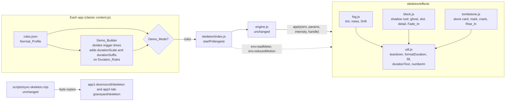
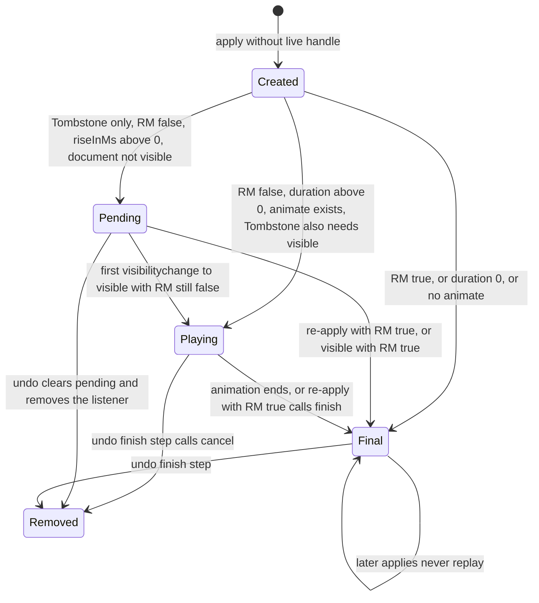

# Design Document: Haunt Polish

## Overview

Haunt Polish is a one-day visual pass. It changes three skeleton effects (Fog, Block, Tombstone), one shared helper module (`skeleton/effects/util.js`), the demo profile builders in both apps, both apps' `rules.json`, the two Package_Validators' `EXPECTED_RULES`, two Graveyard browser assertions, one Tombstone unit test, nine places across three files of the tab-graveyard-app spec (`requirements.md`, `design.md`, `tasks.md`), and three places across two files of the doomscroll-app spec (`requirements.md`, `design.md`). The doomscroll-app `tasks.md` does not change. Flicker, `rot.js`, the engine, meters, validator, schema, `index.js` files, manifests, popups, and `demo-site/` do not change.

The design favours the smallest change per criterion:

- All new motion uses the Web Animations API (`element.animate()`), guarded by `typeof el.animate === 'function'`. No stylesheet, no `@keyframes`, no timers, and no new `[data-poltergeist]` elements.
- All new shared code goes into the existing `util.js`, so the import graph and both manifests stay unchanged.
- Block and Tombstone draw their new visuals inside an open shadow root. Fog draws two unmarked child layers inside the existing Fog_Overlay.
- Visual params that shape the DOM (`figure`, `weathered`) are read once, when the effect creates its element. Params that set text, opacity, or motion are read on every `apply`.

This spec adds no property-based tests (Requirement 9.1). Verification is Vitest example-based tests, the existing unit and browser suites, and the manual Screenshot_Checklist.

### Research findings

- **Web Animations API.** `Element.animate(keyframes, options)` creates and plays an `Animation` and returns it. `options.iterations: Infinity` repeats without end. `Animation.cancel()` removes the effect at once and `Animation.finish()` jumps to the end state ([MDN: Element.animate()](https://developer.mozilla.org/en-US/docs/Web/API/Element/animate), [MDN: Using the Web Animations API](https://developer.mozilla.org/en-US/docs/Web/API/Web_Animations_API/Using_the_Web_Animations_API)). With the default `fill: 'none'`, a finished or cancelled animation leaves the element at its base style. All three motions therefore keep the final state as the base style, so `finish()`, `cancel()`, and "no animation at all" all show the final state.
- **jsdom has no Web Animations API.** Checked locally: with jsdom 25.0.1, `typeof document.createElement('div').animate` is `'undefined'`, and so are `Animation` and `KeyframeEffect`. The effects skip motion when `animate` is missing, so every existing jsdom suite, including the Restoration_Suite, runs with no motion and no change. New tests install a `vi.fn()` as `Element.prototype.animate` with `Object.defineProperty(..., { configurable: true })` and delete it afterwards. `vi.spyOn` cannot be used because the property does not exist.
- **Vitest jsdom defaults.** Vitest 5.1's jsdom environment creates the window with `pretendToBeVisual: true` (read from `node_modules/vitest/dist/chunks/index.Bi0NXYPf.js`), so `document.visibilityState` is `'visible'` unless a test overrides it, as `tombstone.test.js` does.
- **CSSOM colour probe in jsdom.** Assigning to `style.color` on a detached element gives `'rgb(158, 178, 164)'` for `#9eb2a4`, `''` for `red;background:url(x)` and `notacolor`, and `'var(--x)'` for `var(--x)`. A string blocklist must therefore run before the probe (Requirement 5.4).
- **Hit testing through shadow roots.** `document.elementFromPoint` reports a hit on shadow content as the shadow host ([MDN: Document.elementFromPoint()](https://developer.mozilla.org/en-US/docs/Web/API/Document/elementFromPoint), [MDN: ShadowRoot.elementFromPoint()](https://developer.mozilla.org/en-US/docs/Web/API/ShadowRoot/elementFromPoint)). Elements with `pointer-events: none` are skipped. `pointer-events` is inherited, so shadow content follows the host's inline value.
- **Reduced-motion changes.** A `MediaQueryList` from `matchMedia('(prefers-reduced-motion: reduce)')` fires `change` when the preference flips ([MDN: MediaQueryList change event](https://developer.mozilla.org/en-US/docs/Web/API/MediaQueryList/change_event)). `startPoltergeist` reads the same query through the `env.reducedMotion` getter.
- **Code facts that constrain the design.**
  - `app1-doomscroll/test/browser/pause-resume.pw.js` allows at most one light-DOM `[data-poltergeist]` element per kind (two for Flicker). A marked Fog style element would break it, and an unmarked one would be page-global CSS.
  - `skeleton/test/browser/effects.pw.js` reads the Block_Overlay's computed opacity right after `apply`. The Fade_In must not touch the overlay's own opacity.
  - `app1-doomscroll/test/browser/doomscroll.pw.js` compares the Block_Overlay's `textContent` with the rule's `message`, and requires the overlay to be the hit target at the viewport centre.
  - `skeleton/test/tombstone.test.js` counts pending timers after `apply`, so the Rise_In cannot use timers.
  - `scripts/package-checks.mjs` `resolveGraph` follows only static `import`/`export ... from` specifiers. It treats a specifier with a scheme as a remote import. A string literal passed to `createElementNS` is not a specifier.
  - The engine passes the rule's `effect.params` object itself on every `apply`, so effects must not mutate `params`.
  - In Tab Graveyard, `timeAway` rises while the page is hidden. The Tombstone is therefore usually created while the tab is in the background, and the Rise_In must wait for the first visible moment (Requirement 3.12).

### Design decisions

| # | Decision | Alternatives considered | Why |
|---|----------|-------------------------|-----|
| D1 | Web Animations API for the Fade_In, Rise_In, and Drift | CSS `@keyframes` in a shadow-root `<style>` (Block, Tombstone) and a document-level `<style>` (Fog) | One mechanism for all three. No stylesheet, so Fog needs no extra element and pause-resume counts stay at one per kind. No timers. `cancel()` and `finish()` give exact undo and reduced-motion behaviour. jsdom tests spy on one method. |
| D2 | Shared helpers in `util.js`. `tombstone.js` re-exports `formatDuration` from it. | New `skeleton/effects/duration.js` | No new module on the import graph, so `web_accessible_resources` and both manifests stay unchanged (Requirement 7.7, 7.8). |
| D3 | Block: the light DOM keeps exactly one text node (`message`). A shadow root shows it through a `<slot>` and adds the figure and the second line. | Copy the message into the shadow root | One source of message text. `textContent` stays equal to `message`. Screen readers read the flat tree once. |
| D4 | Fog tint and noise are child `div`s of the Fog_Overlay | Overlay `background-color` with alpha | Requirement 5.4 allows the tint only as the whole value of one colour property. The tint opacity then needs its own element, and the overlay's own opacity would also fade the `backdrop-filter`. |
| D5 | Drift moves the noise layer with `transform: translate()` by exactly one 240 px tile period | Animate `background-position` | Transform runs on the compositor and avoids repainting a full-screen gradient every frame, which matters for stutter (Requirement 9.6). One full period ends where it started (Requirement 4.3). |
| D6 | `figure` (Block) and `weathered` (Tombstone) are read when the effect creates its element. Later applies keep the elements created then. | Add or remove the elements on every apply | Rules are static. Requirement 2.6 forbids a second figure. Fewer code paths. |
| D7 | Fog also listens for `change` on the reduced-motion query and stops the Drift at once | Rely on the next `apply` only | In Tab Graveyard, Fog is not re-applied while the tab stays visible, so a running Drift would otherwise survive a switch to `reduce`. The amended tab-graveyard-app Requirement 2.8 (Requirement 8.1) forbids that. Block and Tombstone motions are one-shot (at most 10 s), and Doomscroll already restarts its haunt when the preference changes. |
| D8 | Tombstone keeps resolving `durationMeter` exactly as before (`{...DEFAULTS, ...params}`). Block treats a non-string `durationMeter` as `timeOnSite`. | Same fallback for both | Requirement 1.7 requires unchanged Tombstone text. `durationMeter` is a new param only for Block (Requirement 5.6 covers params this spec introduces). |

## Architecture



The import graph from `skeleton/index.js` does not change. `fog.js`, `block.js`, and `tombstone.js` already import `./util.js`. `tombstone.js` gains `export { formatDuration } from './util.js'`, an edge to a module that is already on the graph.

### Entrance animation and Drift lifecycle



The Drift has no Final state. It is running or stopped, and `syncDrift` reconciles it on every Fog `apply` and on every reduced-motion `change` event (D7).

### Reduced-motion matrix

| Situation | Fade_In (Block) | Rise_In (Tombstone) | Drift (Fog) |
|-----------|-----------------|---------------------|-------------|
| Created with RM false, duration > 0 | Plays once | Plays once if visible, else waits for first visible | Runs while `noise > 0` |
| Created with RM true, or duration 0 | None, content at opacity 1 | None, card in final place at opacity 1 | None, texture fixed |
| Re-apply with RM true | `finish()` on all, never restarts | `finish()`, pending cleared, never restarts | `cancel()` |
| Re-apply with RM false | Nothing (never replays) | Nothing (never replays) | Starts if stopped, else left running |
| RM `change` event, no apply | No reaction | No reaction (pending Rise_In re-checks RM when visible) | `syncDrift` stops or starts it |
| Undo with `durationMs > 0` | Existing overlay opacity fade; Fade_In cancelled in finish | Existing host opacity fade; Rise_In cancelled in finish | Opacity and `backdrop-filter` fade; Drift cancelled in finish |

## Components and Interfaces

### `skeleton/effects/util.js` (changed)

Existing exports stay. These are added:

```js
const plural = (n, unit) => `${n} ${unit}${n === 1 ? '' : 's'}`;

/** Duration_Formatter, moved verbatim from tombstone.js. Non-finite input gives 'a while'. */
export function formatDuration(seconds) {
  if (typeof seconds !== 'number' || !Number.isFinite(seconds)) return 'a while';
  const s = Math.max(0, seconds);
  if (s < 60) return plural(Math.floor(s), 'second');
  if (s < 3600) return plural(Math.floor(s / 60), 'minute');
  if (s < 48 * 3600) return plural(Math.floor(s / 3600), 'hour');
  return plural(Math.floor(s / 86400), 'day');
}

/** Replace each {key} in order; split/join so "$&" stays literal. Moved verbatim from tombstone.js. */
export const fill = (template, values) =>
  Object.entries(values).reduce((s, [key, v]) => s.split(`{${key}}`).join(v), String(template));

/** v if it is a finite number in [min, max], otherwise fallback. */
export const numberIn = (v, min, max, fallback) =>
  typeof v === 'number' && Number.isFinite(v) && v >= min && v <= max ? v : fallback;

/** Duration_Text for one {duration} (Requirement 1.2 to 1.5). */
export function durationText(env, meter, params) {
  const raw = typeof env.readMeter === 'function' ? env.readMeter(meter) : undefined;
  if (typeof raw !== 'number' || !Number.isFinite(raw)) return 'a while';
  const k = params.durationScale;
  const scaled = raw * (typeof k === 'number' && Number.isFinite(k) && k > 0 ? k : 1);
  if (!Number.isFinite(scaled)) return 'a while';
  const suffix = typeof params.durationSuffix === 'string' ? params.durationSuffix : '';
  return formatDuration(scaled) + suffix;
}
```

- With both duration params absent, `durationText` returns exactly `formatDuration(raw)` for finite values and `'a while'` otherwise. That is the old Tombstone output (Requirement 1.7).
- The scale is applied before flooring: 0.5 × 60 = 30 gives `30 seconds`, and 33 × 3600 gives `33 hours` (Requirement 1.8, 1.9).
- In the Tombstone, `fill` replaces `{title}` before `{duration}`, so a `{title}` inside the suffix stays literal. Block replaces only `{duration}`, in one pass. Neither substitutes inside the suffix.

### `skeleton/effects/tombstone.js` (changed)

Public interface: `apply`, `undo`, `description`, `formatTitle` (unchanged), and `formatDuration` (now `export { formatDuration } from './util.js'`).

New params, resolved on every `apply` after `{...DEFAULTS, ...params}`:

| Param | Valid set | Default | Read |
|-------|-----------|---------|------|
| `weathered` | boolean | `true` | at creation (D6) |
| `mark` | any string | `'R.I.P.'` | every apply |
| `riseInMs` | finite 0 to 10000 | `800` | at creation and at the deferred visible start |
| `durationScale`, `durationSuffix` | see `durationText` | 1, `''` | every render |

Shadow tree (the host keeps `HOST_CSS` and has no light-DOM children):

```
div[data-poltergeist="tombstone"]                 opacity = maxOpacity × intensity, pointer-events by blockAt
└─ #shadow-root (open)
   └─ div[role="dialog"]  (handle.card)            Rise_In target; stone or flat look
      ├─ div[aria-hidden="true"]  (handle.markEl)  text = mark; only when mark !== ''
      ├─ h1                                        filled heading
      ├─ p                                         filled message
      ├─ button                                    actionLabel
      └─ div[aria-hidden="true"]  crack            weathered only; no child nodes
```

The chipped section is not an element. It is the card's `clip-path` polygon (weathered only), which cuts a 34 × 26 px chip off the bottom-right corner and a 9 px notch into the left edge. The crack starts at the card's top edge (`top: 0`), so it lies on the outline. The card has `position: relative; overflow: hidden`, which clips the crack to the arch.

Style constants (fixed px font sizes everywhere, Requirement 3.5):

```js
const CARD_BASE =
  'box-sizing:border-box;position:relative;overflow:hidden;max-width:min(32rem,90vw);padding:3rem 2.5rem 2rem;' +
  'border-radius:45% 45% 0.5rem 0.5rem / 25% 25% 0.5rem 0.5rem;color:#ece9e4;' +
  'font:400 16px/1.4 system-ui,sans-serif;text-align:center;';
const CARD_FLAT = CARD_BASE + 'background:#3a3a3f;border:2px solid #55555c;'; // pre-polish colour, border, corners
const STONE_IMAGE = [
  'radial-gradient(circle at 30% 20%, rgba(255,255,255,0.08) 0 1px, transparent 2px)',
  'radial-gradient(circle at 70% 65%, rgba(0,0,0,0.22) 0 1.5px, transparent 2.5px)',
  'radial-gradient(ellipse at 20% 85%, rgba(0,0,0,0.28), transparent 55%)',
  'radial-gradient(ellipse at 80% 10%, rgba(255,255,255,0.10), transparent 50%)',
  'linear-gradient(170deg, #5a5a61 0%, #46464c 60%, #3b3b41 100%)',
].join(', ');
const CHIP_CLIP =
  'polygon(0 0, 100% 0, 100% calc(100% - 26px), calc(100% - 34px) 100%, 0 100%, ' +
  '0 calc(62% + 16px), 9px calc(62% + 7px), 0 62%)';
const CARD_STONE = CARD_BASE +
  'background-color:#4b4b51;background-image:' + STONE_IMAGE + ';' +
  'background-size:7px 7px, 11px 11px, 100% 100%, 100% 100%, 100% 100%;' +
  'border:2px solid #6c6c73;text-shadow:0 1px 0 rgba(0,0,0,0.55);clip-path:' + CHIP_CLIP + ';';
const CRACK_CSS =
  'position:absolute;top:0;left:60%;width:34px;height:86px;' +
  'background-image:linear-gradient(180deg, rgba(14,14,16,0.95), rgba(14,14,16,0.35));' +
  'clip-path:polygon(44% 0, 60% 0, 52% 24%, 76% 44%, 54% 68%, 64% 100%, 56% 100%, 42% 70%, 62% 45%, 38% 25%);';
const MARK_CSS = 'margin:0 0 12px;font:600 22px/1 Georgia,serif;letter-spacing:6px;color:#d9d5cd;';
const HEADING_CSS = 'margin:0 0 0.75rem;font:600 30px/1.25 system-ui,sans-serif;overflow-wrap:anywhere;';
const MESSAGE_CSS = 'margin:0 0 1.5rem;font:400 20px/1.4 system-ui,sans-serif;';
const BUTTON_CSS =
  'font:600 17px system-ui,sans-serif;padding:0.6rem 1.4rem;border:0;border-radius:0.4rem;' +
  'background:#ece9e4;color:#1b1b1d;cursor:pointer;text-shadow:none;';
const RISE_KEYFRAMES = [
  { opacity: 0, transform: 'translateY(48px)' },
  { opacity: 1, transform: 'translateY(0px)' },
];
const RISE_TIMING = { easing: 'cubic-bezier(0.2, 0.8, 0.2, 1)', iterations: 1 }; // duration = riseInMs
```

The screenshot pass may tune gradient stops, colours, and the crack and chip coordinates. Param defaults, font sizes, and the element structure are fixed here.

Behaviour changes, in the order they run:

1. `apply` resolves `p` first. If there is no live handle, it calls `create(env, p)`, which builds the card with `CARD_STONE` (plus the crack) or `CARD_FLAT`, then appends the host as before.
2. On a live handle, `apply` sets `handle.params = p`, the host opacity, and pointer-events as before, then calls `syncMark(handle, p.mark)` and `render(handle)`.
   - `syncMark` creates the mark `div` before the `h1` when `mark` is non-empty, sets its `textContent` to `mark` with no placeholder replacement, and removes it when `mark` is `''`.
   - `render` now fills `duration` with `durationText(env, params.durationMeter, params)`.
3. On a newly created handle, `apply` calls `startRiseOrDefer(handle)`:
   - If `env.reducedMotion` is true or `riseInMs` is 0, nothing happens.
   - Otherwise, if `document.visibilityState === 'visible'`, it calls `startRise`.
   - Otherwise it sets `handle.risePending = true`.
4. On a re-apply with `env.reducedMotion` true, `apply` calls `endRise(handle)`, which runs `handle.rise?.finish()` and clears `rise` and `risePending`.
5. The existing `onVisible` listener first checks `risePending`. If it is set, the listener clears it and calls `startRise` (which re-checks `handle.env.reducedMotion` and `riseInMs`). Then it schedules the existing re-render timer exactly as before. `apply` itself never schedules a timer (Requirement 3.9).
6. `startRise` calls `card.animate(RISE_KEYFRAMES, { ...RISE_TIMING, duration: riseInMs })` only when `typeof card.animate === 'function'`, and stores the result in `handle.rise`.
7. `undo` begin step: the existing steps, plus `risePending = false`. Finish step: the existing steps, plus `handle.rise?.cancel()`. The Rise_In may continue during a fade-out and is cancelled when the host is removed.

The host's inline `transition` and `animation` stay empty while the card rises (Requirement 3.8). Only the existing undo fade sets `transition`.

### `skeleton/effects/block.js` (changed)

New params:

| Param | Valid set | Default | Read |
|-------|-----------|---------|------|
| `figure` | `'ghost'`, `'none'` | `'ghost'` | at creation (D6) |
| `detail` | any string | `''` | every apply |
| `durationMeter` | any string | `'timeOnSite'` | every apply |
| `fadeInMs` | finite 0 to 10000 | `1500` | at creation |
| `durationScale`, `durationSuffix` | see `durationText` | 1, `''` | every apply |

Shadow tree (the host keeps its current `cssText`, `role="status"`, and `data-poltergeist="block"`):

```
div[data-poltergeist="block"][role="status"]     light DOM: one text node === message
└─ #shadow-root (open)
   └─ div  (handle.stage)                         flex column, centred, gap 24px, max-width 960px
      ├─ svg[aria-hidden="true"] (handle.figureEl)   ghost; only when figure === 'ghost'   ← Fade_In
      ├─ div (handle.messageEl) > slot               40px bold, shows the light-DOM text  ← Fade_In
      └─ p   (handle.detailEl)                       24px, filled detail; only when non-empty ← Fade_In
```

- The flex-column order puts the figure's bottom edge above the message and the second line's top edge below it (Requirement 2.2, 2.4).
- The `svg` is the only `aria-hidden` element and `p` is the only paragraph (Requirement 2.3 to 2.5).
- No shadow element sets `pointer-events`, so all of them inherit the host's inline value. When the host is `auto`, `elementFromPoint` at the centre returns the host even over the ghost or text (Requirement 2.12).

Ghost figure, built with `doc.createElementNS('http://www.w3.org/2000/svg', tag)` in one local helper. That call is the only place the namespace string appears (Requirement 7.11):

```
svg     viewBox="0 0 120 140" width="120" height="140" aria-hidden="true" style="display:block"
path    d="M10 60a50 50 0 0 1 100 0v70q-8.33-10-16.67 0t-16.67 0-16.66 0-16.67 0-16.66 0-16.67 0z" fill="#f2f2f7"
ellipse cx="44" cy="62" rx="7" ry="10" fill="#15151a"
ellipse cx="76" cy="62" rx="7" ry="10" fill="#15151a"
ellipse cx="60" cy="92" rx="8" ry="10" fill="#15151a"
```

Style constants:

```js
const STAGE_CSS = 'display:flex;flex-direction:column;align-items:center;gap:24px;max-width:960px;';
const MESSAGE_CSS = 'font:700 40px/1.25 system-ui,sans-serif;';
const DETAIL_CSS = 'margin:0;font:400 24px/1.4 system-ui,sans-serif;color:#d4d4dc;';
const FADE_KEYFRAMES = [{ opacity: 0 }, { opacity: 1 }];
const FADE_TIMING = { easing: 'ease-out', iterations: 1 }; // duration = fadeInMs
```

`apply` flow:

```js
export function apply(env, params = {}, intensity, handle) {
  const p = resolve(params);               // defaults + valid-set fallbacks, never mutates params
  const i = clamp01(intensity);
  const created = !handle || handle.dead;
  if (created) handle = create(env, p);    // host + shadow root + stage + figure + message slot
  handle.el.textContent = p.message;       // unchanged light-DOM contract
  syncDetail(handle, env, p);              // add, update, or remove the p; text via fill + durationText
  handle.el.style.opacity = String((p.maxOpacity * i).toFixed(3));
  handle.el.style.pointerEvents = i >= p.blockAt ? 'auto' : 'none';
  if (created) startFade(handle, env, p.fadeInMs); // after syncDetail, so the second line fades too
  else if (env.reducedMotion) endFade(handle);     // finish() each, then clear; never restarts
  return handle;
}
```

- `startFade` does nothing when `env.reducedMotion` is true or `fadeInMs` is 0. Otherwise it calls `el.animate(FADE_KEYFRAMES, { ...FADE_TIMING, duration: fadeInMs })` on each of `figureEl`, `messageEl`, and `detailEl` that exists and has `animate`, and keeps the results in `handle.fade`. Each element animates its own opacity, so the overlay's opacity stays `maxOpacity × intensity` (Requirement 2.7, 2.9).
- `undo` keeps the existing begin step. The finish step runs `cancel()` on every `handle.fade` entry, clears the list, and removes the host (Requirement 2.13, 2.14).
- A second line that first appears on a later apply is shown at full opacity. It was not part of the Fade_In.

### `skeleton/effects/fog.js` (changed)

New params:

| Param | Valid set | Default | Notes |
|-------|-----------|---------|-------|
| `tint` | any string; a non-empty one must pass the tint check | `'#9eb2a4'` (faint green-grey) | a failing string is treated as `''` (Requirement 5.10) |
| `noise` | finite 0 to 1 | `0.3` | 0 means no noise layer |
| `driftMs` | 0, or finite 1000 to 600000 | `20000` | 0 means a fixed texture |

Fixed constants: `TINT_MAX_OPACITY = 0.22` and `DRIFT_PX = 240`.

DOM (the overlay keeps every existing inline style and adds `overflow: hidden` so the oversized noise layer never adds scrollable area):

```
div[data-poltergeist="fog"]          backdrop-filter unchanged; pointer-events none; z-index 2147483645
├─ div (handle.tintEl)               only for an accepted non-empty tint
│                                    inset 0; pointer-events none; backgroundColor = tint; opacity = 0.22 × i
└─ div (handle.noiseEl)              only when noise > 0
                                     top/left -240px, right/bottom 0; pointer-events none; will-change transform
                                     background-image = NOISE_IMAGE; opacity = noise × i; Drift target
```

Neither child carries `data-poltergeist`, so light-DOM marker counts stay at one Fog element.

```js
const NOISE_IMAGE = [ // every tile size divides DRIFT_PX (240), so one Drift cycle ends where it started
  'radial-gradient(circle at 30% 40%, rgba(255,255,255,0.55) 0 1px, transparent 1.6px)',
  'radial-gradient(circle at 70% 20%, rgba(0,0,0,0.45) 0 1px, transparent 1.6px)',
  'radial-gradient(circle at 55% 75%, rgba(255,255,255,0.4) 0 0.8px, transparent 1.4px)',
  'radial-gradient(circle at 15% 85%, rgba(0,0,0,0.35) 0 1.2px, transparent 1.8px)',
  'radial-gradient(ellipse 60% 40% at 30% 40%, rgba(235,242,238,0.45), transparent 70%)',
  'radial-gradient(ellipse 50% 35% at 75% 70%, rgba(220,232,226,0.35), transparent 70%)',
].join(', ');
const NOISE_SIZE = '24px 24px, 30px 30px, 16px 16px, 40px 40px, 240px 240px, 240px 240px';
const DRIFT_KEYFRAMES = [{ transform: 'translate(0px, 0px)' }, { transform: 'translate(240px, 240px)' }];
const DRIFT_TIMING = { easing: 'linear', iterations: Infinity }; // duration = driftMs
```

The screenshot pass may tune gradient stops and colours. Every tile size must keep dividing 240 px.

Tint check (Requirement 5.4), run on every apply:

```js
function acceptedTint(doc, value) {
  const t = typeof value === 'string' ? value : DEFAULT_TINT;  // non-string falls back to the default
  if (t === '' || /[\\;{}]/.test(t) || /(?:var|env|attr|url)\(/i.test(t)) return '';
  const probe = doc.createElement('div');                       // never attached to the document
  probe.style.color = t;
  return probe.style.color === '' ? '' : t;
}
```

An accepted colour is written only as `tintEl.style.backgroundColor = t`, never into `cssText`, a style element, or a gradient.

`apply` flow on a live handle:

1. Set the `backdrop-filter` and `-webkit-backdrop-filter` exactly as before (Requirement 4.6).
2. `syncTint`: create the tint layer with `prepend` so it stays below the noise, update it, or remove it.
3. `syncNoise`: create, update, or remove the noise layer. Removing it cancels the Drift first.
4. Store `handle.driftMs`.
5. `syncDrift(handle, env)`: the Drift is wanted when `noiseEl` exists, `env.reducedMotion` is false, `driftMs` is greater than 0, and `noiseEl.animate` is a function. A wanted Drift that is not running starts. An unwanted running Drift gets `cancel()`. A running wanted Drift is left alone, so its cycle never restarts (Requirement 4.5).

At creation the handle also gets `unwatch = watchMotion(env, () => { if (handleState(handle) === LIVE) syncDrift(handle, handle.env); })`. `watchMotion` is a small local function in `fog.js`. It calls `env.window?.matchMedia?.('(prefers-reduced-motion: reduce)')`, adds a `change` listener when `addEventListener` exists, and returns the remover, or a no-op function when there is no `matchMedia` (jsdom, and the skeleton browser env).

`undo`:

- Begin step (`durationMs > 0`): keep the existing overlay transition and zero `backdrop-filter`. On each existing layer, set `transition = opacity <d>ms linear` and `opacity = '0'`. All four values fade linearly over the same `durationMs` (Requirement 4.8).
- Finish step (after `durationMs`, or at once): `unwatch()`, `drift?.cancel()`, then remove the overlay together with its layers (Requirement 4.9).

### App Demo_Builders (changed)

Both functions keep their shape. The trigger division no longer `continue`s, so every rule also reaches the Duration_Rule check. Malformed rules are skipped without error (Requirement 6.9).

`app2-tab-graveyard/content.js`:

```js
function graveyardCreateDemoProfile(normalDocument) {
  const DEMO_TIME_SCALE = 3600;
  const DEMO_SUFFIX = ' (demo time)';
  const demo = typeof structuredClone === 'function'
    ? structuredClone(normalDocument)
    : JSON.parse(JSON.stringify(normalDocument));
  const rules = Array.isArray(demo) ? demo : demo && Array.isArray(demo.rules) ? demo.rules : [];
  for (const rule of rules) {
    const trigger = rule && rule.trigger;
    if (trigger && typeof trigger === 'object') {
      if (typeof trigger.threshold === 'number') trigger.threshold /= DEMO_TIME_SCALE;
      if (typeof trigger.rampTo === 'number') trigger.rampTo /= DEMO_TIME_SCALE;
    }
    // Duration_Rule: params name a string durationMeter. Its {duration} reads in demo time.
    const effect = rule && rule.effect;
    const params = effect && typeof effect === 'object' ? effect.params : undefined;
    if (params && typeof params === 'object' && !Array.isArray(params) && typeof params.durationMeter === 'string') {
      params.durationScale = DEMO_TIME_SCALE;
      params.durationSuffix = DEMO_SUFFIX;
    }
  }
  return demo;
}
```

`app1-doomscroll/content.js` gets the same body with `DEMO_TIME_SCALE = 60` in place of the two literal `60` divisors. Both doc comments add one sentence: "Rules whose params name a string `durationMeter` also get `durationScale` and `durationSuffix` so their `{duration}` text reads in demo time."

Existing property tests stay valid without edits:

- Doomscroll Property 2 and Graveyard Property 4 generate `effect.params` with `fc.dictionary(fc.string({ maxLength: 4 }), fc.integer())`. A key has at most 4 characters, so `durationMeter` (13 characters) never appears. Every generated rule is therefore not a Duration_Rule and comes out exactly as before.
- The trigger handling is unchanged for every generated shape.

## Data Models

### Normal_Profile params (exact, in key order)

The Package_Validators compare params with `JSON.stringify`, so key order matters. Both apps use the same Fog visual values.

`app1-doomscroll/rules.json` (only `effect.params` change; every other field stays as is):

| Rule | `effect.params` |
|------|-----------------|
| `doomscroll-fog` | `{ "maxBlur": 5, "maxGrayscale": 0.8, "tint": "#9eb2a4", "noise": 0.3, "driftMs": 20000 }` |
| `doomscroll-flicker` | unchanged: `{ "maxDepth": 0.22, "periodMs": 1600 }` |
| `doomscroll-rot` | `{ "maxFraction": 0.55, "glyphs": "▓▒░█" }` |
| `doomscroll-block` | `{ "maxOpacity": 0.96, "blockAt": 0.8, "message": "You have scrolled long enough. Close this tab and take a break.", "detail": "You lost {duration} to this feed.", "durationMeter": "timeOnSite", "figure": "ghost", "fadeInMs": 1500 }` |

`app2-tab-graveyard/rules.json`:

| Rule | `effect.params` |
|------|-----------------|
| `graveyard-fog` | `{ "maxBlur": 4, "maxGrayscale": 0.8, "tint": "#9eb2a4", "noise": 0.3, "driftMs": 20000 }` |
| `graveyard-rot` | `{ "maxFraction": 0.45, "glyphs": "▓▒░█" }` |
| `graveyard-tombstone` | `{ "heading": "Here lies {title}", "message": "Abandoned for {duration}.", "actionLabel": "Resurrect", "action": "resurrect", "durationMeter": "timeAway", "maxOpacity": 0.96, "weathered": true, "mark": "R.I.P.", "riseInMs": 800 }` |

Neither file contains `durationScale` or `durationSuffix` (Requirement 6.5). Each has exactly one Duration_Rule: `doomscroll-block` and `graveyard-tombstone` (Requirement 6.10).

### `EXPECTED_RULES` (exact replacements)

`scripts/validate-doomscroll-package.mjs`:

```js
export const EXPECTED_RULES = Object.freeze([
  { id: 'doomscroll-fog', threshold: 120, rampTo: 300, type: 'fog', params: { maxBlur: 5, maxGrayscale: 0.8, tint: '#9eb2a4', noise: 0.3, driftMs: 20000 }, undo: { mode: 'fade', durationMs: 400 } },
  { id: 'doomscroll-flicker', threshold: 300, rampTo: 600, type: 'flicker', params: { maxDepth: 0.22, periodMs: 1600 }, undo: { mode: 'instant' } },
  { id: 'doomscroll-rot', threshold: 600, rampTo: 900, type: 'rot', params: { maxFraction: 0.55, glyphs: '▓▒░█' }, undo: { mode: 'instant' } },
  { id: 'doomscroll-block', threshold: 1200, rampTo: 1500, type: 'block', params: { maxOpacity: 0.96, blockAt: 0.8, message: MESSAGE, detail: 'You lost {duration} to this feed.', durationMeter: 'timeOnSite', figure: 'ghost', fadeInMs: 1500 }, undo: { mode: 'fade', durationMs: 600 } },
]);
```

`scripts/validate-graveyard-package.mjs`:

```js
export const EXPECTED_RULES = Object.freeze([
  { id: 'graveyard-fog', trigger: { meter: 'timeAway', threshold: 1800, rampTo: 7200 }, type: 'fog', params: { maxBlur: 4, maxGrayscale: 0.8, tint: '#9eb2a4', noise: 0.3, driftMs: 20000 }, undo: { mode: 'fade', durationMs: 400 } },
  { id: 'graveyard-rot', trigger: { meter: 'timeAway', threshold: 14400, rampTo: 43200 }, type: 'rot', params: { maxFraction: 0.45, glyphs: '▓▒░█' }, undo: { mode: 'instant' } },
  {
    id: 'graveyard-tombstone',
    trigger: { meter: 'timeAway', threshold: 86400 },
    type: 'tombstone',
    params: { heading: 'Here lies {title}', message: 'Abandoned for {duration}.', actionLabel: 'Resurrect', action: 'resurrect', durationMeter: 'timeAway', maxOpacity: 0.96, weathered: true, mark: 'R.I.P.', riseInMs: 800 },
    undo: { mode: 'fade', durationMs: 600 },
  },
]);
```

Nothing else in either validator, in `package-checks.mjs`, or in the sync scripts changes (Requirement 7.10).

### Demo_Profile additions

| App | Duration_Rule | Added params |
|-----|---------------|--------------|
| Doomscroll | `doomscroll-block` | `durationScale: 60`, `durationSuffix: " (demo time)"` |
| Graveyard | `graveyard-tombstone` | `durationScale: 3600`, `durationSuffix: " (demo time)"` |

Resulting demo text: `You lost 20 minutes (demo time) to this feed.` at `timeOnSite` 20, and `Abandoned for 33 hours (demo time).` at `timeAway` 33 (Requirement 6.7, 6.8).

### Handle shapes (additions only)

| Effect | Added handle fields |
|--------|---------------------|
| Block | `stage`, `figureEl` (or `null`), `messageEl`, `detailEl` (or `null`), `fade: Animation[]` |
| Tombstone | `card`, `markEl` (or `null`), `crackEl` (or `null`), `rise: Animation \| null`, `risePending: boolean` |
| Fog | `tintEl`, `noiseEl` (each or `null`), `drift: Animation \| null`, `driftMs`, `unwatch: () => void` |

All handles keep `env`, `dead`, `fading`, and `timer`, and use `teardown` exactly as before.

### Rot glyphs

`rot.js` is unchanged. Both rules set `glyphs` to `▓▒░█`. `Array.from` splits it into 4 glyphs, so rotted characters become solid or shaded blocks and never spaces. That keeps them readable on camera.

### Earlier app spec edits (Requirement 8, exact text)

#### tab-graveyard-app (`.kiro/specs/tab-graveyard-app/`)

`requirements.md`, Requirement 2, criterion 4 becomes (Requirement 8.9, 8.11):

> 4. THE `graveyard-rot` rule SHALL start at 14400 seconds (4 hours), reach full intensity at 43200 seconds (12 hours), use effect `rot` with `maxFraction` 0.45 and glyphs `▓▒░█`, and undo instantly. (amended by haunt-polish)
>
>    Reason (haunt-polish): The old light glyphs `░▒·_ ` were hard to see at video resolution.

`requirements.md`, directly after Requirement 2, criterion 5, which begins "5. THE `graveyard-tombstone` rule SHALL start at 86400 seconds" (criterion text unchanged, Requirement 8.12):

>    Note (haunt-polish): haunt-polish Requirement 7 adds `tint`, `noise`, and `driftMs` to `graveyard-fog`, and `weathered`, `mark`, and `riseInMs` to `graveyard-tombstone`. The exact values are in haunt-polish `design.md`. The params listed in criteria 3 to 5 stay as stated, apart from the glyphs amended in criterion 4.

`requirements.md`, Requirement 2, criterion 8 becomes (Requirement 8.1, 8.3):

> 8. THE app SHALL NOT use the `flicker` effect. THE app's only animations and transitions SHALL be the fade-out on undo, the Fog Drift, and the Tombstone Rise_In defined in the haunt-polish spec. WHILE the user's `prefers-reduced-motion` preference is `reduce`, THE app's only animation or transition SHALL be the fade-out on undo. WHILE Demo_Mode is on, THE Tombstone SHALL fill `{duration}` with the Away_Time multiplied by the Demo_Time_Scale and followed by ` (demo time)`, as defined in haunt-polish Requirements 1 and 6 (for example `Abandoned for 33 hours (demo time).` after 33 seconds away). WHILE Demo_Mode is off, THE Tombstone `{duration}` text SHALL be the same as before haunt-polish. (amended by haunt-polish)
>
>    Reason (haunt-polish): The 3-minute demo video must show the Graveyard finale clearly, and a tombstone that appears in a single frame is easy to miss on camera. `prefers-reduced-motion` remains the safeguard, so users who ask for reduced motion see no new motion. Demo_Mode durations are labelled `(demo time)` so that viewers see realistic durations and know they are simulated.

`requirements.md`, directly after Requirement 4, criterion 5 (criterion text unchanged, Requirement 8.6):

>    Note (haunt-polish): haunt-polish Requirement 1 extends this criterion with the `durationScale` and `durationSuffix` params. When both params are absent, as in the Normal_Profile, the inserted text is unchanged. In Demo_Mode the Tombstone shows demo time instead of seconds, for example `33 hours (demo time)` after 33 seconds away.

`requirements.md`, Requirement 4, criterion 10 becomes (Requirement 8.2, 8.3):

> 10. WHEN applied without a live Handle while `env.reducedMotion` is false and `riseInMs` is greater than 0, THE Tombstone_Effect SHALL play the Rise_In defined in the haunt-polish spec once. WHEN applied without a live Handle while `env.reducedMotion` is true or `riseInMs` is 0, THE Tombstone_Effect SHALL show no animation. WHEN applied with a live Handle, THE Tombstone_Effect SHALL NOT replay the Rise_In or start any other animation. WHEN applied, THE Tombstone_Effect SHALL schedule no timer. (amended by haunt-polish)
>
>    Reason (haunt-polish): The 3-minute demo video must show the Graveyard finale clearly, and a tombstone that appears in a single frame is easy to miss on camera. `prefers-reduced-motion` remains the safeguard, so users who ask for reduced motion see no new motion.

`requirements.md`, directly after Requirement 4, criterion 12 (criterion text unchanged, Requirement 8.4):

>    Note (haunt-polish): This criterion limited only the skeleton changes made under this spec. haunt-polish deliberately changes the Fog, Block, and Tombstone effects and the Rot glyphs in both apps' rules, and leaves Flicker, `rot.js`, `engine.js`, and `match.js` unchanged.

`design.md`, directly after Property 4's `**Validates: Requirement 2.6**` line (Requirement 8.7):

> Note (haunt-polish): The `graveyard-tombstone` rule is a Duration_Rule (its params name a string `durationMeter`), so its Demo_Profile copy also gains `durationScale` 3600 and `durationSuffix` set to the Demo_Suffix ` (demo time)`. The property as written holds for every rule without a string `durationMeter`, and these are the only rules its test generator produces.

`tasks.md`, as a nested bullet directly under "- No site-specific selectors, no animation, no watch modes. …" in "Constraints for every task" (Requirement 8.8):

>   - Note (haunt-polish): haunt-polish allows the Fog Drift and the Tombstone Rise_In. Neither plays while `prefers-reduced-motion` is `reduce`.

`design.md`, directly after the closing fence of the JSON code block in "### Rules (`app2-tab-graveyard/rules.json`)", before "### Schedules" (listing unchanged, Requirement 8.14):

> Note (haunt-polish): The Rot glyphs are now `▓▒░█`. haunt-polish added new visual params to the Fog and Tombstone rules. haunt-polish `design.md` holds the current values.

#### doomscroll-app (`.kiro/specs/doomscroll-app/`)

`requirements.md`, Requirement 2, criterion 7 becomes (Requirement 8.10, 8.11):

> 7. THE `doomscroll-rot` rule SHALL start at 600 seconds, ramp to full intensity at 900 seconds, use effect type `rot` with `maxFraction` 0.55 and nonempty glyph string `▓▒░█`, and use instant undo. (amended by haunt-polish)
>
>    Reason (haunt-polish): The old light glyphs `░▒·_ ` were hard to see at video resolution.

`requirements.md`, directly after Requirement 2, criterion 8, which begins "8. THE `doomscroll-block` rule SHALL start at 1200 seconds" (criterion text unchanged, Requirement 8.13):

>    Note (haunt-polish): haunt-polish Requirement 7 adds `tint`, `noise`, and `driftMs` to `doomscroll-fog`, and `figure`, `fadeInMs`, `detail`, and `durationMeter` to `doomscroll-block`. The exact values are in haunt-polish `design.md`. The params listed in criteria 4 and 8 stay as stated.

`design.md`, directly after the last row of the rule table in "### Rule profile" (the `doomscroll-block` row), before the paragraph that begins "Because `computeIntensity` yields" (table unchanged, Requirement 8.15):

> Note (haunt-polish): The Rot glyphs are now `▓▒░█`. haunt-polish added new visual params to the Fog and Block rules. haunt-polish `design.md` holds the current values.

`tasks.md` in doomscroll-app does not change, although its Rot task still names the old glyphs (Requirement 8.5).

#### Placement rules

- Notes under a numbered criterion are indented 3 spaces, and the note in tab-graveyard-app `tasks.md` is a nested bullet indented 2 spaces, so list numbering and nesting stay intact.
- Notes after a code block or a table are top-level paragraphs, separated from the block or table by one blank line, so the table stays a single table.
- No other text in the five edited files changes (Requirement 8.5).

### Graveyard browser test edits (Requirement 9.3)

In both `return-resurrect.pw.js` and `discard-reload.pw.js`, the comment "… and under 60 s so the duration is worded in seconds" becomes "Demo_Mode shows the duration in demo time: each second away reads as one hour." The message assertion becomes the following. `upper` is `Math.ceil(longAwayMs / 1000) + 1` in `return-resurrect.pw.js`, and `Math.ceil((Date.now() - left) / 1000) + 1` in `discard-reload.pw.js`, as each test already measures.

```js
  const message = tombstone.locator('p');
  await expect(message).toHaveText(/^Abandoned for \d+ (?:hours|days) \(demo time\)\.$/);
  const [, shownCount, shownUnit] = (await message.textContent())
    .match(/^Abandoned for (\d+) (hours|days) \(demo time\)\.$/);
  const upper = Math.ceil(longAwayMs / 1000) + 1; // discard-reload: Math.ceil((Date.now() - left) / 1000) + 1
  if (shownUnit === 'hours') {
    expect(Number(shownCount)).toBeGreaterThanOrEqual(TOMBSTONE_S);
    expect(Number(shownCount)).toBeLessThanOrEqual(upper);
  } else {
    expect(upper, 'days only once the absence reaches 48 s').toBeGreaterThanOrEqual(48);
    expect(Number(shownCount)).toBeGreaterThanOrEqual(2);
    expect(Number(shownCount)).toBeLessThanOrEqual(Math.floor(upper / 24));
  }
```

`TOMBSTONE_S` is 24, so N is between 24 and `upper`. Days are accepted only when `upper` is at least 48, with D between 2 and `floor(upper / 24)`. No other line in those files changes.

### Rewritten Tombstone unit test (Requirement 9.3)

In `skeleton/test/tombstone.test.js`, the test "shows no animation and schedules no timers when applied" is replaced in place by the following. It is the only change to that file.

```js
  it('plays the Rise_In only when motion is allowed and schedules no timers when applied', () => {
    const calls = [];
    Object.defineProperty(Element.prototype, 'animate', {
      configurable: true,
      writable: true,
      value: vi.fn(function animate(keyframes, options) {
        const anim = { target: this, keyframes, options, cancel: vi.fn(), finish: vi.fn() };
        calls.push(anim);
        return anim;
      }),
    });
    try {
      for (const [params, reducedMotion, plays] of [[{}, false, true], [{}, true, false], [{ riseInMs: 0 }, false, false]]) {
        calls.length = 0;
        const h = ts(makeEnv({ reducedMotion }), params, 1);
        expect(hostEl().style.transition).toBe('');
        expect(hostEl().style.animation).toBe('');
        expect(['', 'none']).toContain(h.card.style.animation);
        const onCard = calls.filter((c) => c.target === h.card);
        if (plays) {
          expect(onCard).toHaveLength(1);
          expect(onCard[0].options).toMatchObject({ duration: 800, iterations: 1 });
        } else {
          expect(onCard).toHaveLength(0);
        }
        expect(calls.filter((c) => c.target === hostEl())).toHaveLength(0);
        expect(vi.getTimerCount()).toBe(0);
        tombstone.undo(h, { durationMs: 0 });
      }
    } finally {
      delete Element.prototype.animate;
    }
  });
```

## Correctness Properties

This spec adds no property-based tests: no new `fast-check` import and no new `fc.assert` call (Requirement 9.1). PBT does not fit this work. Most of the change is DOM rendering, styling, and one-shot animation wiring in jsdom, where the useful checks are concrete examples, and the requirements pin the exact example values. The invariants below are the correctness rules of the design. Each one is checked by named example-based Vitest cases or by an existing suite.

### Invariant 1: Restoration after undo

Every Fog, Block, and Tombstone handle, with motion running or not, leaves the Restoration_Suite snapshot equal to the snapshot before the first apply. This holds after an instant undo, and after a fade undo once `durationMs` has passed. A second undo changes nothing. Checked by the existing `restoration.test.js` (including the 24-order test) and by `polish-safety.test.js` "undo cancels every animation and restores the snapshot", which runs with the animate spy installed.

**Validates: Requirements 2.13, 2.14, 3.13, 4.8, 4.9, 5.7**

### Invariant 2: No motion under reduced motion

For each of the three effects, applying with `reducedMotion` true starts no animation, and re-applying with `reducedMotion` true ends or stops any running one. Checked in `polish-block.test.js`, `polish-tombstone.test.js`, `polish-fog.test.js` (cases "Fade_In / Rise_In / Drift do not play when reducedMotion is true" and "re-apply with reducedMotion true ends it"), and by the rewritten `tombstone.test.js` case.

**Validates: Requirements 2.8, 3.7, 4.4, 4.5, 5.5, 5.11**

### Invariant 3: Unchanged default text

With `durationScale` and `durationSuffix` absent, the Tombstone heading and message equal the pre-polish output for the existing meter table, the missing-`readMeter` case, and custom templates. Checked by the unchanged `tombstone.test.js` placeholder cases and `index.test.js`, plus `polish-duration.test.js` "formatDuration is the util implementation and matches the pinned table".

**Validates: Requirements 1.6, 1.7**

### Invariant 4: Demo builder isolation

The Demo_Builder adds the two duration params only to Duration_Rules and leaves the Normal_Profile deep-equal to a copy taken before the call. Checked by the existing Doomscroll Property 2 and Graveyard Property 4 (unedited) and the new `demo-time.test.js` cases in each app.

**Validates: Requirements 6.1 to 6.4, 6.9**

## Error Handling

| Condition | Behaviour |
|-----------|-----------|
| Any new param present with a value outside its valid set, including `null` | Effect uses the param's default and renders the rest normally (Requirement 5.6). The only exception is `tint`: a non-empty string that fails the tint check is treated as `''`. |
| `env.readMeter` missing, or it returns a non-number, `NaN`, or `Infinity`, or the scaled value overflows | `durationText` returns `a while` with no suffix (Requirement 1.3). |
| `durationScale` of 0, a negative number, `NaN`, `Infinity`, or `"60"` | Scale 1 (Requirement 1.4). |
| `durationSuffix` that is not a string | Empty suffix (Requirement 1.5). |
| `tint` such as `red;background:url(https://example.com/x.png)` | Rejected by the `;` and `url(` checks before the probe. No layer and no declaration is written (Requirement 5.10). |
| `element.animate` missing (jsdom, very old engines) | No motion. Elements show their final state. |
| `env.window` or `matchMedia` missing (jsdom, skeleton browser env) | `watchMotion` returns a no-op remover. The Drift follows only `apply`. |
| Env with only `document` and `reducedMotion` (skeleton browser suite) | No timers are needed for instant undo. `readMeter` is missing, so `{duration}` gives `a while`. No error (Requirement 5.8). |
| Visibility event after undo | The listener is removed in the begin step, so no Rise_In can start later (Requirement 3.13). |
| Undo while a fade-out is running | The existing `teardown` behaviour applies. Finish runs once, and animations are cancelled in finish. |
| Malformed rule passed to a Demo_Builder (`null`, a string, no `effect`, `params` that is `null`, an array, or a string, a non-string `durationMeter`) | Skipped for the duration params, with no error. `validateRules` decides validity as before (Requirement 6.9). |
| Effect code throws for any other reason | Unchanged. The engine's `safe()` wrapper logs and continues. |

## Testing Strategy

### Approach

- **Vitest example-based tests** for every new param (default plus one valid override), every Duration_Text case named in Requirement 9.1, the motion rules in Requirement 9.7, and the observation rule in Requirement 9.8.
- **Existing suites unchanged**, except the edits listed in Requirement 9.3: the Restoration_Suite, `effects.test.js`, `tombstone.test.js` (one test rewritten), `index.test.js`, the app unit, package, and popup tests, and all Playwright projects (two assertions edited).
- **Manual Screenshot_Checklist** in Chrome for looks, geometry, and smoothness, which jsdom cannot show.
- **No property-based tests.** Requirement 9.1 forbids them. The design's invariants are pinned by examples (see Correctness Properties).

### Shared test helper

`skeleton/test/polish-helpers.js` is a plain module, not matched by `*.test.js`. It exports:

- `installAnimateSpy()`: defines `Element.prototype.animate` as a `vi.fn()`. Each call records `{ target, keyframes, options, cancel, finish, playState }` and returns a fake `Animation`. The helper returns `{ calls, on(el), restore() }`.
- `makeEnv(overrides)`: `{ window, document, reducedMotion: false, setTimeout, clearTimeout, readMeter: () => undefined }` merged with `overrides`.
- `isPlaying(spy, el, { duration, iterations })` and `isStill(spy, el)`: the Requirement 9.8 rule. Playing means one `animate()` call on `el` with that duration and iteration count. Still means no call on `el` and `el.style.animation` is `''` or `'none'`.

The helper lives under `skeleton/test/`, which the Skeleton_Sync excludes, so it never ships.

### New test files and cases

| File | Cases |
|------|-------|
| `skeleton/test/polish-duration.test.js` (jsdom) | `tombstone.formatDuration === util.formatDuration` and the old table. For Tombstone and Block: `33 hours (demo time)` at scale 3600 and `2 days (demo time)` at meter 48; `20 minutes (demo time)` and `30 seconds (demo time)` (meter 0.5) at scale 60; `a while` with no suffix when `readMeter` is missing or returns `NaN`; scale 1 for `durationScale` 0, -1, and `"60"`; empty suffix for `durationSuffix` 5 and `null`; suffix text taken literally (`" {title}"`). Re-apply and re-render after visible use the latest params and meter (Requirement 1.10). |
| `skeleton/test/polish-block.test.js` (jsdom) | Open shadow root, no light-DOM elements, `textContent === message` with a `{duration}` left literal. `figure` default gives exactly one `aria-hidden` `svg` before the message, and `none` gives none. `detail` default gives no `p`, and a set `detail` gives one `p` after the message with the filled text. `durationMeter` default `timeOnSite` and override `scrollDistance`. Message font size of at least 36 px and detail 24 px. Re-apply keeps the same overlay, figure, and `p`, updates text, and does not replay the Fade_In. Fade_In plays on figure, message, and detail with duration 1500 and 1 iteration; an override of 400 gives 400; none with RM true; none with `fadeInMs` 0. Re-apply with RM true calls `finish()`. Overlay opacity and pointer-events are unchanged during the Fade_In. Undo during the Fade_In cancels it and restores the snapshot, instantly and after `durationMs`. |
| `skeleton/test/polish-tombstone.test.js` (jsdom) | `weathered` default: card `background-image` contains only `*-gradient(` layers, the card has a `clip-path`, and a crack element exists with no child nodes. `weathered: false`: background `#3a3a3f` (`rgb(58, 58, 63)`), border `2px solid #55555c`, the old radius, no gradient, no `clip-path`, no crack. `mark` default `R.I.P.` is in a `div` before the `h1`, an override such as `Ci-gît {title}` stays literal, `''` removes an earlier mark, and a non-string value gives the default. Exactly one `h1`, one `p`, and one `button`, and no element other than those three and the mark has a text-node child. Fixed px font sizes. Rise_In plays with duration 800 and 1 iteration, an override of 300 gives 300, none with RM true, none with 0. Created while hidden: no call until the first `visible` event, then exactly one, and none on later events. Re-apply with RM true while pending or running ends it. Undo while running or pending: `cancel()`, no later start, snapshot restored. `vi.getTimerCount()` is 0 after each `apply`. |
| `skeleton/test/polish-fog.test.js` (jsdom) | `tint` default: tint layer `backgroundColor` `rgb(158, 178, 164)` with opacity 0.22 × i, 0 at intensity 0; override `rgb(120, 140, 200)`; `''` gives no tint layer. `noise` default 0.3 gives a noise layer with opacity 0.3 × i whose `background-image` contains only gradients; override 0.5; 0 gives no noise layer. `tint ''` with `noise 0` leaves the overlay with no child nodes and no background. `driftMs` default gives a Drift with duration 20000 and `Infinity` iterations whose keyframes end at `translate(240px, 240px)`; override 5000; 0 gives a fixed texture; 500 falls back to 20000. RM true gives no Drift. Re-apply with RM true cancels it, re-apply with RM false starts it again, and a re-apply while running makes no new call. A fake `matchMedia` `change` to reduce stops the Drift, and undo removes the listener. Re-apply keeps one overlay and the same layers. The `backdrop-filter` string is unchanged. Fade undo puts `opacity 500ms linear` on both layers and the existing overlay transition. All layers have `pointer-events: none`. |
| `skeleton/test/polish-safety.test.js` (jsdom) | Source scan of `fog.js`, `block.js`, and `tombstone.js`: no `innerHTML`, `outerHTML`, `insertAdjacentHTML`, `DOMParser`, `createContextualFragment`, `document.write`, `url(`, `image-set(`, `@import`, or `@font-face`; the SVG namespace appears only as `createElementNS('http://www.w3.org/2000/svg'`. DOM scan after apply (light and shadow): no `img`, `image`, `[href]`, or `[src]` elements, and no `url(` in any `style` attribute. No change to `head`, `body`, `adoptedStyleSheets`, or the `html`/`body` attributes. The Requirement 5.6 table: each invalid value, including `null`, renders like the default. Hostile `tint` values (`red;background:url(https://example.com/x.png)`, `var(--x)`, `u\\rl(x)`, `{}`) give no tint layer and no error. Env with only `document` and `reducedMotion`, for both values: apply and instant undo of Fog and Block raise no error, Block detail shows `a while`, and the snapshot is restored. "Undo cancels every animation and restores the snapshot" runs for all three effects with the spy installed. |
| `app1-doomscroll/test/demo-time.test.js` (jsdom) | The builder on `rules.json`: `doomscroll-block` gains `durationScale` 60 and `durationSuffix ' (demo time)'`; every other rule and param equals the Normal_Profile apart from the divided trigger times; the Normal_Profile deep-equals a copy taken before the call; editing demo params leaves it unchanged. A synthetic Block rule without a string `durationMeter` gains neither param. Malformed rules do not throw. `validateRules(demo, builtinEffects)` is valid with `[]` errors. The Normal_Profile has no duration params and exactly one Duration_Rule. End to end: Block applied with the demo rule's params and `readMeter('timeOnSite') = 20` shows `You lost 20 minutes (demo time) to this feed.` |
| `app2-tab-graveyard/test/demo-time.test.js` (jsdom) | The same cases with 3600 and `graveyard-tombstone`, plus a Tombstone rule whose `durationMeter` is 5. End to end: Tombstone applied with the demo params and `readMeter('timeAway') = 33` shows `Abandoned for 33 hours (demo time).` |

App tests load `content.js` with `node:vm`, as the existing `content.test.js` files do. Each existing "passes every package check" test remains the evidence that the updated `rules.json` matches `EXPECTED_RULES` (Requirement 9.2).

### Geometry and visuals

jsdom has no layout. Unit tests check DOM order and the flex-column style. The Screenshot_Checklist in the final task checks that:

- the ghost sits above the message and the second line below it;
- the mark sits above the heading;
- the textures read well and text is legible;
- the motion is smooth.

This spec adds no new Playwright test. The existing browser suites keep checking the hit test, the Block overlay opacity, marker counts, and byte-exact restoration.

### Commands

- During each task: `npm run build:skeletons`, then `npm test`. The `pretest` step runs `check:graveyard`, which fails on a stale Graveyard mirror. The Kiro save hook rebuilds only the Doomscroll mirror.
- Final check, from the repository root, in order, each exiting 0:
  1. `npm test`
  2. `npm run build:skeletons`, then `git status --porcelain` shows nothing under `app1-doomscroll/skeleton/` or `app2-tab-graveyard/skeleton/`
  3. `npm run test:browser`
- `git diff --stat <commit before task 1>` lists no change to `skeleton/engine.js`, `match.js`, `meters.js`, `validator.js`, `rule-schema.json`, `index.js`, `effects/index.js`, `flicker.js`, or `rot.js`, and no change to either `manifest.json` (Requirement 5.9, 7.8).

### Requirement traceability

| Requirement | Design section | Evidence |
|-------------|----------------|----------|
| 1 Duration text | util.js, tombstone.js, block.js | `polish-duration.test.js`, unchanged `tombstone.test.js` and popup parity test |
| 2 Block finale | block.js | `polish-block.test.js`, `doomscroll.pw.js`, `effects.pw.js`, Restoration_Suite |
| 3 Tombstone finale | tombstone.js | `polish-tombstone.test.js`, rewritten `tombstone.test.js` case, Graveyard Playwright tests |
| 4 Fog | fog.js | `polish-fog.test.js`, `effects.test.js`, Restoration_Suite, `pause-resume.pw.js` |
| 5 Shared rules | all three effects, util.js | `polish-safety.test.js`, Restoration_Suite, `git diff` check |
| 6 Demo profiles | App Demo_Builders, Data Models | both `demo-time.test.js` files, Property 2, Property 4 |
| 7 Packaging | Data Models (rules, `EXPECTED_RULES`), D2 | both `package.test.js` "passes every package check", `check:skeletons`, `build:skeletons` with no diff |
| 8 Docs | Earlier app spec edits | Review of the five edited files against the exact text, and no diff in doomscroll-app `tasks.md` |
| 9 Verification | Testing Strategy, Implementation plan | Final check commands and Screenshot_Checklist |

## Implementation plan outline

Each task ends with `npm run build:skeletons` and a full `npm test`. Tasks 1 and 2 both add cases to `polish-duration.test.js`. Otherwise each task touches its own files.

1. **Shared duration helpers and Tombstone duration params.** Move `formatDuration` and `fill` into `util.js`, and add `durationText` and `numberIn`. Make `tombstone.js` re-export `formatDuration` and render `{duration}` through `durationText`. Add `polish-helpers.js` and the Tombstone half of `polish-duration.test.js`. (Requirements 1, 5.6 for the duration params)
2. **Block finale.** Add the shadow root, slot, ghost SVG, second line, Fade_In, reduced-motion handling, and undo cancellation in `block.js`. Add `polish-block.test.js` and the Block half of `polish-duration.test.js`. (Requirements 1, 2, 5)
3. **Tombstone finale.** Add the stone and flat card styles, the crack and chip, the mark, px fonts, the Rise_In with its deferred visible start, reduced-motion handling, and undo cancellation in `tombstone.js`. Rewrite the one `tombstone.test.js` case and add `polish-tombstone.test.js`. (Requirements 3, 5, 9.3)
4. **Fog tint, noise, and Drift.** Add the tint check, the tint and noise layers, `syncDrift`, `watchMotion`, and the fade of all four values in `fog.js`. Add `polish-fog.test.js` and the cross-effect `polish-safety.test.js`. (Requirements 4, 5)
5. **Apps and packaging.**
   - Update both Demo_Builders.
   - Update both `rules.json` files (new params and `▓▒░█` glyphs) and both `EXPECTED_RULES`.
   - Run `npm run build:skeletons`.
   - Add both `demo-time.test.js` files.
   - Edit the demo message assertions and comments in `return-resurrect.pw.js` and `discard-reload.pw.js`.
   - (Requirements 6, 7, 9.2, 9.3)
6. **Earlier app spec amendments.** Apply the exact edits in "Earlier app spec edits": to tab-graveyard-app `requirements.md`, `design.md`, and `tasks.md`, and to doomscroll-app `requirements.md` and `design.md`. Leave doomscroll-app `tasks.md` unchanged. (Requirement 8)
7. **Final check.**
   - Run, in order: `npm test`; `npm run build:skeletons` followed by `git status --porcelain` with no Generated_Skeleton changes; `npm run test:browser`. Check the `git diff --stat` list of unchanged files.
   - Then take the Screenshot_Checklist by hand in Chrome with Demo_Mode on. Mark each item as taken or record the defect seen. Doomscroll times count visible seconds since Demo_Mode was turned on with the page in front. Graveyard times are absences from the tab.
     - Doomscroll on an approved host, 3 to 5 s in: Fog with tint and texture, on one light and one dark page.
     - Doomscroll, 13 to 19 s in: Rot with the heavier glyphs readable on camera, on one light and one dark page.
     - Doomscroll, 25 to 59 s in: the Block finale with the ghost, the large message, and `You lost N minutes (demo time) to this feed.`
     - Doomscroll, with `prefers-reduced-motion: reduce` emulated in DevTools before the Block appears: the Block finale at full opacity at once, with no Fade_In.
     - Graveyard on any `http` or `https` page, after an absence of 2 to 3 s: Fog.
     - Graveyard, after an absence of 8 to 12 s: Rot.
     - Graveyard, after an absence of 24 to 47 s: the Tombstone finale with the stone texture, the cracked edge, the `R.I.P.` mark, the page title, and `Abandoned for N hours (demo time).`
     - Graveyard, same finale: the mark, heading, message, and button text clearly readable against the stone at video resolution.
     - Graveyard, with `prefers-reduced-motion: reduce` emulated in DevTools on the tab before returning: the card in its final position at full opacity at once, with no Rise_In.
     - Graveyard: the page after Resurrect, with no Fog, Rot, or Tombstone left.
     - With no DevTools animation slow-down, watch one full Fade_In (1.5 s), one full Rise_In (0.8 s), and one full Drift cycle (20 s). Record `none`, or each stutter (a visible jump or pause) or clipping (part of the ghost, message, second line, card, or noise texture cut off) seen.
