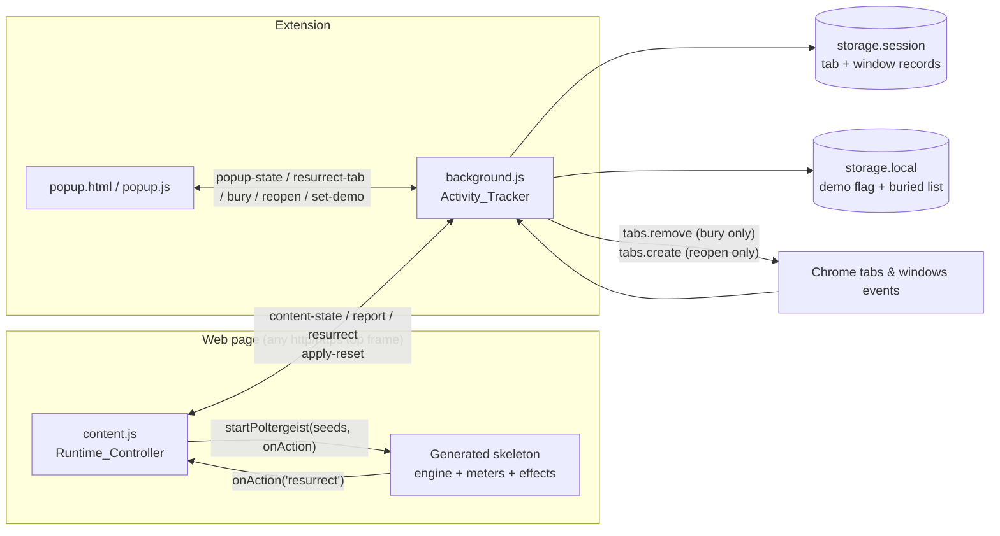
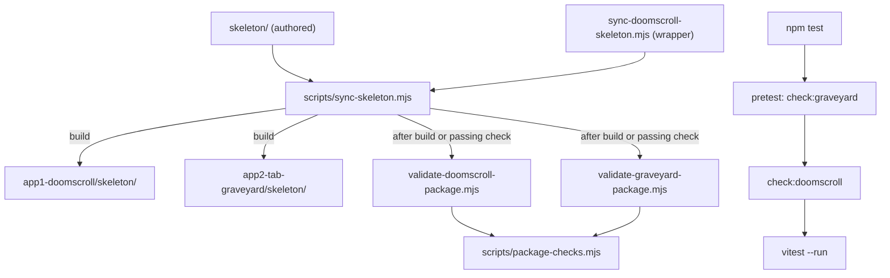

# Tab Graveyard App Design

## Overview

Tab Graveyard is a thin host around the root skeleton. The service worker records when each tab was left and for how long. The content script, injected on every http/https page, starts one Poltergeist instance seeded with those values, and the skeleton's new `timeAway` meter keeps the decay current while the page lives. Three rules turn Away_Time into Fog (30 min), Rot (4 h), and a Tombstone (24 h). The popup reads the worker's records to list dead tabs, bury them, and reopen buried ones.

### Current-to-target delta

| Area | Current state | Target | Requirements |
|---|---|---|---|
| Meters | `timeSinceActive` is 0 while visible | Add `timeAway`: holds the longest Absence since reset, seedable, resettable | 3 |
| Effects | Block shows a static message, no action | Add `tombstone`: epitaph with title and duration, one trusted-click action | 4 |
| Entry point | No way for an effect to read a meter or report an action | `startPoltergeist({ onAction })`; env gains `readMeter`, `onAction` | 4 |
| App package | `app2-tab-graveyard/` is empty | MV3 manifest, rules, classic loader, module worker, popup | 1, 2, 5, 6, 7 |
| Sync script | Doomscroll-only | One registry-driven script for both apps; Doomscroll wrapper kept | 9 |
| Validators | Doomscroll-only, helpers inline | Shared helper module; Graveyard_Validator | 9 |
| Tests | Doomscroll and skeleton | Graveyard unit and Playwright suites; existing suites unchanged | 10 |

### Goals

- Decay matches how long a tab was abandoned and survives reloads and discards.
- Nothing is closed unless the user clicks `Bury all`, and every buried tab can be reopened.
- `storage` is the only permission.
- The skeleton additions are generic, Chrome-free, and leave Doomscroll's behaviour unchanged.
- One sync script and one set of package checks serve both apps.

### Non-goals

- Persisting tab records across a browser restart (`storage.session` is cleared; see Risks).
- Pausing the haunt, per-site allow lists, tab groups, cross-device sync.
- Changing `skeleton/engine.js`, `skeleton/match.js`, or existing effects.
- Fixing Doomscroll's own bfcache behaviour.

### Decisions for review

These choices go beyond the brief or interpret it. Each is cheap to reverse before implementation.

1. **`timeAway` holds the longest Absence since reset, not the most recent one.** If it held only the last Absence, a tab fogged after 45 minutes away would heal when the user left it again for 5 minutes, because the new, shorter Absence would replace the old one. The brief says decay stays until Resurrect, so the meter takes the maximum. Short switches away never add up, so a tab you use often does not decay.
2. **The tombstone is a new effect, not a Block variant.** It needs a button, live text, and style isolation. Adding these to `block.js` would change bytes that Doomscroll's restoration and browser tests cover. A new module is lower risk. Because it is registered in `builtinEffects`, it joins the skeleton's static import graph. Doomscroll's validator requires every reachable module to be web-accessible, so Doomscroll's `manifest.json` gains one resource line. Doomscroll's behaviour is unchanged.
3. **Two optional env hooks on `startPoltergeist`.** Rules are JSON, so an effect cannot carry a callback or a live duration in its params. `env.readMeter(name)` and `env.onAction(name)` are generic, optional, and unused by existing effects.
4. **Pages report absences back to the worker.** The worker sees tab activation only. The page also sees a minimised or fully covered window as hidden. If the two disagreed, a reload could heal a tab. Because Held_Absence is a maximum, reports can be merged in any order without conflict. This keeps the worker as the source of truth and the two views consistent.
5. **Demo mode has its own Register per tab.** Without one, turning demo on would make every tab left for more than 24 seconds dead at once, and a `Bury all` during recording would close real tabs. Demo absences count only from the moment demo was enabled.
6. **Popup `Resurrect this tab`.** Fog and Rot have no in-page button, so without this button the only way to clear early decay would be to wait for the Tombstone. It is one extra message.
7. **`"incognito": "not_allowed"`.** This keeps incognito titles and URLs out of storage without runtime checks.
8. **`pretest` runs `check:graveyard`.** An existing test requires the `test` script to be exactly `npm run check:doomscroll && vitest --run`, so the graveyard check is added through npm's `pretest` hook instead of editing that script or that test.
9. **No Kiro save hook for the graveyard mirror.** The existing Doomscroll hook fires on saves made by Kiro's agent (it did not fire on manual editor saves in testing; see KIRO_FILES.md, update of 2026-11-19), but it rebuilds only the Doomscroll mirror. No second hook is added: `npm run build:skeletons` rebuilds both mirrors, and the drift check in `npm test` is the guarantee for both apps.

### Research findings

- Most Tabs API calls, including creating, removing, querying, and messaging tabs, need no permission. The `tabs` permission only unlocks the `url`, `pendingUrl`, `title`, and `favIconUrl` properties. This app gets the URL from `MessageSender.url` and the title from the content script, so it never needs those properties. See [Chrome Tabs API](https://developer.chrome.com/docs/extensions/reference/api/tabs).
- Chrome reloads a discarded tab when it is activated; there is no separate "undiscard" event. Discarding has historically replaced the tab's WebContents and changed its id, reported through `tabs.onReplaced`. The tracker handles both a kept id and a replaced id. See [Stack Overflow: activating a discarded tab](https://stackoverflow.com/questions/77831520/how-to-activate-a-discarded-chromium-tab-from-an-extension) and [brave/muon#487](https://github.com/brave/muon/issues/487).
- Doomscroll's real-Chrome run showed that `use_dynamic_url: true` blocks the content script's `runtime.getURL` import, so this app also uses `false` (KIRO_FILES.md, 2026-11-17).

Content from the cited sources was rephrased for compliance with licensing restrictions.

### Permission justification

`storage` is the only permission. The content script is declared statically for the Web_Scope. That declaration produces Chrome's "read and change all your data on all websites" install warning, which is inherent to a haunt that runs on every page. No `host_permissions` are declared, because the worker never fetches pages, never injects scripts, and never reads protected `Tab` properties. Tab ids, `active`, and `windowId` are available without permission, and so are `tabs.remove` and `tabs.create`.

## Architecture

### Runtime boundaries



### Return after discard

```mermaid
sequenceDiagram
  participant U as User
  participant C as Chrome
  participant W as Worker
  participant P as Page (content.js)
  U->>C: leaves tab T (activates S)
  C->>W: tabs.onActivated(S)
  W->>W: T.leftAt = now
  Note over C: T is discarded while away
  U->>C: clicks T after 26 h
  C->>W: tabs.onActivated(T)
  W->>W: held = max(held, now - leftAt); leftAt = null
  C->>P: reload, content.js at document_idle
  P->>W: graveyard:content-state {title}
  W-->>P: {heldSeconds: 93600, currentSeconds: 0, demoMode, epoch, timeScale}
  P->>P: startPoltergeist(initialMeters: {timeAway: 93600})
  P->>P: first tick applies fog, rot, tombstone
```

If the content-state request is handled before `onActivated`, the reply carries `currentSeconds = now - leftAt`. The page is visible at creation, so the meter treats that Absence as complete. Either order gives the same result.

### Build and verification



## Components and Interfaces

### Concrete file plan

| File | Plan | Responsibility |
|---|---|---|
| `skeleton/meters.js` | Change | Add `timeAway`, its seeds, and `reset(name)` |
| `skeleton/effects/tombstone.js` | New | Tombstone overlay, text, trusted action |
| `skeleton/effects/index.js` | Change | Register `tombstone` |
| `skeleton/index.js` | Change | `onAction` option; `env.readMeter`, `env.onAction` |
| `skeleton/validator.js`, `skeleton/rule-schema.json` | Change | Add `timeAway` to the meter enum |
| `skeleton/test/meters.test.js` | Extend (append only) | `timeAway` cases and property test |
| `skeleton/test/tombstone.test.js` | New | Tombstone unit and restoration tests |
| `skeleton/test/index.test.js` | Extend (append only) | env hooks |
| `app2-tab-graveyard/manifest.json`, `rules.json` | New | Scope and profile |
| `app2-tab-graveyard/background.js` | New | Activity_Tracker, protocol, Bury, Reopen |
| `app2-tab-graveyard/content.js` | New | Classic loader and Runtime_Controller |
| `app2-tab-graveyard/popup.{html,js,css}` | New | Graveyard UI |
| `app2-tab-graveyard/skeleton/` | Generated | Committed mirror |
| `app2-tab-graveyard/test/**` | New | Vitest and Playwright suites, fixture page |
| `scripts/sync-skeleton.mjs` | New | Registry-driven build/check |
| `scripts/sync-doomscroll-skeleton.mjs` | Rewrite as wrapper | Same exports, CLI, and messages |
| `scripts/package-checks.mjs` | New | Shared helpers moved from the Doomscroll validator |
| `scripts/validate-doomscroll-package.mjs` | Change | Import and re-export shared helpers; logic unchanged |
| `scripts/validate-graveyard-package.mjs` | New | Graveyard_Validator |
| `app1-doomscroll/manifest.json` | One line | Expose `skeleton/effects/tombstone.js` |
| `app1-doomscroll/skeleton/` | Regenerated | Mirror rebuild |
| `package.json`, `vitest.config.js`, `playwright.config.js` | Change | Scripts, discovery, project |

### Time_Away_Meter (`skeleton/meters.js`)

The meter has two new private fields: `heldAway` (seconds) and `awayStartedAt` (ms on the meter clock, or `null`).

```js
// creation
const seedHeld = nonNegative(initial.timeAway);
const seedCurrent = nonNegative(initial.timeAwayCurrent);
if (isVisible()) { heldAway = Math.max(seedHeld, seedCurrent); awayStartedAt = null; }
else { heldAway = seedHeld; awayStartedAt = now() - seedCurrent * 1000; }

const startAway = (t) => { if (awayStartedAt === null) awayStartedAt = t; };
const endAway = (t) => {
  if (awayStartedAt === null) return;
  heldAway = Math.max(heldAway, Math.max(0, t - awayStartedAt) / 1000);
  awayStartedAt = null;
};

// existing onVisibility handler gains: isVisible() ? endAway(now()) : startAway(now())
// update(): after computing t, isVisible() ? endAway(t) : startAway(t)
// values().timeAway:
//   awayStartedAt === null ? heldAway : Math.max(heldAway, Math.max(0, lastTick - awayStartedAt) / 1000)
// reset('timeAway'): heldAway = 0; if (awayStartedAt !== null) awayStartedAt = now(); return true
// reset(other): return false
```

`timeOnSite`, `scrollDistance`, `timeSinceActive`, and their listeners are untouched. Existing tests assert with `toMatchObject` or read single keys, so the extra `timeAway` key does not affect them.

### Tombstone_Effect (`skeleton/effects/tombstone.js`)

```js
const DEFAULTS = {
  heading: 'Here lies {title}', message: 'Abandoned for {duration}.',
  actionLabel: 'Resurrect', action: 'resurrect', durationMeter: 'timeAway',
  maxOpacity: 0.96, blockAt: 1,
};
```

- Host: a `div[data-poltergeist="tombstone"]` appended to `documentElement`, with `position:fixed; inset:0; z-index:2147483647`. It has an open shadow root containing inline-styled markup (a centred "stone" card, heading, message, button) and no external CSS. Rot walks only `document.body`, so it never sees the host. The shadow root also keeps page CSS out.
- Handle: `{ env, host, root, headingEl, messageEl, button, params, onClick, onVisible, renderTimer, dead, fading, timer }`.
- `apply`: create the host if there is no live Handle; store the params; set the host opacity and `pointer-events` (`auto` once intensity ≥ `blockAt`); call `render()`.
- `render()`: format the title and duration and assign them with `textContent`. The duration comes from `env.readMeter?.(durationMeter)`; formatting follows Requirement 4.5.
- `onVisible`: when the document becomes visible, schedule `render()` with `env.setTimeout(…, 0)`. The meter's own listener was registered earlier, so the held value is already updated when `render()` runs.
- `onClick(event)`: if `event.isTrusted` and the Handle is live, call `env.onAction?.(params.action)` inside try/catch.
- `undo`: uses the shared `teardown`. `begin` removes the listeners, sets `pointer-events:none`, and starts the opacity transition. `finish` removes the listeners (idempotent), clears `renderTimer`, and removes the host.

### Entry point (`skeleton/index.js`)

```js
export function startPoltergeist({ ..., onAction } = {}) {
  let meters; // assigned below; env closures read it lazily
  const env = {
    ...existing,
    readMeter: (name) => meters?.values()[name],
    onAction: (name) => { if (typeof onAction !== 'function') return;
      try { onAction(name); } catch (err) { console.error('[poltergeist] onAction:', err); } },
  };
  meters = createMeters({ ... });
  ...
}
```

The returned `{ engine, meters, stop }` contract is unchanged.

### Activity_Tracker (`app2-tab-graveyard/background.js`)

The structure mirrors Doomscroll: `createBackground(chromeApi, { now })` returns the handlers, `registerBackground` attaches the listeners, and a guarded top-level call registers them synchronously.

#### Storage keys

| Area | Key | Value |
|---|---|---|
| session | `graveyard.tab.<tabId>` | Tab_Record (below) |
| session | `graveyard.window.<windowId>` | active tab id |
| session | `graveyard.profile` | `{ epoch, startedAt }` |
| local | `graveyard.demoMode` | Boolean (absent or malformed = false) |
| local | `graveyard.buried` | Buried_Entry array, newest first, ≤ 200 |

```js
// Tab_Record
{
  url: string | null,       // from sender.url; null until a content script reports
  title: string,            // ≤ 300 chars, from content script
  since: number,            // epoch ms: created or last reset; caps reports
  leftAt: number | null,    // epoch ms when the current Absence started
  normal: { heldMs: number },
  demo:   { heldMs: number, epoch: number },
}
```

#### Core functions

```js
awayMs(record, mode, profile, t) =
  mode === 'normal'
    ? max(record.normal.heldMs, record.leftAt ? t - record.leftAt : 0)
    : max(record.demo.epoch === profile.epoch ? record.demo.heldMs : 0,
          record.leftAt ? t - max(record.leftAt, profile.startedAt) : 0)

completeAbsence(record, profile, t):   // on activation
  if leftAt === null: return
  normal.heldMs = max(normal.heldMs, t - leftAt)
  demoHeld = demo.epoch === profile.epoch ? demo.heldMs : 0
  demo = { heldMs: max(demoHeld, t - max(leftAt, profile.startedAt)), epoch: profile.epoch }
  leftAt = null

stage(seconds, thresholds) -> 'alive' | 'fogged' | 'rotting' | 'dead'
```

Thresholds come from `rules.json` rule ids `graveyard-fog`, `graveyard-rot`, and `graveyard-tombstone`. The file is fetched once per worker life and the Promise is cached. In demo mode the thresholds are divided by 3600. The worker does not import the skeleton.

#### Event handling

All of the following run inside one serialized `enqueue(fn)` Promise chain:

- `onActivated({tabId, windowId})`: read the previous id from `graveyard.window.<windowId>`. If the previous id differs from `tabId`, call `tabs.get(prev)`. If that tab exists and `active === false`, set `leftAt = now` when it is null, creating a stub record (`url: null`, `since: now`) if none exists; this guard covers tabs moved between windows. Then run `completeAbsence` on `tabId`'s record, if it exists, and write the window key.
- `onInstalled` / `onStartup`: `tabs.query({})`. Write window keys for active tabs. For each inactive tab without a record, create a stub with `url: null` and `leftAt: now`.
- `onReplaced(added, removed)`: move the record and rewrite any window key that held `removed`.
- `onRemoved(tabId, {windowId})`: delete the record and clear the window key if it points to `tabId`.
- `windows.onRemoved(windowId)`: delete the window key.
- Demo change (`set-demo`): write `graveyard.demoMode`, then bump `graveyard.profile` to `{epoch + 1, startedAt: now}`. Content scripts converge through `storage.onChanged`.

#### Messages

| Type | From → to | Payload | Result |
|---|---|---|---|
| `graveyard:content-state` | content → worker | `{title}` | Create or update the record (url from `sender.url`). `{ok, demoMode, timeScale, epoch, heldSeconds, currentSeconds}` for the active profile |
| `graveyard:report` | content → worker | `{title, heldSeconds, epoch}` | Update the title. If `epoch` matches, raise the active Register to `min(heldSeconds·1000, now − since)`. `{ok}` |
| `graveyard:resurrect` | content → worker | `{}` | Reset the sender tab: both Registers to 0, `since = now`, `leftAt = null` if active. `{ok}` |
| `graveyard:popup-state` | popup → worker | `{tabId}` | `{ok, demoMode, current:{known, stage, awaySeconds}, dead:[{tabId, title, url, awaySeconds}], buried:[…]}` |
| `graveyard:resurrect-tab` | popup → worker | `{tabId}` | Reset, then send `graveyard:apply-reset` to the tab. `{ok, delivered}` |
| `graveyard:bury` | popup → worker | `{tabIds: number[]}` | See Bury below. `{ok, buried:[tabId], notClosed:[tabId]}` |
| `graveyard:reopen` | popup → worker | `{entryId}` | Validate the URL, `tabs.create({url, active:true})`, then remove the entry. `{ok}` |
| `graveyard:set-demo` | popup → worker | `{enabled}` | `{ok, demoMode}` |
| `graveyard:apply-reset` | worker → content | `{}` | Content resets its meter. `{ok}` |

Content messages require `sender.id === runtime.id`, an integer `sender.tab.id`, `sender.frameId === 0`, and an `http:`/`https:` `sender.url`. Popup messages require an extension-page sender (`sender.url` starts with `runtime.getURL('')`), as in Doomscroll.

#### Bury

```text
1. Require an extension-page sender and an array of integer ids (max 500).
2. Load thresholds; on failure return {ok:false}.
3. For each id: read the record; keep it if url != null and awayMs ≥ dead threshold now.
4. Build entries {id: crypto.randomUUID(), title, url, buriedAt: now, awaySeconds}.
5. Write graveyard.buried = [...entries, ...existing].slice(0, 200). On failure return {ok:false}; close nothing.
6. tabs.remove(id) for each kept id, individually; collect failures as notClosed.
7. Return {ok:true, buried, notClosed}.
```

`tabs.remove` appears only in step 6, which a test enforces by scanning the source and by spying on calls.

### Runtime_Controller (`app2-tab-graveyard/content.js`)

The controller is a classic script with the same shape as Doomscroll: two top-level function declarations (`graveyardCreateDemoProfile`, `graveyardCreateController`) and a contained async bootstrap.

State: `{ current: {ghost, epoch} | null, generation, queue, disposed, fault, packagePromise }`.

- `refresh()` is enqueued at boot, on a `graveyard.demoMode` storage change, and on `pageshow` with `persisted`. It increments `generation`, sends `content-state`, loads the package, builds and validates the profile (Normal, or Demo when `reply.demoMode`), checks `generation`, stops the current instance, and calls `startPoltergeist({ rules, initialMeters: {timeAway, timeAwayCurrent}, tickMs: 1000, onAction })`.
- `onAction('resurrect')` sends `graveyard:resurrect`; on `{ok:true}` it calls `ghost.meters.reset('timeAway')` and then `ghost.engine.tick()`.
- `visibilitychange` sends `graveyard:report` with `{title: document.title, heldSeconds, epoch: current.epoch}`. The content script's listener is registered before the meter's, so it reads `values().timeAway` in a `setTimeout(…, 0)` after a change to visible, when the meter has completed the Absence. On a change to hidden, the report carries the title with `heldSeconds` 0, which the max-merge ignores.
- `pagehide` sets `disposed`; the skeleton's own listener stops the instance. `pageshow` with `persisted` clears `disposed` and enqueues `refresh()`.
- `runtime.onMessage` handles `graveyard:apply-reset` like a successful Resurrect.

### Popup

The popup shows three sections:

1. **This tab**: Stage label (`Alive`, `Fogged`, `Rotting`, `Dead`), the Away_Time in words, and `Resurrect this tab`. It shows `Not haunted here` when the tab is unknown.
2. **Graveyard** (dead tabs): title and host per row, `Abandoned 3 days`, and a `Bury all (N)` button.
3. **Buried**: title, host, and buried date per row, with a `Reopen` button.

A `Demo mode` checkbox sits at the bottom. Durations use the same wording rules as the tombstone; the formatter is duplicated in `popup.js` because the popup does not load the skeleton, and a unit test pins both to the same outputs. The popup is static and has no animation.

### Package checks

`scripts/package-checks.mjs` receives `stripJsComments`, `extractStaticSpecifiers`, `resolveGraph`, `expandWar`, `scanSource`, and the file walker, moved verbatim from the Doomscroll validator, which re-exports them. `validate-graveyard-package.mjs` mirrors Doomscroll's validator structure with graveyard constants: `WEB_SCOPE`, `EXPECTED_RULES`, no `host_permissions`, and `incognito: "not_allowed"`.

`scripts/sync-skeleton.mjs`:

```js
export const APPS = Object.freeze({
  doomscroll: { dir: 'app1-doomscroll', label: 'Doomscroll', validator: './validate-doomscroll-package.mjs', buildScript: 'build:doomscroll' },
  graveyard:  { dir: 'app2-tab-graveyard', label: 'Tab Graveyard', validator: './validate-graveyard-package.mjs', buildScript: 'build:graveyard' },
});
export function check(repoRoot, appKey) { … }  // read-only
export async function build(repoRoot, appKey) { … } // guarded to <dir>/skeleton
// CLI: [--check] [--app <key>]...; unknown args -> exit 2
```

The wrapper keeps Doomscroll's messages, for example `Doomscroll skeleton mirror is out of sync (run: npm run build:doomscroll):`. The general script builds each message from `label` and `buildScript`, so Doomscroll output is identical either way.

## Data Models

### Rules (`app2-tab-graveyard/rules.json`)

```json
{
  "rules": [
    { "id": "graveyard-fog", "enabled": true, "match": ["http://*/*", "https://*/*"],
      "trigger": { "meter": "timeAway", "threshold": 1800, "rampTo": 7200 },
      "effect": { "type": "fog", "params": { "maxBlur": 4, "maxGrayscale": 0.8 } },
      "undo": { "mode": "fade", "durationMs": 400 } },
    { "id": "graveyard-rot", "enabled": true, "match": ["http://*/*", "https://*/*"],
      "trigger": { "meter": "timeAway", "threshold": 14400, "rampTo": 43200 },
      "effect": { "type": "rot", "params": { "maxFraction": 0.45, "glyphs": "░▒·_ " } },
      "undo": { "mode": "instant" } },
    { "id": "graveyard-tombstone", "enabled": true, "match": ["http://*/*", "https://*/*"],
      "trigger": { "meter": "timeAway", "threshold": 86400 },
      "effect": { "type": "tombstone", "params": {
        "heading": "Here lies {title}", "message": "Abandoned for {duration}.",
        "actionLabel": "Resurrect", "action": "resurrect", "durationMeter": "timeAway", "maxOpacity": 0.96 } },
      "undo": { "mode": "fade", "durationMs": 600 } }
  ]
}
```

Note (haunt-polish): The Rot glyphs are now `▓▒░█`. haunt-polish added new visual params to the Fog and Tombstone rules. haunt-polish `design.md` holds the current values.

### Schedules

| Stage | Normal | Demo (÷ 3600) |
|---|---|---|
| Fog starts / full | 30 min / 2 h | 0.5 s / 2 s |
| Rot starts / full | 4 h / 12 h | 4 s / 12 s |
| Tombstone (dead) | 24 h | 24 s |

Fog reaches full intensity well before Rot starts, and Rot reaches full intensity half a day before the Tombstone, so the three stages are distinct when the user returns.

### Buried_Entry

```js
{ id: 'uuid', title: 'Lecture 4 notes', url: 'https://example.edu/l4', buriedAt: 1795000000000, awaySeconds: 93600 }
```

## Correctness Properties

### Property 1: `timeAway` matches a reference model

For every finite sequence of `hide`, `show`, `advance(ms)`, `update`, and `reset` operations, starting from any valid seeds, `values().timeAway` after `update` equals the reference model. The model is the maximum completed Absence since the last reset, raised by the current Absence while hidden. The value never decreases between resets while visible.

**Validates: Requirements 3.2–3.9**

### Property 2: Registers merge in any order

For every set of completed Absences and page reports for one tab and one epoch, the final Held_Absence is the same in every delivery order and equals the capped maximum of the inputs.

**Validates: Requirements 5.2, 5.10, 5.12**

### Property 3: Nothing closes without Bury

For every sequence of tracker events, content messages, popup messages other than `graveyard:bury`, and timer advances, `tabs.remove` is never called. For `graveyard:bury`, the closed ids are a subset of the requested ids that are Dead_Tabs at handling time, and each has a saved Buried_Entry before `tabs.remove` is called.

**Validates: Requirements 7.7–7.10, 6.13**

### Property 4: Demo scaling preserves shape and order

For every Normal_Profile rule, the Demo_Profile rule is deeply equal except `threshold / 3600` and `rampTo / 3600`, the order is preserved, and the Normal_Profile is unchanged.

**Validates: Requirement 2.6**

Note (haunt-polish): The `graveyard-tombstone` rule is a Duration_Rule (its params name a string `durationMeter`), so its Demo_Profile copy also gains `durationScale` 3600 and `durationSuffix` set to the Demo_Suffix ` (demo time)`. The property as written holds for every rule without a string `durationMeter`, and these are the only rules its test generator produces.

### Property 5: At most one live instance

For every sequence of refresh triggers (boot, demo changes, `pageshow`), deferred package loads, and state replies, at most one Poltergeist instance is live after each reconciliation, and a replacement starts only after the previous `stop` returned.

**Validates: Requirements 6.10, 6.11, 6.12**

### Property 6: Generated mirrors are exact for both apps

For each registered app, a passing check implies its mirror has exactly the admitted root files with equal bytes.

**Validates: Requirements 9.2, 9.3, 9.9**

## Error Handling

| Failure | Behaviour | State after |
|---|---|---|
| `rules.json` fetch fails in worker | Popup shows an error; `dead` is empty; Bury returns `{ok:false}` | No tab closed |
| Storage write fails during Bury | `{ok:false}`; no `tabs.remove` | All tabs open |
| `tabs.remove` fails for one tab | Entry kept; id in `notClosed` | Other tabs buried |
| `tabs.create` fails on Reopen | Entry kept; `{ok:false}` | List unchanged |
| Reopen URL not http/https | `{ok:false, error:'unsupported url'}` | Entry kept |
| Resurrect commit fails | Decay stays; one diagnostic | Page and worker agree |
| `apply-reset` undelivered (discarded tab) | `{ok:true, delivered:false}` | The reload seeds 0 |
| Content import, fetch, or validation fails | One diagnostic; no instance | Page clean |
| `stop()` throws | Fault; keep the reference; no restart | No overlap |
| Malformed or unknown message | `{ok:false}` | Unchanged |
| Worker restarted mid-session | State read from `storage.session` | Continues |

## Testing Strategy

### Vitest

| Suite | Focus |
|---|---|
| `skeleton/test/meters.test.js` (appended) | `timeAway` rules, seeds, reset, missed events, Property 1 (fast-check, 100 runs) |
| `skeleton/test/tombstone.test.js` | Markup in shadow root, placeholders, duration wording, `textContent` safety, untrusted click ignored (jsdom cannot make trusted events; Playwright covers the real click), re-render on visible, fade and instant undo, exact restoration, rot running alongside without touching it |
| `skeleton/test/index.test.js` (appended) | `readMeter` reads live values; `onAction` forwarded and contained; omitted callback is a no-op |
| `app2-tab-graveyard/test/background.test.js` | All tracker events, guard, epochs, Property 2, Property 3, Bury and Reopen paths, cap, restart, protocol rejection |
| `app2-tab-graveyard/test/content.test.js` | Loader in a VM context like Doomscroll; seeds, reports, Resurrect order, apply-reset, demo restart, bfcache, Property 4, Property 5 |
| `app2-tab-graveyard/test/popup.test.js` | Rendering of each section, disabled states, Bury and Reopen flows, rollback, duplicate-click guard, formatter parity |
| `app2-tab-graveyard/test/package.test.js` | Graveyard_Validator success and failures, `check:graveyard` failing on an extra permission in a temp repo, mirror not ignored |
| `app2-tab-graveyard/test/sync.test.js` | Registry, `--app`, all-apps mode, guarded targets, Property 6, wrapper exports and messages |

Existing test files are not edited. New skeleton cases go into new `describe` blocks appended to existing files or into new files.

### Playwright (`app2-tab-graveyard/test/browser/`)

The fixture copies Doomscroll's approach: a read-only check, a fresh persistent context with only `app2-tab-graveyard/` loaded, routing of `https://graveyard-a.test/page`, `https://graveyard-b.test/page`, and `https://graveyard-c.test/page` to a local `fixtures/page.html` (unique `<title>` per URL, long text), and aborting other requests. Control messages go through an extension-origin page.

| Test | Steps | Evidence |
|---|---|---|
| Fog on short absence | Demo on; open A; bring B to front for 3 s; bring A back | `[data-poltergeist="fog"]` present; no tombstone |
| Decay stays | Continue on A for 5 s | Fog still present |
| Tombstone and Resurrect | Leave A for 26 s; return | Tombstone shadow text contains A's title and `seconds`; a trusted click on `Resurrect` removes all `[data-poltergeist]` and restores the fixture text exactly; worker record reset |
| Survives reload or discard | Leave A for 26 s; discard via `chrome.tabs.discard`, or reload in the background if discard is unavailable; activate A | Tombstone present after reload |
| Bury and reopen | A, B left 26 s with C in front; open popup page | Graveyard lists A and B only; tab count unchanged before the click; after `Bury all`, A and B closed, C open, two Buried_Entries; `Reopen` creates a tab at A's URL |

Every test asserts no page, worker, or namespaced errors. Tests that need 26 s away use a 90-second timeout.

### Mapping

| Requirement | Unit | Browser |
|---|---|---|
| 1 Manifest | package | load |
| 2 Profiles | package, content | timings |
| 3 Meter | meters | return flows |
| 4 Tombstone | tombstone, index | Resurrect |
| 5 Tracker | background | reload/discard |
| 6 Page | content | all |
| 7 Popup | background, popup | Bury/Reopen |
| 8 Privacy | background | – |
| 9 Packaging | sync, package | fixture check |
| 10 Verification | all | all |

## Risks and Limitations

| Risk | Effect | Mitigation / accepted boundary |
|---|---|---|
| `storage.session` clears on browser restart | Tabs restored after a restart start alive, so users who restart Chrome daily rarely reach the 24 h Tombstone | Accepted for this spec. A later change could key records in `storage.local` by URL with a time-to-live |
| Web-accessible resources on every site with a fixed id | Any site can detect the extension by fetching `rules.json` | Accepted: `use_dynamic_url: true` breaks loading (Doomscroll finding); the exposed set is minimal |
| Discarded tab reloads at `document_idle` | The page is briefly clean before decay appears | Accepted; effects apply on the first tick after startup |
| Background timer throttling | A hidden tab's effects may lag by up to a minute | Absences are recomputed on return; the first visible tick is within 1 s |
| Playwright `bringToFront` and headless visibility | Background pages might not report `hidden` | Verify in task 7.2; if needed run the project headed or use real tab activation through `chrome.tabs.update` from the worker |
| `chrome.tabs.discard` under Playwright | The discarded page object may close and a new one appear | The test locates the page by URL after activation; falls back to background reload and records which path ran |
| Tombstone blocks the page | Keyboard users can still tab into the page below | Same boundary as Block; the button is focusable and labelled |
| Content script on every page | Extra module loads on each page | Small modules, cached package Promise, 1 s tick |
| Page scripts can see the open shadow root | A page could read the epitaph or call `click()` | Untrusted clicks are ignored; the text holds only the page's own title |
